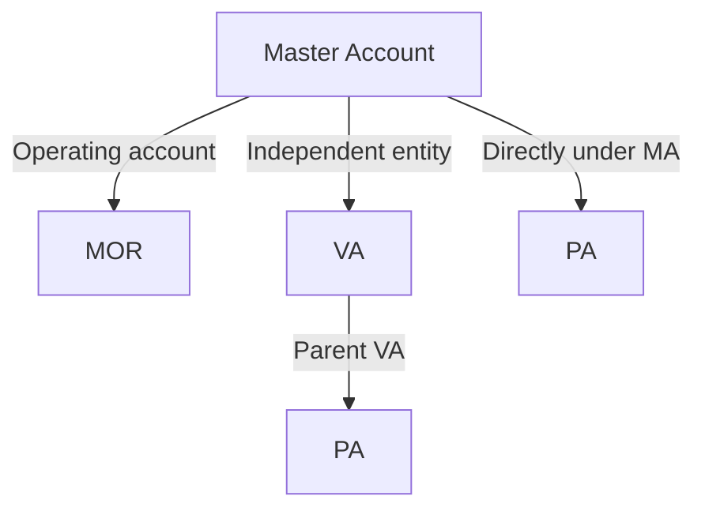

## Account hierarchy

MA is the master account. MOR and VA belong directly to MA. The immediate parent of a PA can be MA or a VA under the same MA. Neither VA nor PA can be created without a parent.

## Account features and opening requirements

Once the account is activated, the bank account is ready, and the required services are enabled, you can query balances and statement entries, manage Pix keys, handle incoming and outgoing payments, issue refunds, and handle disputes. Funds and transactions are recorded separately for each account. The hierarchy does not mean balances are automatically aggregated.

| Account | Example use cases | How to open an account | Required information |
| --- | --- | --- | --- |
| MA master account | The platform company acts as the integrating entity and manages its own accounts and the managed accounts of its merchants or customers | Complete business registration, verification, and activation through the platform. See Quick start | Business name, CNPJ, contact information, business operations and ownership information, and verification information for related persons; provide documents as required by the form |
| MOR operating account | The same MA entity creates separate accounts for different business operations, such as tracking incoming and outgoing payments separately for online and offline operations. These accounts reuse MA compliance information | Open the account using the API credentials of the owning master account holder. The system automatically links it to the master account | Account opening business ID; you can provide a trade name and notification email address. The account reuses the master account's approved compliance information. Do not submit a compliance mode, an entity review payload, provider-session information, a return URL, or a parent-account selector for MOR <Badge color="blue" size="sm">Added · module-3-F03</Badge> |
| VA managed account | The platform creates an account for each onboarded CNPJ business merchant to track that merchant's incoming payments, outgoing payments, and statement entries separately | Open the account using the API credentials of the owning master account holder. The system automatically links it to the master account | Account opening business ID, review information submission method, business entity document type (CNPJ), CNPJ, and legal business name. Depending on the selected review method, provide additional details, a return URL to use after the review is complete, or an existing verification record |
| PA payment account | The platform creates payment accounts for individual customers with a CPF or business customers with a CNPJ. Use the owning MA's USER credentials to initiate operations on the target account. A payment account can belong directly to the MA or to a VA under it | Use the owning MA's `USER` credentials to open the account. Specify the owning MA or a VA directly under it as the parent account. The parent must belong to the same owning user, have `ACTIVE` status, and have an active bank account <Badge color="blue" size="sm">Added · module-3-F02</Badge> | Account opening business ID, submission method for review documents, the PA's own document type, CPF or CNPJ, and individual name or legal business name. Also provide the parent account's bank participant identifier and account number. Provide any additional information required by the review method |

VA and PA accounts do not need to resubmit the MA's business information, but must still provide their own entity information and complete the applicable compliance processes. VA currently supports account opening only for legal entities with a CNPJ. PA supports individuals with a CPF or legal entities with a CNPJ.

Before creating a managed account, confirm that the account opening fee is configured and that sufficient funds are available to pay the applicable fee. A fee failure prevents successful account creation. For technical integration requirements and API call examples, see [Create managed account](/api-reference/onboarding/create-managed-account). <Badge color="blue" size="sm">Added · module-3-F05</Badge>

## Credentials and account selection

| Credentials | Purpose | Account selection requirements |
| --- | --- | --- |
| Platform-level API credentials | Subscribe to MA compliance events within the authorization scope | Not used for ordinary bank account funds operations; no account specified for funds operations |
| User-level API credentials | Open and query managed accounts under the owning MA, perform funds operations on authorized accounts, and manage subscriptions to managed-account compliance events and transaction events for authorized accounts <Badge color="blue" size="sm">Added · module-3-F04</Badge> | Credentials determine the scope of account opening management. To create a managed account, use the owning MA's `USER` credentials without `X-ISPB` or `X-Account-Number` headers. The owning user must have managed account functionality enabled and exactly one valid MA with `ACTIVE` status and an active bank account. For funds operations, specify the bank participant identifier and account number of the account used for the operation <Badge color="blue" size="sm">Added · module-3-F01</Badge> |
| Bank-account-level API credentials | Operate the MOR/VA bank account bound to the credentials | Operations target the bank account bound to the credentials by default. If you specify an account, it must match the bound account. These credentials cannot create managed accounts or operate PA accounts |

The parent account specified during account opening differs from the account whose funds are used for a transaction. To initiate a transaction for a PA, you must specify the PA's own bank account.

## Integration examples

### Account models: choose by funds ownership

Using product sales as an example, choose based on funds ownership and whether a separate account needs to be opened.

| Business needs | Selection guidance |
| --- | --- |
| A business sells its own products and collects payments centrally | Complete MA integration first. Evaluate MOR if you need to reuse the MA's compliance records to create an operating account. Ordinary buyers do not need a PA. |
| Open separate accounts for merchants joining the platform | Legal entities can evaluate VA. Individuals or legal entities can evaluate PA based on eligibility requirements. |
| Buyers need their own funds accounts | Evaluate PA and separately confirm permissions for funds operations such as payments and withdrawals. |

Account ownership is not the same as debit authorization. The final choice depends on entity eligibility and enabled services.

<Accordion title="Corrections to the source document (5)" icon="clipboard-check">
This page was checked against the Pagsmile Open API source code on 2026-11-10. Each change below is marked in the page with a badge that shows its ID.

| ID | Change | Location | Source document text | Updated text |
| --- | --- | --- | --- | --- |
| module-3-F01 | Added (missing in the source) | Credentials and account selection / User-level API credentials | Credentials determine the scope of account opening management. For funds operations, you must specify the bank participant identifier and account number of the account used for the operation | Credentials determine the scope of account opening management. To create a managed account, use the owning MA's USER credentials without X-ISPB or X-Account-Number headers. The owning user must have managed account functionality enabled and exactly one valid MA with ACTIVE status and an active bank account. For funds operations, specify the bank participant identifier and account number of the account used for the operation |
| module-3-F02 | Added (missing in the source) | Account features and opening requirements / PA payment account | Use the API credentials of the owning master account holder to open the account. Specify the owning master account or a VA under it as the parent account | Use the owning MA's USER credentials to open the account. Specify the owning MA or a VA directly under it as the parent account. The parent must belong to the same owning user, have ACTIVE status, and have an active bank account |
| module-3-F03 | Added (missing in the source) | Account features and opening requirements / MOR operating account | Account opening business ID; you can provide a trade name and notification email address. The account reuses the master account's approved compliance information, so you do not need to submit separate entity review information | Account opening business ID; you can provide a trade name and notification email address. The account reuses the master account's approved compliance information. Do not submit a compliance mode, an entity review payload, provider-session information, a return URL, or a parent-account selector for MOR |
| module-3-F04 | Added (missing in the source) | Credentials and account selection / User-level API credentials | Open and query managed accounts under the owning MA, and perform funds operations on authorized accounts | Open and query managed accounts under the owning MA, perform funds operations on authorized accounts, and manage subscriptions to managed-account compliance events and transaction events for authorized accounts |
| module-3-F05 | Added (missing in the source) | Account features and opening requirements / after the account requirements table | For technical integration requirements and API call examples, see Create managed account. | Before creating a managed account, confirm that the account opening fee is configured and that sufficient funds are available to pay the applicable fee. A fee failure prevents successful account creation. For technical integration requirements and API call examples, see Create managed account. |
</Accordion>
