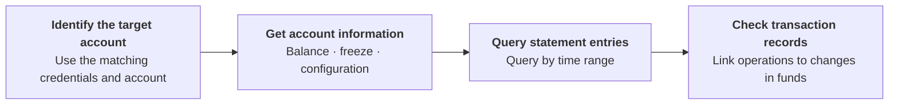

Query bank accounts, balances, and statement entries for account management and reconciliation. Use ACCOUNT-level credentials for their bound account, or USER-level credentials with both `X-ISPB` and `X-Account-Number` for an account within your authorization scope. Each request queries one account; the subaccount operation does not return a list of subaccounts or aggregate balances. With ACCOUNT-level credentials, omit both account-target headers or provide both with values matching the bound account. <Badge color="blue" size="sm">Added · module-5-F01</Badge>

## API operations

| Operation | POST path |
| --- | --- |
| [Get account balance](/api-reference/accounts/get-account-balance) | `/v3/bank_account` |
| [Get account statement](/api-reference/accounts/get-account-statement) | `/v3/statements` |
| [Get subaccounts and balances](/api-reference/accounts/get-subaccounts-and-balances) | `/v3/bank_account` |

## Call sequence

Query bank accounts and balances → Query account statement entries by time range → Check transaction and funds records. Statement results are paginated. Omit `cursor` for the first request, then use the returned `cursor` and `snapshot_timestamp` to retrieve subsequent pages with the same account and filters. Continue until no cursor is returned before treating the queried range as fully retrieved. If `page_size` is omitted, the default is 20; when provided, it must be between 1 and 100. <Badge color="blue" size="sm">Added · module-5-F02</Badge>

If the balance snapshot cannot be retrieved, the account query can still return account information with balance, available amount, and frozen amounts set to `"0"`. The response has no fallback indicator. Do not treat a single zero-valued response as proof of a zero balance; query again and cross-check the account's statement entries and transaction records. <Badge color="blue" size="sm">Added · module-5-F03</Badge>

<Accordion title="Corrections to the source document (3)" icon="clipboard-check">
This page was checked against the Pagsmile Open API source code on 2026-11-10. Each change below is marked in the page with a badge that shows its ID.

| ID | Change | Location | Source document text | Updated text |
| --- | --- | --- | --- | --- |
| module-5-F01 | Added (missing in the source) | Introduction / account selection guidance | Query bank accounts, balances, and statement entries for account management and reconciliation. | Query bank accounts, balances, and statement entries for account management and reconciliation. Use ACCOUNT-level credentials for their bound account, or USER-level credentials with both `X-ISPB` and `X-Account-Number` for an account within your authorization scope. Each request queries one account; the subaccount operation does not return a list of subaccounts or aggregate balances. With ACCOUNT-level credentials, omit both account-target headers or provide both with values matching the bound account. |
| module-5-F02 | Added (missing in the source) | Call sequence / statement reconciliation | Query bank accounts and balances → Query account statement entries by time range → Check transaction and funds records. | Query bank accounts and balances → Query account statement entries by time range → Check transaction and funds records. Statement results are paginated. Omit `cursor` for the first request, then use the returned `cursor` and `snapshot_timestamp` to retrieve subsequent pages with the same account and filters. Continue until no cursor is returned before treating the queried range as fully retrieved. If `page_size` is omitted, the default is 20; when provided, it must be between 1 and 100. |
| module-5-F03 | Added (missing in the source) | Call sequence / balance interpretation | [Figure: Account and funds queries] labels: Identify the target account \| Use the matching credentials and account \| Get account information \| Balance · freeze · configuration \| Query statement entries \| Query by time range \| Check transaction records \| Link operations to changes in funds | [Figure: Account and funds queries] labels: Identify the target account \| Use the matching credentials and account \| Get account information \| Balance · freeze · configuration \| Query statement entries \| Query by time range \| Check transaction records \| Link operations to changes in funds If the balance snapshot cannot be retrieved, the account query can still return account information with balance, available amount, and frozen amounts set to `"0"`. The response has no fallback indicator. Do not treat a single zero-valued response as proof of a zero balance; query again and cross-check the account's statement entries and transaction records. |
</Accordion>
