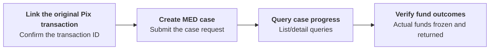

Create, query, or cancel MED cases and query associated infraction reports.

Use `ACCOUNT` credentials for the authorized account, or `USER` credentials with both `X-ISPB` and `X-Account-Number` identifying an account you are authorized to access. `PLATFORM` credentials are not accepted for these operations. Case queries and cancellation use the case's account context. Follow [Environments & Credentials](/environments-and-credentials). <Badge color="blue" size="sm">Added · module-10-F01</Badge>

## API operations

| Operation | POST path |
| --- | --- |
| [Create MED case](/api-reference/med/create-med-case) | `/v3/med/create` |
| [List MED cases](/api-reference/med/list-med-cases) | `/v3/med/list` |
| [Get MED case details](/api-reference/med/get-med-case-details) | `/v3/med/detail` |
| [Cancel MED case](/api-reference/med/cancel-med-case) | `/v3/med/cancel` |
| [List infraction reports](/api-reference/med/list-infraction-reports) | `/v3/infractions/list` |
| [Get infraction report details](/api-reference/med/get-infraction-report-details) | `/v3/infractions/detail` |

Infraction queries use the authorized payee account context of the linked transaction. Access to a payer's MED case does not grant access to the payee's infraction or return tasks. The case detail and cancellation responses leave `infractions`, `refunds`, and `fund_dispositions` empty; `timeline` is also empty when linked tasks or funds disposition records exist. Use the infraction operations with the appropriate account context to inspect accessible infraction and freeze information. <Badge color="blue" size="sm">Added · module-10-F03</Badge>

## Call sequence

Identify the original Pix payment by its `end_to_end_id`, not its internal transaction ID. Creating a case requires this identifier and a valid `original_fraud_situation`: `1 SCAM`; `2 ACCOUNT_TAKEOVER`; `3 COERCION`; `4 SOCIAL_ENGINEERING`; `5 OTHER`; `6 UNKNOWN`. The value `0 UNSPECIFIED` is not accepted. You can also provide `report_details`, `complaint_create_time` in UTC Unix milliseconds, and the `automatic_refund` option. If omitted, `automatic_refund` is `false`. Save `data.med_case.case_id` from the creation response and use it for detail queries and cancellation. See [Create MED case](/api-reference/med/create-med-case) for the request fields. <Badge color="blue" size="sm">Added · module-10-F02</Badge>

A successful case detail query can return the last stored case state if the latest status cannot be retrieved. Do not interpret a successful query as confirmation that the case has advanced or that funds have been returned; continue tracking the case and verify the funds outcomes separately. <Badge color="blue" size="sm">Added · module-10-F07</Badge>

A new MED case cannot be created when the original payer account is closed or closing. <Badge color="blue" size="sm">Added · module-10-F08</Badge>

To cancel, query the latest case details and confirm that `can_cancel` is `true`. Eligible case statuses are `1 CREATED`, `2 TRACKED`, `3 AWAITING_ANALYSIS`, and `4 ANALYZED`; cancellation is rejected in other statuses. <Badge color="blue" size="sm">Added · module-10-F05</Badge> Then submit the cancellation request with `case_id`. Continue checking the case and funds outcomes: releasing blocked funds can finish after the cancellation response. <Badge color="blue" size="sm">Added · module-10-F06</Badge>

Confirm the original Pix transaction → Create MED case → Query case progress → Verify freeze and return results.

Creating or completing a case does not by itself confirm that funds have been returned. Check `requested_amount`, `blocked_amount_total`, and `returned_amount_total` separately, and confirm any return against the corresponding funds records. Where you can access infraction details, distinguish `freeze_target_amount`, `freeze_effective_amount`, and `freeze_shortfall_amount`. A block restricts funds availability; it is not a completed return. The automatic return option does not guarantee full recovery. <Badge color="blue" size="sm">Added · module-10-F04</Badge>

<Accordion title="Corrections to the source document (8)" icon="clipboard-check">
This page was checked against the Pagsmile Open API source code on 2026-11-10. Each change below is marked in the page with a badge that shows its ID.

| ID | Change | Location | Source document text | Updated text |
| --- | --- | --- | --- | --- |
| module-10-F01 | Added (missing in the source) | Introduction / add an account-context paragraph after the introductory sentence | Create, query, or cancel MED cases and query associated infraction reports. | Create, query, or cancel MED cases and query associated infraction reports. Use ACCOUNT credentials for the authorized account, or USER credentials with both `X-ISPB` and `X-Account-Number` identifying an account you are authorized to access. PLATFORM credentials are not accepted for these operations. Case queries and cancellation use the case's account context. Follow Environments & Credentials. |
| module-10-F02 | Added (missing in the source) | Call sequence / add a preparation paragraph before the figure | — | Identify the original Pix payment by its `end_to_end_id`, not its internal transaction ID. Creating a case requires this identifier and a valid `original_fraud_situation`: 1 SCAM; 2 ACCOUNT_TAKEOVER; 3 COERCION; 4 SOCIAL_ENGINEERING; 5 OTHER; 6 UNKNOWN. The value 0 UNSPECIFIED is not accepted. You can also provide `report_details`, `complaint_create_time` in UTC Unix milliseconds, and the `automatic_refund` option. If omitted, `automatic_refund` is false. Save `data.med_case.case_id` from the creation response and use it for detail queries and cancellation. See Create MED case for the request fields. |
| module-10-F03 | Added (missing in the source) | API operations / add an account-visibility note after the table | — | Infraction queries use the authorized payee account context of the linked transaction. Access to a payer's MED case does not grant access to the payee's infraction or return tasks. The case detail and cancellation responses leave `infractions`, `refunds`, and `fund_dispositions` empty; `timeline` is also empty when linked tasks or funds disposition records exist. Use the infraction operations with the appropriate account context to inspect accessible infraction and freeze information. |
| module-10-F04 | Added (missing in the source) | Call sequence / add an outcomes paragraph after the final sequence | — | Creating or completing a case does not by itself confirm that funds have been returned. Check `requested_amount`, `blocked_amount_total`, and `returned_amount_total` separately, and confirm any return against the corresponding funds records. Where you can access infraction details, distinguish `freeze_target_amount`, `freeze_effective_amount`, and `freeze_shortfall_amount`. A block restricts funds availability; it is not a completed return. The automatic return option does not guarantee full recovery. |
| module-10-F05 | Added (missing in the source) | Call sequence / cancellation sentence in the figure | To cancel, query the case status first and confirm that the case meets the cancellation requirements. | To cancel, query the latest case details and confirm that `can_cancel` is true. Eligible case statuses are 1 CREATED, 2 TRACKED, 3 AWAITING_ANALYSIS, and 4 ANALYZED; cancellation is rejected in other statuses. |
| module-10-F06 | Added (missing in the source) | Call sequence / final cancellation sentence in the figure | Then submit the cancellation request. | Then submit the cancellation request with `case_id`. Continue checking the case and funds outcomes: releasing blocked funds can finish after the cancellation response. |
| module-10-F07 | Added (missing in the source) | Call sequence / add a progress-query caveat after the preparation paragraph | — | A successful case detail query can return the last stored case state if the latest status cannot be retrieved. Do not interpret a successful query as confirmation that the case has advanced or that funds have been returned; continue tracking the case and verify the funds outcomes separately. |
| module-10-F08 | Added (missing in the source) | Call sequence / add a case-initiation prerequisite before the figure | — | A new MED case cannot be created when the original payer account is closed or closing. |
</Accordion>
