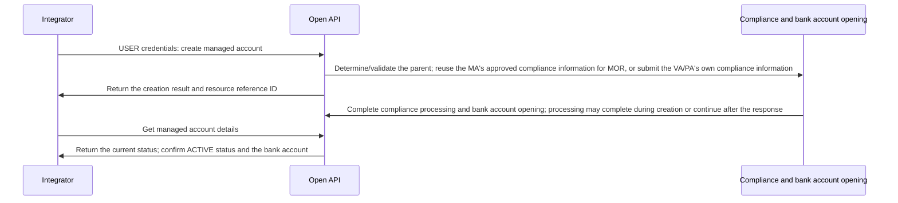

Manage account opening and account queries for MOR, VA, and PA. See each endpoint for information requirements and status descriptions.

## API operations

| Operation | POST path |
| --- | --- |
| [Create managed account](/api-reference/onboarding/create-managed-account) | `/v3/onboarding/managed_accounts/create` |
| [Get managed account details](/api-reference/onboarding/get-managed-account) | `/v3/onboarding/managed_accounts/detail` |
| [List managed accounts](/api-reference/onboarding/list-managed-accounts) | `/v3/onboarding/managed_accounts/list` |

## Call sequence

*Managed account opening: creation, compliance processing, and status confirmation* <Badge color="orange" size="sm">Corrected · module-4-F01</Badge>

- Register an MA on the Banking platform and complete its compliance review and bank account opening. Before creating a managed account, confirm that the owning USER has the managed account feature enabled and exactly one valid MA with `ACTIVE` status and an active bank account. <Badge color="blue" size="sm">Added · module-4-F02</Badge>
- Use the owning USER's credentials to create MOR/VA/PA and query their respective account opening statuses. Do not include bank account targeting headers when calling the create, detail, or list operation. <Badge color="blue" size="sm">Added · module-4-F03</Badge>

For VA/PA onboarding with a hosted link, direct the account applicant to the returned `verification_url` to complete the required information submission. A compliance status of `PENDING_SUBMISSION` means this submission is still required; querying the account alone does not complete it. Continue checking managed account details to confirm the account opening result. <Badge color="blue" size="sm">Added · module-4-F04</Badge>

<Accordion title="Corrections to the source document (4)" icon="clipboard-check">
This page was checked against the Pagsmile Open API source code on 2026-11-10. Each change below is marked in the page with a badge that shows its ID.

| ID | Change | Location | Source document text | Updated text |
| --- | --- | --- | --- | --- |
| module-4-F01 | Corrected (did not match the code) | Call sequence / figure | [Figure: Managed account opening: creation, compliance processing, and status confirmation] labels: Integrator \| Open API \| Compliance/account opening service \| USER credentials: create managed account \| Determine/validate the parent and submit compliance information \| Return the creation result and resource identifier \| Process compliance and bank account opening asynchronously \| Get managed account details \| Return the current status; confirm ACTIVE status and the bank account | [Figure: Managed account opening: creation, compliance processing, and status confirmation] labels: Integrator \| Open API \| Compliance and bank account opening \| USER credentials: create managed account \| Determine/validate the parent; reuse the MA's approved compliance information for MOR, or submit the VA/PA's own compliance information \| Return the creation result and resource reference ID \| Complete compliance processing and bank account opening; processing may complete during creation or continue after the response \| Get managed account details \| Return the current status; confirm ACTIVE status and the bank account |
| module-4-F02 | Added (missing in the source) | Call sequence / first prerequisite bullet | Register an MA on the Banking platform and confirm that the managed account opening conditions are met. | Register an MA on the Banking platform and complete its compliance review and bank account opening. Before creating a managed account, confirm that the owning USER has the managed account feature enabled and exactly one valid MA with ACTIVE status and an active bank account. |
| module-4-F03 | Added (missing in the source) | Call sequence / USER-credentials bullet | Use the associated USER credentials to create VA/PA and query their respective account opening statuses. | Use the owning USER's credentials to create MOR/VA/PA and query their respective account opening statuses. Do not include bank account targeting headers when calling the create, detail, or list operation. |
| module-4-F04 | Added (missing in the source) | Call sequence / add a paragraph after the USER-credentials bullet | — | For VA/PA onboarding with a hosted link, direct the account applicant to the returned verification_url to complete the required information submission. A compliance status of PENDING_SUBMISSION means this submission is still required; querying the account alone does not complete it. Continue checking managed account details to confirm the account opening result. |
</Accordion>
