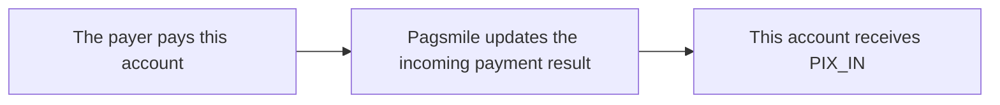

## Behavior and handling

This account, as Payee, receives notifications of successful incoming Pix payments to update incoming payment orders and verify transactions credited to the account. The event represents funds flowing into this account.



## Events and funds flow direction

| Subscription value | Event name | Use cases |
| --- | --- | --- |
| 1 · PIX_IN | PIX_PAYMENT_IN | Update the order after receiving an incoming Pix payment, and verify the transaction details. |

Use `1 / PIX_IN` to subscribe to incoming payment events. The callback body has no top-level `event_type`. Identify incoming Pix payment notifications using the incoming payment subscription configuration, `txn_type=TXN_TYPE_PAYMENT`, `payment_method=PAYMENT_METHOD_PIX`, and `flow_type=FLOW_TYPE_IN`. Do not require `flow_direction`: it is not populated in these callbacks. <Badge color="orange" size="sm">Corrected · payin-transaction-webhooks-F01</Badge>

## ACCOUNT / USER delivery differences

| Scope | Delivery target | Deduplication identifier |
| --- | --- | --- |
| ACCOUNT | An active account configuration that matches the incoming Pix payment event (PIX_IN), ISPB, and account number. | The callback does not include delivery_id. Deduplicate by "Subscribed event type + txn_id". |
| USER | An active subscription that belongs to the USER who owns the receiving account and matches the incoming Pix payment event (`PIX_IN`). Before each delivery attempt, account ownership and the subscription configuration are checked again. Delivery is canceled if account ownership no longer matches, the subscription is inactive, or its configuration or signing credential has changed. <Badge color="blue" size="sm">Added · payin-transaction-webhooks-F13</Badge> | The callback includes delivery_id, which stays unchanged across retries of the same delivery. |

## JSON example

The following is a USER callback example for an incoming Pix payment received by this account. `payee` is this account, and the funds flow direction is IN. The example identifiers and amounts are fictional. Optional fields may be omitted in actual callbacks. ACCOUNT uses the transaction structure for the same scenario, but without `delivery_id`. <Badge color="orange" size="sm">Corrected · payin-transaction-webhooks-F02</Badge>

Unset fields and fields with default values are omitted in actual callbacks, including empty strings, zero timestamps, and unspecified enum values. Treat an absent field as not provided for that event. <Badge color="blue" size="sm">Added · payin-transaction-webhooks-F03</Badge>

Status/enum values and int64 timestamps are strings. `created_at` is the transaction initiation time, and `completed_at` is its completion time; both use Unix timestamps in milliseconds. <Badge color="blue" size="sm">Added · payin-transaction-webhooks-F04</Badge> Amounts remain decimal strings. The callback is not a REST response in the `code/message/data` format.

<ResponseField name="payer.document_id" type="string">
  Optional. Payer's CPF or CNPJ. May be masked according to the document-masking configuration.
</ResponseField>

<ResponseField name="payee.document_id" type="string">
  Optional. Payee's CPF or CNPJ. May be masked according to the document-masking configuration.
</ResponseField>

<ResponseField name="payer.document_type" type="string">
  Optional. Document type enum name: `DOCUMENT_TYPE_CPF` or `DOCUMENT_TYPE_CNPJ`.
</ResponseField>

<ResponseField name="payee.document_type" type="string">
  Optional. Document type enum name: `DOCUMENT_TYPE_CPF` or `DOCUMENT_TYPE_CNPJ`.
</ResponseField>

<ResponseField name="payer.bank_account_type" type="string">
  Optional. Bank account type enum name: `BANK_ACCOUNT_TYPE_CHECKING`, `BANK_ACCOUNT_TYPE_SALARY`, `BANK_ACCOUNT_TYPE_SAVINGS`, `BANK_ACCOUNT_TYPE_PAYMENT`, `BANK_ACCOUNT_TYPE_TRANSCTIONAL_PI`, `BANK_ACCOUNT_TYPE_GUARANTEED`, or `BANK_ACCOUNT_TYPE_DEPOSIT`.
</ResponseField>

<ResponseField name="payee.bank_account_type" type="string">
  Optional. Bank account type enum name: `BANK_ACCOUNT_TYPE_CHECKING`, `BANK_ACCOUNT_TYPE_SALARY`, `BANK_ACCOUNT_TYPE_SAVINGS`, `BANK_ACCOUNT_TYPE_PAYMENT`, `BANK_ACCOUNT_TYPE_TRANSCTIONAL_PI`, `BANK_ACCOUNT_TYPE_GUARANTEED`, or `BANK_ACCOUNT_TYPE_DEPOSIT`.
</ResponseField>

<ResponseField name="payer.bank_branch" type="string">
  Optional. Payer's bank branch code.
</ResponseField>

<ResponseField name="payee.bank_branch" type="string">
  Optional. Payee's bank branch code.
</ResponseField>

<ResponseField name="payer.bank_name" type="string">
  Optional. Payer's bank name.
</ResponseField>

<ResponseField name="payee.bank_name" type="string">
  Optional. Payee's bank name. <Badge color="blue" size="sm">Added · payin-transaction-webhooks-F05</Badge>
</ResponseField>

<ResponseField name="refunded_amount" type="string">
  Optional. Amount already refunded, as a decimal string. Omitted when not provided; `"0"` is a supplied string value, not an omitted numeric zero. <Badge color="blue" size="sm">Added · payin-transaction-webhooks-F07</Badge>
</ResponseField>

<ResponseField name="pix_details" type="object">
  Optional. Pix-specific details, when available. Its unset fields are omitted.
</ResponseField>

<ResponseField name="pix_details.pix_key" type="string">
  Optional. Pix key associated with the transaction.
</ResponseField>

<ResponseField name="pix_details.pix_key_type" type="string">
  Optional. Pix key type enum name: `PIX_KEY_TYPE_CPF`, `PIX_KEY_TYPE_CNPJ`, `PIX_KEY_TYPE_EMAIL`, `PIX_KEY_TYPE_PHONE`, or `PIX_KEY_TYPE_EVP`.
</ResponseField>

<ResponseField name="pix_details.qr_code_id" type="string">
  Optional. Associated QR code ID, when available.
</ResponseField>

<ResponseField name="pix_details.qr_code_memo" type="string">
  Optional. Note from the associated QR code, when available. <Badge color="blue" size="sm">Added · payin-transaction-webhooks-F09</Badge>
</ResponseField>

<ResponseField name="merchant_order_id" type="string">
  Optional. For an incoming payment callback, the merchant order ID from the associated QR code. It matches `request_merchant_order_id`. Omitted when that QR-code order reference is unavailable.
</ResponseField>

<ResponseField name="request_merchant_order_id" type="string">
  Optional. Merchant order ID from the associated QR code, when available. It may be omitted for payments without a QR-code order reference or when that reference cannot be retrieved. <Badge color="blue" size="sm">Added · payin-transaction-webhooks-F11</Badge>
</ResponseField>

<Accordion title="Incoming Pix payments · USER" defaultOpen>
```json
{
  "delivery_id": "0000000000000000000000000000000000000000000000000000000000000001",
  "payer": {
    "name": "Demo Payer",
    "bank_account": "00098765",
    "bank_code": "87654321"
  },
  "payee": {
    "name": "Demo Merchant",
    "bank_account": "00012345",
    "bank_code": "12345678"
  },
  "txn_id": "PIX-IN-001",
  "settlement_txn_id": "SET-PAYMENT-IN-001",
  "txn_status": "TXN_STATUS_COMPLETED",
  "amount": "100.00",
  "currency": "BRL",
  "txn_type": "TXN_TYPE_PAYMENT",
  "payment_method": "PAYMENT_METHOD_PIX",
  "created_at": "1710000000000",
  "completed_at": "1710000005000",
  "flow_type": "FLOW_TYPE_IN",
  "merchant_order_id": "ORDER-IN-001",
  "request_merchant_order_id": "ORDER-IN-001",
  "pix_details": {
    "pix_key": "merchant@example.com",
    "pix_key_type": "PIX_KEY_TYPE_EMAIL",
    "qr_code_id": "QR-IN-001"
  }
}
```
</Accordion>

<Accordion title="Corrections to the source document (9)" icon="clipboard-check">
This page was checked against the Pagsmile Open API source code on 2026-11-10. Each change below is marked in the page with a badge that shows its ID.

| ID | Change | Location | Source document text | Updated text |
| --- | --- | --- | --- | --- |
| payin-transaction-webhooks-F01 | Corrected (did not match the code) | Events and funds flow direction | Identify incoming Pix payment notifications using the incoming payment subscription configuration, `txn_type=TXN_TYPE_PAYMENT`, `payment_method=PAYMENT_METHOD_PIX`, and `flow_direction=FLOW_DIRECTION_IN`. | Identify incoming Pix payment notifications using the incoming payment subscription configuration, `txn_type=TXN_TYPE_PAYMENT`, `payment_method=PAYMENT_METHOD_PIX`, and `flow_type=FLOW_TYPE_IN`. Do not require `flow_direction`: it is not populated in these callbacks. |
| payin-transaction-webhooks-F02 | Corrected (did not match the code) | JSON example / Incoming Pix payments · USER | `{ "delivery_id": "0000000000000000000000000000000000000000000000000000000000000001", "payer": { "name": "Demo Payer", "bank_account": "00098765", "bank_code": "87654321" }, "payee": { "name": "Demo Merchant", "bank_account": "00012345", "bank_code": "12345678" }, "txn_id": "PIX-IN-001", "settlement_txn_id": "SET-PAYMENT-IN-001", "txn_status": "TXN_STATUS_COMPLETED", "amount": "100.00", "currency": "BRL", "txn_type": "TXN_TYPE_PAYMENT", "payment_method": "PAYMENT_METHOD_PIX", "created_at": "1710000000000", "completed_at": "1710000005000", "flow_type": "FLOW_TYPE_IN", "flow_direction": "FLOW_DIRECTION_IN", "merchant_order_id": "ORDER-IN-001", "request_merchant_order_id": "ORDER-IN-001" }` | `{ "delivery_id": "0000000000000000000000000000000000000000000000000000000000000001", "payer": { "name": "Demo Payer", "bank_account": "00098765", "bank_code": "87654321" }, "payee": { "name": "Demo Merchant", "bank_account": "00012345", "bank_code": "12345678" }, "txn_id": "PIX-IN-001", "settlement_txn_id": "SET-PAYMENT-IN-001", "txn_status": "TXN_STATUS_COMPLETED", "amount": "100.00", "currency": "BRL", "txn_type": "TXN_TYPE_PAYMENT", "payment_method": "PAYMENT_METHOD_PIX", "created_at": "1710000000000", "completed_at": "1710000005000", "flow_type": "FLOW_TYPE_IN", "merchant_order_id": "ORDER-IN-001", "request_merchant_order_id": "ORDER-IN-001", "pix_details": { "pix_key": "merchant@example.com", "pix_key_type": "PIX_KEY_TYPE_EMAIL", "qr_code_id": "QR-IN-001" } }` |
| payin-transaction-webhooks-F03 | Added (missing in the source) | JSON example / serialization guidance | Optional fields may be omitted in actual callbacks. | Unset fields and fields with default values are omitted in actual callbacks, including empty strings, zero timestamps, and unspecified enum values. Treat an absent field as not provided for that event. |
| payin-transaction-webhooks-F04 | Added (missing in the source) | JSON example / serialization guidance | Status/enum values and int64 timestamps are strings. | Status/enum values and int64 timestamps are strings. `created_at` is the transaction initiation time, and `completed_at` is its completion time; both use Unix timestamps in milliseconds. |
| payin-transaction-webhooks-F05 | Added (missing in the source) | JSON example / add callback fields table before the example | — | `payer.document_id` \| string \| Optional \| Payer's CPF or CNPJ. May be masked according to the document-masking configuration. `payee.document_id` \| string \| Optional \| Payee's CPF or CNPJ. May be masked according to the document-masking configuration. `payer.document_type` \| string \| Optional \| Document type enum name: `DOCUMENT_TYPE_CPF` or `DOCUMENT_TYPE_CNPJ`. `payee.document_type` \| string \| Optional \| Document type enum name: `DOCUMENT_TYPE_CPF` or `DOCUMENT_TYPE_CNPJ`. `payer.bank_account_type` \| string \| Optional \| Bank account type enum name: `BANK_ACCOUNT_TYPE_CHECKING`, `BANK_ACCOUNT_TYPE_SALARY`, `BANK_ACCOUNT_TYPE_SAVINGS`, `BANK_ACCOUNT_TYPE_PAYMENT`, `BANK_ACCOUNT_TYPE_TRANSCTIONAL_PI`, `BANK_ACCOUNT_TYPE_GUARANTEED`, or `BANK_ACCOUNT_TYPE_DEPOSIT`. `payee.bank_account_type` \| string \| Optional \| Bank account type enum name: `BANK_ACCOUNT_TYPE_CHECKING`, `BANK_ACCOUNT_TYPE_SALARY`, `BANK_ACCOUNT_TYPE_SAVINGS`, `BANK_ACCOUNT_TYPE_PAYMENT`, `BANK_ACCOUNT_TYPE_TRANSCTIONAL_PI`, `BANK_ACCOUNT_TYPE_GUARANTEED`, or `BANK_ACCOUNT_TYPE_DEPOSIT`. `payer.bank_branch` \| string \| Optional \| Payer's bank branch code. `payee.bank_branch` \| string \| Optional \| Payee's bank branch code. `payer.bank_name` \| string \| Optional \| Payer's bank name. `payee.bank_name` \| string \| Optional \| Payee's bank name. |
| payin-transaction-webhooks-F07 | Added (missing in the source) | JSON example / new callback fields table | — | `refunded_amount` \| string \| Optional \| Amount already refunded, as a decimal string. Omitted when not provided; `"0"` is a supplied string value, not an omitted numeric zero. |
| payin-transaction-webhooks-F09 | Added (missing in the source) | JSON example / new callback fields table | — | `pix_details` \| object \| Optional \| Pix-specific details, when available. Its unset fields are omitted. `pix_details.pix_key` \| string \| Optional \| Pix key associated with the transaction. `pix_details.pix_key_type` \| string \| Optional \| Pix key type enum name: `PIX_KEY_TYPE_CPF`, `PIX_KEY_TYPE_CNPJ`, `PIX_KEY_TYPE_EMAIL`, `PIX_KEY_TYPE_PHONE`, or `PIX_KEY_TYPE_EVP`. `pix_details.qr_code_id` \| string \| Optional \| Associated QR code ID, when available. `pix_details.qr_code_memo` \| string \| Optional \| Note from the associated QR code, when available. |
| payin-transaction-webhooks-F11 | Added (missing in the source) | JSON example / new callback fields table | — | `merchant_order_id` \| string \| Optional \| For an incoming payment callback, the merchant order ID from the associated QR code. It matches `request_merchant_order_id`. Omitted when that QR-code order reference is unavailable. `request_merchant_order_id` \| string \| Optional \| Merchant order ID from the associated QR code, when available. It may be omitted for payments without a QR-code order reference or when that reference cannot be retrieved. |
| payin-transaction-webhooks-F13 | Added (missing in the source) | ACCOUNT / USER delivery differences / USER delivery target cell | An active subscription that belongs to the USER and matches the incoming Pix payment event (PIX_IN). | An active subscription that belongs to the USER who owns the receiving account and matches the incoming Pix payment event (PIX_IN). Before each delivery attempt, account ownership and the subscription configuration are checked again. Delivery is canceled if account ownership no longer matches, the subscription is inactive, or its configuration or signing credential has changed. |
</Accordion>
