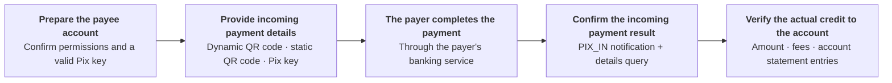
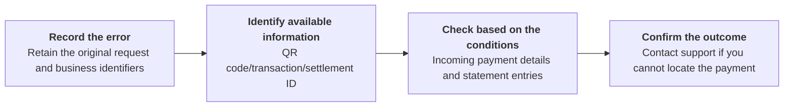

Receive payments through a dynamic QR code, static QR code, or Pix key, and query the actual incoming payment result.

## API operations

| Operation | POST path |
| --- | --- |
| [Generate dynamic QR code](/api-reference/payin/generate-dynamic-qr-code) | `/v3/qr_code/generate/dynamic` |
| [Generate static QR code](/api-reference/payin/generate-static-qr-code) | `/v3/qr_code/generate/static` |
| [Get QR code details](/api-reference/payin/get-qr-code-details) | `/v3/qr_code/details` |
| [Get transaction details](/api-reference/payin/get-transaction-details) | `/v3/charges/details` |

## Call sequence

- Confirm that the payee account is ready and obtain an active Pix key belonging to that account. Static QR code generation requires an EVP key (random Pix key). <Badge color="blue" size="sm">Added · module-7-F02</Badge>
- Generate a dynamic or static QR code for your scenario, or provide the Pix key directly. For incoming QR code payments, save the QR code ID and merchant order ID.
- The payer completes the Pix payment through a banking service.
- Receive the `PIX_IN` notification, obtain `txn_id` or `settlement_txn_id` from the callback, and query the incoming payment details. Send the callback's `txn_id` as `txn_id`, or its `settlement_txn_id` as `settlement_id`, in the transaction details request. See [Incoming Pix payment callbacks](/api-reference/payin/callbacks) for the callback structure. <Badge color="blue" size="sm">Added · module-7-F04</Badge> QR code details provide information about the QR code and may include the most recent associated transaction in `last_txn`. Use that transaction's `txn_id` or `settlement_id` to query the incoming payment details; QR code details do not replace transaction details or account statement checks. <Badge color="orange" size="sm">Corrected · module-7-F01</Badge>
- Check the transaction status, amount, fees, and account statement entries to confirm the actual credit to the account.

## Error scenarios

The following is the recommended workflow for integrators. A missing notification or request timeout does not necessarily mean the incoming payment failed. First, distinguish between a QR code generation error and an unconfirmed credit to the account.

| Error scenarios | Checks and actions |
| --- | --- |
| QR code generation request times out or the response is lost | If you saved qr_code_id, call [Get QR code details](/api-reference/payin/get-qr-code-details). If you did not obtain a QR code ID, retain the order ID, account, and request time, and contact support. Do not treat a new QR code generated with a different order ID as recovery of the original request. Do not use it to determine whether funds were credited to the account. |
| The customer reports payment, but no PIX_IN notification has been received | If you have a `txn_id` or `settlement_id`, call [Get transaction details](/api-reference/payin/get-transaction-details). This query returns incoming transaction details only after the underlying transaction is completed; a transaction that is not yet completed can return a transaction-not-found result. That result alone does not prove that the payment failed. You can also check statement entries by account and time range to verify the records. You must not determine whether funds have been credited based only on a customer screenshot, successful QR code generation, or a missing notification. <Badge color="blue" size="sm">Added · module-7-F03</Badge> |
| A QR code exists, but the actual transaction is unconfirmed | Use QR code details to verify the QR code. They do not replace actual incoming payment details. A static QR code may be associated with multiple incoming payments. Record the transaction ID for each payment. |
| The transaction cannot be found, or the amount/status does not match | If queries and checks still do not confirm whether funds have been credited, retain the original records and contact integration support. Avoid duplicate accounting entries or duplicate fulfillment. |

When you need support, provide the environment, endpoint, target account, order ID, any existing QR code/transaction/settlement IDs, amount, request or payment time (including the time zone), and masked response. Do not submit your SK. Support channels and response times are subject to your integration agreement.

<Accordion title="Corrections to the source document (4)" icon="clipboard-check">
This page was checked against the Pagsmile Open API source code on 2026-11-10. Each change below is marked in the page with a badge that shows its ID.

| ID | Change | Location | Source document text | Updated text |
| --- | --- | --- | --- | --- |
| module-7-F01 | Corrected (did not match the code) | Call sequence | QR code details only provide information about the QR code. | QR code details provide information about the QR code and may include the most recent associated transaction in last_txn. Use that transaction's txn_id or settlement_id to query the incoming payment details; QR code details do not replace transaction details or account statement checks. |
| module-7-F02 | Added (missing in the source) | Call sequence — prepare the payee account | Confirm that the payee account is ready and obtain a valid Pix key for that account. | Confirm that the payee account is ready and obtain an active Pix key belonging to that account. Static QR code generation requires an EVP key (random Pix key). |
| module-7-F03 | Added (missing in the source) | Error scenarios — missing PIX_IN notification | If you have a txn_id or settlement_id, call Get transaction details. You can also check statement entries by account and time range to verify the records. You must not determine whether funds have been credited based only on a customer screenshot, successful QR code generation, or a missing notification. | If you have a txn_id or settlement_id, call Get transaction details. This query returns incoming transaction details only after the underlying transaction is completed; a transaction that is not yet completed can return a transaction-not-found result. That result alone does not prove that the payment failed. You can also check statement entries by account and time range to verify the records. You must not determine whether funds have been credited based only on a customer screenshot, successful QR code generation, or a missing notification. |
| module-7-F04 | Added (missing in the source) | Call sequence — receive the incoming event | Receive the PIX_IN event, obtain the transaction or settlement ID, and query the incoming payment details. | Receive the PIX_IN notification, obtain txn_id or settlement_txn_id from the callback, and query the incoming payment details. Send the callback's txn_id as txn_id, or its settlement_txn_id as settlement_id, in the transaction details request. See Incoming Pix payment callbacks for the callback structure. |
</Accordion>
