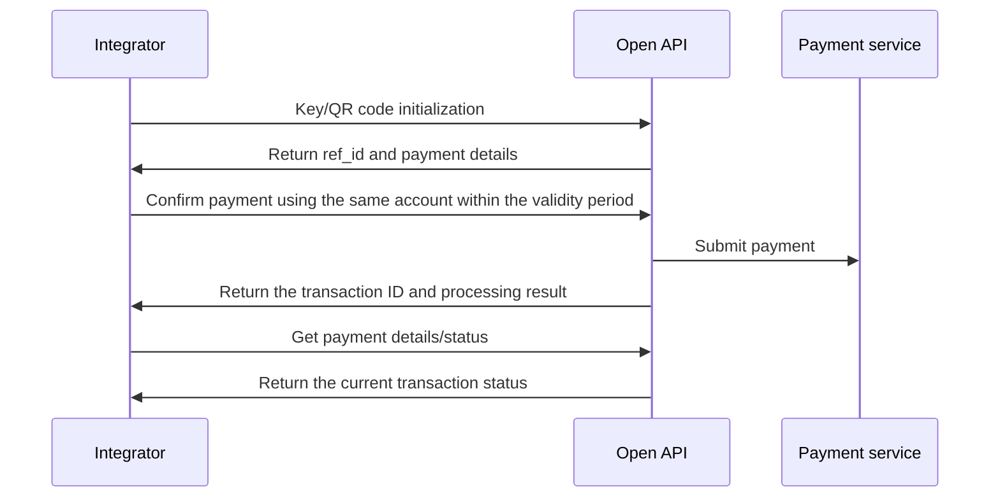
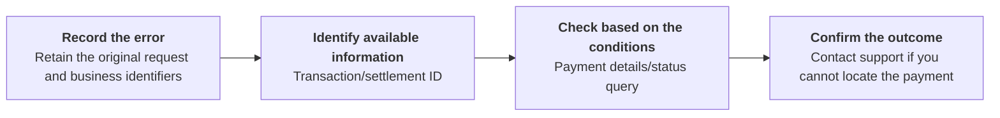

Select Pix, TED, or internal transfer (Book Transfer) as the payment method. The payment and query endpoints for each method are listed below.

A successful payment submission returns a transaction ID and a `Processing` status; it confirms acceptance for asynchronous processing, not payment completion. Save the transaction ID and query the original payment until its outcome is confirmed. <Badge color="blue" size="sm">Added · module-8-F02</Badge>

## Pix

Initiate a Pix payment using a Pix key, QR code, or bank account.

### API operations

| Operation | POST path |
| --- | --- |
| [Initialize Pix key payment](/api-reference/payout/pix/initialize-pix-key-payment) | `/v3/transfers/pix/key-initiate` |
| [Confirm Pix key payment](/api-reference/payout/pix/confirm-pix-key-payment) | `/v3/transfers/pix/key-confirm` |
| [Initialize QR code payment](/api-reference/payout/pix/initialize-qr-code-payment) | `/v3/transfers/pix/qr-code-initiate` |
| [Confirm QR code payment](/api-reference/payout/pix/confirm-qr-code-payment) | `/v3/transfers/pix/qr-code-confirm` |
| [Pay with Pix using bank account details](/api-reference/payout/pix/pay-with-bank-account-details) | `/v3/transfers/pix/bank-account` |
| [Get payment status](/api-reference/payout/get-payment-status) | `/v3/transfers/status/check` |
| [Get payment details](/api-reference/payout/get-payment-details) | `/v3/transfers/details` |

### Call sequence

- Pix key: Initialize → Verify payee details → Confirm payment → Query the result.
- QR code: Initialize → Verify the amount and payee → Confirm payment → Query the result.
- Bank account: Initiate a Pix payment directly → Query the result. Initialization and confirmation are not required.

*Pix two-step payment: initialization and confirmation*

A Pix key initialization reference is valid for 1 minute. A QR code initialization reference is valid for 5 minutes. Confirm using the same payer account within that period. The QR code's own validity period is separate from the confirmation reference validity period. <Badge color="blue" size="sm">Added · module-8-F03</Badge>

After a successful confirmation, the initialization reference is removed. Do not reuse `ref_id` to confirm the same payment again. Track the accepted payment using the returned `txn_id`. <Badge color="blue" size="sm">Added · module-8-F07</Badge>

## TED

Initiate a TED payment using a bank account at a different institution from the payer account. For accounts at the same institution, use internal transfer (Book Transfer). <Badge color="blue" size="sm">Added · module-8-F04</Badge>

### API operations

| Operation | POST path |
| --- | --- |
| [Initiate TED payment](/api-reference/payout/ted/initiate-ted-payment) | `/v3/transfers/ted/bank-account` |
| [Get payment status](/api-reference/payout/get-payment-status) | `/v3/transfers/status/check` |
| [Get payment details](/api-reference/payout/get-payment-details) | `/v3/transfers/details` |

### Call sequence

Enter the payee bank account and payment details → Initiate TED payment → Save the transaction ID → Get payment status and details.

## Book Transfer

Make an internal transfer between different accounts at the same institution. The payer account cannot also be the payee account. <Badge color="blue" size="sm">Added · module-8-F05</Badge>

### API operations

| Operation | POST path |
| --- | --- |
| [Initiate internal transfer](/api-reference/payout/book-transfer/initiate-internal-transfer) | `/v3/transfers/internal` |
| [Get payment status](/api-reference/payout/get-payment-status) | `/v3/transfers/status/check` |
| [Get payment details](/api-reference/payout/get-payment-details) | `/v3/transfers/details` |

### Call sequence

Enter the payee account at the same institution and transfer details → Initiate internal transfer → Save the transaction ID → Get payment status and details.

### Error scenarios

The following is the recommended workflow for integrators. If a payment request has been sent but the response is lost or times out, you must record it as "Unknown result". You must not treat it as a failed payment.

| Known information / failure stage | Checks and actions |
| --- | --- |
| txn_id available | Call [Get payment details](/api-reference/payout/get-payment-details) or [Get payment status](/api-reference/payout/get-payment-status) to track the original transaction. Continue querying while the payment status is `Processing`. If a recently accepted payment is not yet found, allow time for asynchronous processing and query the original transaction again; do not treat that response as a failed payment or submit a new payment. Finally, check the statement entries to verify the funds outcome. <Badge color="blue" size="sm">Added · module-8-F06</Badge> |
| Only settlement_id available | Call [Get payment details](/api-reference/payout/get-payment-details). The payment status endpoint still requires txn_id. |
| Only merchant_order_id available, with no transaction or settlement ID | The current details endpoint does not support queries by order ID alone. Stop automatic resubmissions, retain the original request information, and contact integration support to locate the original transaction. |
| Initialization succeeded, but payment confirmation has not been submitted | Initialization does not mean the payment has been executed. Check the account and reference validity period. Initialize again if the reference has expired. If the confirmation request has already been sent, follow the "Unknown result" workflow to investigate. |
| The API explicitly rejects the request | Correct the parameters, permissions, or account conditions based on the error code. If a failure occurs during payment processing, you must still check the original transaction first. Do not determine the funds outcome from the error text alone. |

Do not blindly resubmit with a new order ID before verifying the original payment result. For payment forms, Preview generates a new order ID. Send submits the currently displayed request JSON without replacing its order ID. <Badge color="orange" size="sm">Corrected · module-8-F01</Badge> Clicking Send again is not a safe technical retry of the original request.

When you need support, provide the environment, endpoint, original order ID, payer account ISPB/account number, amount, request time (including the time zone), available transaction/settlement IDs, masked response, and retry history. Do not submit your SK. Support channels and response times are subject to your integration agreement.

<Accordion title="Corrections to the source document (7)" icon="clipboard-check">
This page was checked against the Pagsmile Open API source code on 2026-11-10. Each change below is marked in the page with a badge that shows its ID.

| ID | Change | Location | Source document text | Updated text |
| --- | --- | --- | --- | --- |
| module-8-F01 | Corrected (did not match the code) | Book Transfer / Error scenarios / Sandbox retry warning | The Sandbox tool generates a new order ID each time you click Preview or Send. | For payment forms, Preview generates a new order ID. Send submits the currently displayed request JSON without replacing its order ID. |
| module-8-F02 | Added (missing in the source) | PayOut introduction / before the payment-method sections | Select Pix, TED, or internal transfer (Book Transfer) as the payment method. | Select Pix, TED, or internal transfer (Book Transfer) as the payment method. A successful payment submission returns a transaction ID and a Processing status; it confirms acceptance for asynchronous processing, not payment completion. Save the transaction ID and query the original payment until its outcome is confirmed. |
| module-8-F03 | Added (missing in the source) | Pix / Call sequence / after the two-step diagram | — | A Pix key initialization reference is valid for 1 minute. A QR code initialization reference is valid for 5 minutes. Confirm using the same payer account within that period. The QR code's own validity period is separate from the confirmation reference validity period. |
| module-8-F04 | Added (missing in the source) | TED / introductory behavior | Initiate a TED payment using a bank account. | Initiate a TED payment using a bank account at a different institution from the payer account. For accounts at the same institution, use internal transfer (Book Transfer). |
| module-8-F05 | Added (missing in the source) | Book Transfer / introductory behavior | Make an internal transfer between accounts at the same institution. | Make an internal transfer between different accounts at the same institution. The payer account cannot also be the payee account. |
| module-8-F06 | Added (missing in the source) | Book Transfer / Error scenarios / txn_id available row | Call Get payment details or Get payment status to track the original transaction. Continue querying while the payment status is Processing. Finally, check the statement entries to verify the funds outcome. | Call Get payment details or Get payment status to track the original transaction. Continue querying while the payment status is Processing. If a recently accepted payment is not yet found, allow time for asynchronous processing and query the original transaction again; do not treat that response as a failed payment or submit a new payment. Finally, check the statement entries to verify the funds outcome. |
| module-8-F07 | Added (missing in the source) | Pix / Call sequence / confirmation and retry behavior | — | After a successful confirmation, the initialization reference is removed. Do not reuse ref_id to confirm the same payment again. Track the accepted payment using the returned txn_id. |
</Accordion>
