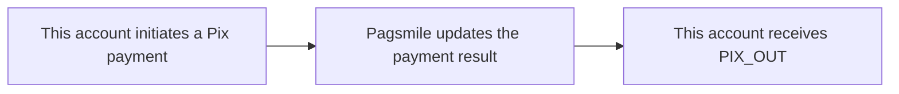

## Behavior and handling

This account, as the Payer, receives processing result notifications for Pix payments it initiates. Use these notifications to update payment status and reconcile debit transactions. The event represents the outgoing payment direction for this account. Result notifications include successful payments (`txn_status=TXN_STATUS_COMPLETED`, enum code 2) and failed payments (`txn_status=TXN_STATUS_FAILED`, enum code 3). A failed-payment notification does not by itself confirm that funds were debited. <Badge color="blue" size="sm">Added · payout-transaction-webhooks-F03</Badge>



## Events and funds flow direction

| Subscription value | Event name | Use cases |
| --- | --- | --- |
| 2 · PIX_OUT | PIX_PAYMENT_OUT | Track processing results for payments initiated by this account. |

Use `2 / PIX_OUT` to subscribe to outgoing payment events. The callback body has no top-level `event_type`. Identify outgoing Pix payment notifications using the outgoing payment subscription configuration, `txn_type=TXN_TYPE_PAYMENT`, and `payment_method=PAYMENT_METHOD_PIX`. Do not require `flow_direction`: it is not populated in the current payment callback body. <Badge color="orange" size="sm">Corrected · payout-transaction-webhooks-F01</Badge>

## ACCOUNT / USER delivery differences

| Scope | Delivery target | Deduplication identifier |
| --- | --- | --- |
| ACCOUNT | The first active account configuration found that matches the outgoing Pix payment event (`PIX_OUT`), ISPB, and account number. ACCOUNT delivery does not send the same event to every matching account configuration. <Badge color="blue" size="sm">Added · payout-transaction-webhooks-F15</Badge> | The callback does not include delivery_id. Deduplicate by "Subscribed event type + txn_id". |
| USER | An active subscription that belongs to the corresponding USER and matches the outgoing Pix payment event (`PIX_OUT`). Before each HTTP attempt, account ownership and the subscription configuration are checked again. Pending delivery is canceled if ownership is lost or the subscription is inactive or has changed. <Badge color="blue" size="sm">Added · payout-transaction-webhooks-F14</Badge> | The callback includes delivery_id, which stays unchanged across retries of the same delivery. |

## JSON example

The following are Pix payment USER callback examples received by this account. `payer` is this account, and the funds direction is OUT. The example identifiers and amounts are fictitious. Optional fields may be omitted in actual callbacks. Both `payer` and `payee` can also contain `document_id` (string), `document_type` (enum name), `bank_account_type` (enum name), `bank_branch` (string), and `bank_name` (string). Document types are `DOCUMENT_TYPE_CPF` (1) and `DOCUMENT_TYPE_CNPJ` (2). Bank account types are `BANK_ACCOUNT_TYPE_CHECKING` (1), `BANK_ACCOUNT_TYPE_SALARY` (2), `BANK_ACCOUNT_TYPE_SAVINGS` (3), and `BANK_ACCOUNT_TYPE_PAYMENT` (4). Numeric codes identify enum values; callbacks send their names and omit unspecified values (0). When document masking is enabled, a CPF can retain only its first 3 and last 4 characters, with the middle characters replaced by `*`; CNPJ values are not masked by this rule. <Badge color="blue" size="sm">Added · payout-transaction-webhooks-F12</Badge> ACCOUNT uses the transaction structure for the same scenario, but without `delivery_id`. <Badge color="orange" size="sm">Corrected · payout-transaction-webhooks-F01</Badge>

Status/enum values and int64 timestamps are strings. `created_at` is the payment initiation time in Unix milliseconds. `completed_at` is the time the payment reaches its final processing result, also in Unix milliseconds; it can be present for a failed payment and does not by itself indicate success. <Badge color="blue" size="sm">Added · payout-transaction-webhooks-F04</Badge> Amounts remain decimal strings. The callback is not a REST response in the `code/message/data` format.

<ResponseField name="refunded_amount" type="string">
  Refunded amount recorded for this payment, as a decimal string. A value such as `"0"` can be included; an empty value is omitted. <Badge color="blue" size="sm">Added · payout-transaction-webhooks-F06</Badge>
</ResponseField>

<ResponseField name="rejection_reason" type="string">
  Reason for a failed payment, when available. Omitted for successful payments or when empty. <Badge color="blue" size="sm">Added · payout-transaction-webhooks-F07</Badge>
</ResponseField>

<ResponseField name="payment_variant" type="string">
  Payment variant as an enum name. Pix values include `PAYMENT_VARIANT_PIX_MANUAL` (1), `PAYMENT_VARIANT_PIX_KEY` (2), `PAYMENT_VARIANT_STATIC_QRCODE` (3), `PAYMENT_VARIANT_DYNAMIC_QRCODE` (4), `PAYMENT_VARIANT_AUTO_PIX` (5), and `PAYMENT_VARIANT_DYNAMIC_BILLING` (9). The numeric codes identify the enum values; the callback sends their names. The unspecified value (0) is omitted. <Badge color="blue" size="sm">Added · payout-transaction-webhooks-F08</Badge>
</ResponseField>

<ResponseField name="pix_details" type="object">
  Pix details, when a Pix record with a nonempty Pix key is available.
</ResponseField>

<ResponseField name="pix_details.pix_key" type="string">
  Pix key recorded for the payment.
</ResponseField>

<ResponseField name="pix_details.pix_key_type" type="string">
  Pix key type as an enum name: `PIX_KEY_TYPE_CPF` (1), `PIX_KEY_TYPE_CNPJ` (2), `PIX_KEY_TYPE_EMAIL` (3), `PIX_KEY_TYPE_PHONE` (4), or `PIX_KEY_TYPE_EVP` (5). The unspecified value (0) is omitted.
</ResponseField>

<ResponseField name="pix_details.qr_code_id" type="string">
  QR code identifier, when recorded for the payment.
</ResponseField>

<ResponseField name="pix_details.qr_code_memo" type="string">
  QR code description, when available. Empty string fields are omitted. <Badge color="blue" size="sm">Added · payout-transaction-webhooks-F09</Badge>
</ResponseField>

<ResponseField name="request_merchant_order_id" type="string">
  Merchant order reference associated with the QR code request, when available. In an outgoing payment callback, `merchant_order_id` remains the payer's payment order reference. Empty references are omitted. <Badge color="blue" size="sm">Added · payout-transaction-webhooks-F11</Badge>
</ResponseField>

<Accordion title="Pix payments · USER">
```json
{
  "delivery_id": "0000000000000000000000000000000000000000000000000000000000000002",
  "payer": {
    "name": "Demo Payer",
    "bank_account": "00098765",
    "bank_code": "87654321"
  },
  "payee": {
    "name": "Demo Merchant",
    "bank_account": "00012345",
    "bank_code": "12345678"
  },
  "txn_id": "PIX-OUT-001",
  "settlement_txn_id": "SET-PAYMENT-OUT-001",
  "txn_status": "TXN_STATUS_COMPLETED",
  "amount": "100.00",
  "currency": "BRL",
  "txn_type": "TXN_TYPE_PAYMENT",
  "payment_method": "PAYMENT_METHOD_PIX",
  "created_at": "1710000000000",
  "completed_at": "1710000005000",
  "flow_type": "FLOW_TYPE_OUT",
  "merchant_order_id": "ORDER-OUT-001"
}
```
</Accordion>

<Accordion title="Corrections to the source document (11)" icon="clipboard-check">
This page was checked against the Pagsmile Open API source code on 2026-11-10. Each change below is marked in the page with a badge that shows its ID.

| ID | Change | Location | Source document text | Updated text |
| --- | --- | --- | --- | --- |
| payout-transaction-webhooks-F01 | Corrected (did not match the code) | Events and funds flow direction | Identify outgoing Pix payment notifications using the outgoing payment subscription configuration, `txn_type=TXN_TYPE_PAYMENT`, `payment_method=PAYMENT_METHOD_PIX`, and `flow_direction=FLOW_DIRECTION_OUT`. | Identify outgoing Pix payment notifications using the outgoing payment subscription configuration, `txn_type=TXN_TYPE_PAYMENT`, and `payment_method=PAYMENT_METHOD_PIX`. Do not require `flow_direction`: it is not populated in the current payment callback body. |
| payout-transaction-webhooks-F03 | Added (missing in the source) | Behavior and handling / append to funds-direction sentence | The event represents funds leaving this account. | The event represents the outgoing payment direction for this account. Result notifications include successful payments (`txn_status=TXN_STATUS_COMPLETED`, enum code 2) and failed payments (`txn_status=TXN_STATUS_FAILED`, enum code 3). A failed-payment notification does not by itself confirm that funds were debited. |
| payout-transaction-webhooks-F04 | Added (missing in the source) | JSON example / timestamp explanation | Status/enum values and int64 timestamps are strings. | Status/enum values and int64 timestamps are strings. `created_at` is the payment initiation time in Unix milliseconds. `completed_at` is the time the payment reaches its final processing result, also in Unix milliseconds; it can be present for a failed payment and does not by itself indicate success. |
| payout-transaction-webhooks-F06 | Added (missing in the source) | JSON example / optional callback-field table | — | `refunded_amount` \| string \| No \| Refunded amount recorded for this payment, as a decimal string. A value such as `"0"` can be included; an empty value is omitted. |
| payout-transaction-webhooks-F07 | Added (missing in the source) | JSON example / optional callback-field table | — | `rejection_reason` \| string \| No \| Reason for a failed payment, when available. Omitted for successful payments or when empty. |
| payout-transaction-webhooks-F08 | Added (missing in the source) | JSON example / optional callback-field table | — | `payment_variant` \| string \| No \| Payment variant as an enum name. Pix values include `PAYMENT_VARIANT_PIX_MANUAL` (1), `PAYMENT_VARIANT_PIX_KEY` (2), `PAYMENT_VARIANT_STATIC_QRCODE` (3), `PAYMENT_VARIANT_DYNAMIC_QRCODE` (4), `PAYMENT_VARIANT_AUTO_PIX` (5), and `PAYMENT_VARIANT_DYNAMIC_BILLING` (9). The numeric codes identify the enum values; the callback sends their names. The unspecified value (0) is omitted. |
| payout-transaction-webhooks-F09 | Added (missing in the source) | JSON example / optional callback-field table | — | `pix_details` \| object \| No \| Pix details, when a Pix record with a nonempty Pix key is available. `pix_details.pix_key` \| string \| No \| Pix key recorded for the payment. `pix_details.pix_key_type` \| string \| No \| Pix key type as an enum name: `PIX_KEY_TYPE_CPF` (1), `PIX_KEY_TYPE_CNPJ` (2), `PIX_KEY_TYPE_EMAIL` (3), `PIX_KEY_TYPE_PHONE` (4), or `PIX_KEY_TYPE_EVP` (5). The unspecified value (0) is omitted. `pix_details.qr_code_id` \| string \| No \| QR code identifier, when recorded for the payment. `pix_details.qr_code_memo` \| string \| No \| QR code description, when available. Empty string fields are omitted. |
| payout-transaction-webhooks-F11 | Added (missing in the source) | JSON example / optional callback-field table | — | `request_merchant_order_id` \| string \| No \| Merchant order reference associated with the QR code request, when available. In an outgoing payment callback, `merchant_order_id` remains the payer's payment order reference. Empty references are omitted. |
| payout-transaction-webhooks-F12 | Added (missing in the source) | JSON example / add party-field descriptions | Optional fields may be omitted in actual callbacks. | Optional fields may be omitted in actual callbacks. Both `payer` and `payee` can also contain `document_id` (string), `document_type` (enum name), `bank_account_type` (enum name), `bank_branch` (string), and `bank_name` (string). Document types are `DOCUMENT_TYPE_CPF` (1) and `DOCUMENT_TYPE_CNPJ` (2). Bank account types are `BANK_ACCOUNT_TYPE_CHECKING` (1), `BANK_ACCOUNT_TYPE_SALARY` (2), `BANK_ACCOUNT_TYPE_SAVINGS` (3), and `BANK_ACCOUNT_TYPE_PAYMENT` (4). Numeric codes identify enum values; callbacks send their names and omit unspecified values (0). When document masking is enabled, a CPF can retain only its first 3 and last 4 characters, with the middle characters replaced by `*`; CNPJ values are not masked by this rule. |
| payout-transaction-webhooks-F14 | Added (missing in the source) | ACCOUNT / USER delivery differences / USER delivery target cell | An active subscription that belongs to the corresponding USER and matches the outgoing Pix payment event (PIX_OUT). | An active subscription that belongs to the corresponding USER and matches the outgoing Pix payment event (PIX_OUT). Before each HTTP attempt, account ownership and the subscription configuration are checked again. Pending delivery is canceled if ownership is lost or the subscription is inactive or has changed. |
| payout-transaction-webhooks-F15 | Added (missing in the source) | ACCOUNT / USER delivery differences / ACCOUNT delivery target cell | An active account configuration that matches the outgoing Pix payment event (PIX_OUT), ISPB, and account number. | The first active account configuration found that matches the outgoing Pix payment event (PIX_OUT), ISPB, and account number. ACCOUNT delivery does not send the same event to every matching account configuration. |
</Accordion>
