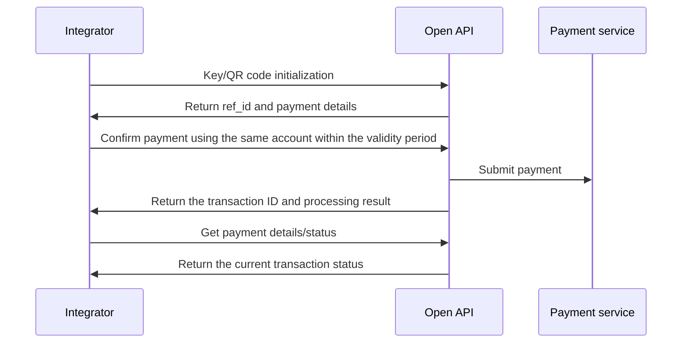

Initiate a Pix payment using a Pix key, QR code, or bank account.

Pix key confirmation, QR code confirmation, and direct bank-account Pix payment return `data.txn_id` and `data.txn_status`. An accepted payment returns `5` (`TXN_STATUS_PROCESSING`), not confirmation that settlement is complete. Save the transaction ID and query the payment status or details to determine the outcome. <Badge color="blue" size="sm">Added · payout-pix-F03</Badge>

These operations require `ACCOUNT` credentials for the bound account, or `USER` credentials with both `X-ISPB` and `X-Account-Number` identifying an account owned by that user. `PLATFORM` credentials are not accepted. With `ACCOUNT` credentials, omit both account-targeting headers or provide both with values matching the bound account. Follow [Environments & Credentials](/environments-and-credentials). <Badge color="blue" size="sm">Added · payout-pix-F06</Badge>

## API operations

| Operation | POST path |
| --- | --- |
| [Initialize Pix key payment](/api-reference/payout/pix/initialize-pix-key-payment) | `/v3/transfers/pix/key-initiate` |
| [Confirm Pix key payment](/api-reference/payout/pix/confirm-pix-key-payment) | `/v3/transfers/pix/key-confirm` |
| [Initialize QR code payment](/api-reference/payout/pix/initialize-qr-code-payment) | `/v3/transfers/pix/qr-code-initiate` |
| [Confirm QR code payment](/api-reference/payout/pix/confirm-qr-code-payment) | `/v3/transfers/pix/qr-code-confirm` |
| [Pay with Pix using bank account details](/api-reference/payout/pix/pay-with-bank-account-details) | `/v3/transfers/pix/bank-account` |
| [Get payment status](/api-reference/payout/get-payment-status) | `/v3/transfers/status/check` |
| [Get payment details](/api-reference/payout/get-payment-details) | `/v3/transfers/details` |

## Call sequence

- Pix key: Initialize → Verify payee details → Confirm payment → Query the result. You can optionally provide `amount` during initialization to check the available BRL balance. If you provide it, confirmation must use the same amount. <Badge color="blue" size="sm">Added · payout-pix-F04</Badge>
- QR code: Initialize → Verify the amount and payee → Confirm payment → Query the result. Confirmation requires a positive amount that can be represented exactly to two decimal places. For a dynamic QR code with a specified, non-editable amount, use the amount returned by initialization; changing it is rejected. <Badge color="blue" size="sm">Added · payout-pix-F05</Badge>
- Bank account: Initiate a Pix payment directly → Query the result. Initialization and confirmation are not required.

If the confirmation or direct payment response is lost or the result is unknown, check the original operation using [Error scenarios in the outgoing payment module](/api-reference/payout/overview). Do not submit another payment with a new `merchant_order_id` merely because the response was lost. A duplicate `merchant_order_id` is rejected rather than replaying the original success response. <Badge color="blue" size="sm">Added · payout-pix-F09</Badge>

For all three Pix payment flows, the payer and payee must not be the same account, identified by the combination of ISPB and account number. <Badge color="blue" size="sm">Added · payout-pix-F07</Badge>

The Pix key initialization reference is valid for 1 minute; the QR code initialization reference is valid for 5 minutes. Confirm using the same payer account. If the reference expires, initialize again and verify the returned payment details. <Badge color="blue" size="sm">Added · payout-pix-F01</Badge>

After confirmation is accepted, the initialization reference is consumed. Do not reuse the same `ref_id` for another payment. <Badge color="blue" size="sm">Added · payout-pix-F02</Badge>

Immediately after acceptance, Get payment status may temporarily return a transaction-not-found error while the payment is still being registered. This is not proof that payment submission failed. Query again rather than creating another payment. When calling Get payment details for a newly accepted payment, include `merchant_order_id` together with the returned `txn_id` so the query can identify a payment that is still awaiting registration. <Badge color="blue" size="sm">Added · payout-pix-F08</Badge>

*Pix two-step payment: initialization and confirmation*

<Accordion title="Corrections to the source document (9)" icon="clipboard-check">
This page was checked against the Pagsmile Open API source code on 2026-11-10. Each change below is marked in the page with a badge that shows its ID.

| ID | Change | Location | Source document text | Updated text |
| --- | --- | --- | --- | --- |
| payout-pix-F01 | Added (missing in the source) | Call sequence / reference validity | Pix key: Initialize → Verify payee details → Confirm payment → Query the result. | Pix key: Initialize → Verify payee details → Confirm payment → Query the result. The Pix key initialization reference is valid for 1 minute; the QR code initialization reference is valid for 5 minutes. Confirm using the same payer account. If the reference expires, initialize again and verify the returned payment details. |
| payout-pix-F02 | Added (missing in the source) | Call sequence / reference reuse | QR code: Initialize → Verify the amount and payee → Confirm payment → Query the result. | QR code: Initialize → Verify the amount and payee → Confirm payment → Query the result. After confirmation is accepted, the initialization reference is consumed. Do not reuse the same ref_id for another payment. |
| payout-pix-F03 | Added (missing in the source) | Call sequence / processing result | Initiate a Pix payment using a Pix key, QR code, or bank account. | Initiate a Pix payment using a Pix key, QR code, or bank account. Pix key confirmation, QR code confirmation, and direct bank-account Pix payment return data.txn_id and data.txn_status. An accepted payment returns 5 (TXN_STATUS_PROCESSING), not confirmation that settlement is complete. Save the transaction ID and query the payment status or details to determine the outcome. |
| payout-pix-F04 | Added (missing in the source) | Call sequence / Pix key amount | Pix key: Initialize → Verify payee details → Confirm payment → Query the result. | Pix key: Initialize → Verify payee details → Confirm payment → Query the result. You can optionally provide amount during initialization to check the available BRL balance. If you provide it, confirmation must use the same amount. |
| payout-pix-F05 | Added (missing in the source) | Call sequence / QR code amount | QR code: Initialize → Verify the amount and payee → Confirm payment → Query the result. | QR code: Initialize → Verify the amount and payee → Confirm payment → Query the result. Confirmation requires a positive amount that can be represented exactly to two decimal places. For a dynamic QR code with a specified, non-editable amount, use the amount returned by initialization; changing it is rejected. |
| payout-pix-F06 | Added (missing in the source) | Introduction / permissions and payer account context | Initiate a Pix payment using a Pix key, QR code, or bank account. | Initiate a Pix payment using a Pix key, QR code, or bank account. These operations require ACCOUNT credentials for the bound account, or USER credentials with both X-ISPB and X-Account-Number identifying an account owned by that user. PLATFORM credentials are not accepted. With ACCOUNT credentials, omit both account-targeting headers or provide both with values matching the bound account. Follow Environments & Credentials. |
| payout-pix-F07 | Added (missing in the source) | Call sequence / payer and payee accounts | Bank account: Initiate a Pix payment directly → Query the result. | Bank account: Initiate a Pix payment directly → Query the result. For all three Pix payment flows, the payer and payee must not be the same account, identified by the combination of ISPB and account number. |
| payout-pix-F08 | Added (missing in the source) | Call sequence / querying a newly accepted payment | Bank account: Initiate a Pix payment directly → Query the result. | Bank account: Initiate a Pix payment directly → Query the result. Immediately after acceptance, Get payment status may temporarily return a transaction-not-found error while the payment is still being registered. This is not proof that payment submission failed. Query again rather than creating another payment. When calling Get payment details for a newly accepted payment, include merchant_order_id together with the returned txn_id so the query can identify a payment that is still awaiting registration. |
| payout-pix-F09 | Added (missing in the source) | Call sequence / unknown result and duplicate submissions | Initialization and confirmation are not required. | Initialization and confirmation are not required. If the confirmation or direct payment response is lost or the result is unknown, check the original operation using Error scenarios in the outgoing payment module. Do not submit another payment with a new merchant_order_id merely because the response was lost. A duplicate merchant_order_id is rejected rather than replaying the original success response. |
</Accordion>
