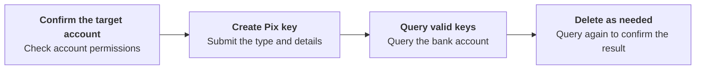

Create and delete Pix keys for the target account. Query the bank account to retrieve valid keys.

With ACCOUNT-level credentials, the target is the account bound to those credentials. You can omit the account headers; if you send either `X-ISPB` or `X-Account-Number`, send both, and both must match the bound account. With USER-level credentials, send both headers to select an account owned by that user and permitted by the account hierarchy. PLATFORM-level credentials cannot perform these operations. See [Environments & Credentials](/environments-and-credentials). <Badge color="blue" size="sm">Added · module-6-F01</Badge>

## API operations

| Operation | POST path |
| --- | --- |
| [Create Pix key](/api-reference/pix-keys/create-pix-key) | `/v3/pix_keys/create` |
| [Delete Pix key](/api-reference/pix-keys/delete-pix-key) | `/v3/pix_keys/delete` |

## Call sequence

Create Pix key → Query the bank account's valid keys → Delete keys as needed → Query again to confirm. Use [Get account balance](/api-reference/accounts/get-account-balance) to read `data.pix_keys`, which contains only ACTIVE keys. The account query can still succeed with an empty key list if key retrieval fails, so an empty list alone does not confirm that creation failed or deletion succeeded. If the result is uncertain, query again and check the create or delete response before updating your system. <Badge color="blue" size="sm">Added · module-6-F02</Badge>

<Accordion title="Corrections to the source document (2)" icon="clipboard-check">
This page was checked against the Pagsmile Open API source code on 2026-11-10. Each change below is marked in the page with a badge that shows its ID.

| ID | Change | Location | Source document text | Updated text |
| --- | --- | --- | --- | --- |
| module-6-F01 | Added (missing in the source) | Opening description / account permissions | Create and delete Pix keys for the target account. | Create and delete Pix keys for the target account. With ACCOUNT-level credentials, the target is the account bound to those credentials. You can omit the account headers; if you send either `X-ISPB` or `X-Account-Number`, send both, and both must match the bound account. With USER-level credentials, send both headers to select an account owned by that user and permitted by the account hierarchy. PLATFORM-level credentials cannot perform these operations. See Environments & Credentials. |
| module-6-F02 | Added (missing in the source) | Call sequence | Create Pix key → Query the bank account's valid keys → Delete keys as needed → Query again to confirm. | Create Pix key → Query the bank account's valid keys → Delete keys as needed → Query again to confirm. Use Get account balance to read `data.pix_keys`, which contains only ACTIVE keys. The account query can still succeed with an empty key list if key retrieval fails, so an empty list alone does not confirm that creation failed or deletion succeeded. If the result is uncertain, query again and check the create or delete response before updating your system. |
</Accordion>
