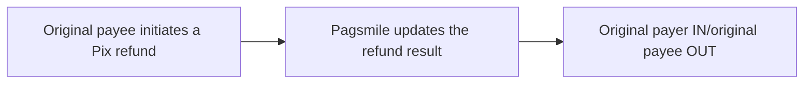

## Behavior and handling

After the original Payee initiates a Pix refund, track the result through callbacks. A successful refund uses `txn_status=TXN_STATUS_COMPLETED`. A failed refund uses `txn_status=TXN_STATUS_FAILED` and is notified only to the original payee through `REFUND_OUT`; `REFUND_IN` is not sent for a failed refund. Delivery requires a matching active subscription for the receiving Pagsmile account; external-bank accounts do not receive these callbacks. <Badge color="blue" size="sm">Added · refund-transaction-webhooks-F04</Badge> The original payer receives an incoming refund notification, REFUND_IN. The original payee receives an outgoing refund notification, REFUND_OUT. Direction is relative to the account receiving the notification.



## Events and funds flow direction

| Subscription value | Event name | Use cases |
| --- | --- | --- |
| 3 · REFUND_IN | PIX_REFUND_IN | This account receives funds returned from its original payment. |
| 4 · REFUND_OUT | PIX_REFUND_OUT | This account refunds the original payer. |

The original payer subscribes to `3 / REFUND_IN`, and the original payee subscribes to `4 / REFUND_OUT`. The callback body has no top-level `event_type`. Distinguish incoming and outgoing refunds using the subscribed event (`3 / REFUND_IN` or `4 / REFUND_OUT`) and the receiving account. The body uses `txn_type=TXN_TYPE_REFUND` and `payment_method=PAYMENT_METHOD_PIX`, but does not populate `flow_direction`. In the refund body, `payer` is the original payee and `payee` is the original payer. <Badge color="orange" size="sm">Corrected · refund-transaction-webhooks-F01</Badge>

## ACCOUNT / USER delivery differences

| Scope | Delivery target | Deduplication identifier |
| --- | --- | --- |
| ACCOUNT | An active account configuration that matches the incoming or outgoing refund event (REFUND_IN/REFUND_OUT), ISPB, and account number. | The callback does not include delivery_id. Deduplicate by "Subscribed event type + txn_id". |
| USER | An active subscription that belongs to the corresponding USER and matches the incoming or outgoing refund event (`REFUND_IN`/`REFUND_OUT`). Delivery also requires continued account access and a valid signing credential. A pending delivery is canceled if access is revoked, the subscription is inactive or changed, or the signing credential becomes invalid. <Badge color="blue" size="sm">Added · refund-transaction-webhooks-F21</Badge> | The callback includes delivery_id, which stays unchanged across retries of the same delivery. |

## JSON example

The following examples show the incoming refund USER callback received by the original payer and the outgoing refund USER callback received by the original payee. `original_txn` links to the original payment transaction. For `REFUND_IN`, `original_txn.merchant_order_id` is the original payment order ID. For `REFUND_OUT`, it is the original QR-code order ID, when available. This field can be omitted when the corresponding order ID is unavailable; `original_txn.txn_id` and `original_txn.settlement_txn_id` identify the original payment independently. <Badge color="blue" size="sm">Added · refund-transaction-webhooks-F05</Badge> The example identifiers and amounts are fictitious. Optional fields may be omitted in actual callbacks. ACCOUNT uses the transaction structure for the same scenario but does not include `delivery_id`. <Badge color="orange" size="sm">Corrected · refund-transaction-webhooks-F03</Badge> <Badge color="orange" size="sm">Corrected · refund-transaction-webhooks-F02</Badge>

Status/enum values and int64 timestamps are strings. `created_at` is the refund initiation time and `completed_at` is the refund completion time, both expressed as UTC Unix milliseconds. An unset timestamp may be omitted. <Badge color="blue" size="sm">Added · refund-transaction-webhooks-F11</Badge> Amounts remain decimal strings. The callback is not a REST response in the `code/message/data` format.

<ResponseField name="merchant_order_id" type="string">
  Refund order ID supplied when initiating the refund. Included in `REFUND_OUT` when available; omitted in `REFUND_IN`. <Badge color="blue" size="sm">Added · refund-transaction-webhooks-F06</Badge>
</ResponseField>

<ResponseField name="memo" type="string">
  Refund memo, when available. <Badge color="blue" size="sm">Added · refund-transaction-webhooks-F07</Badge>
</ResponseField>

<ResponseField name="refund_reason" type="string">
  Description of the refund reason, when available. <Badge color="blue" size="sm">Added · refund-transaction-webhooks-F08</Badge>
</ResponseField>

<ResponseField name="rejection_reason" type="string">
  Description of the failure reason for a failed refund, when available. Omitted for successful refunds. <Badge color="blue" size="sm">Added · refund-transaction-webhooks-F09</Badge>
</ResponseField>

<ResponseField name="payment_variant" type="string (enum)">
  Payment variant inherited from the original Pix payment, when set: `PAYMENT_VARIANT_PIX_MANUAL`, `PAYMENT_VARIANT_PIX_KEY`, `PAYMENT_VARIANT_STATIC_QRCODE`, `PAYMENT_VARIANT_DYNAMIC_QRCODE`, `PAYMENT_VARIANT_AUTO_PIX`, or `PAYMENT_VARIANT_DYNAMIC_BILLING`. <Badge color="blue" size="sm">Added · refund-transaction-webhooks-F10</Badge>
</ResponseField>

<ResponseField name="payer.document_id" type="string">
  Taxpayer document (CPF/CNPJ) of this refund party, when available. May be masked according to the receiving customer's document-masking configuration.
</ResponseField>

<ResponseField name="payee.document_id" type="string">
  Taxpayer document (CPF/CNPJ) of this refund party, when available. May be masked according to the receiving customer's document-masking configuration. <Badge color="blue" size="sm">Added · refund-transaction-webhooks-F12</Badge>
</ResponseField>

<ResponseField name="payer.document_type" type="string (enum)">
  Document type of this refund party: `DOCUMENT_TYPE_CPF` or `DOCUMENT_TYPE_CNPJ`, when set.
</ResponseField>

<ResponseField name="payee.document_type" type="string (enum)">
  Document type of this refund party: `DOCUMENT_TYPE_CPF` or `DOCUMENT_TYPE_CNPJ`, when set. <Badge color="blue" size="sm">Added · refund-transaction-webhooks-F13</Badge>
</ResponseField>

<ResponseField name="payer.bank_account_type" type="string (enum)">
  Bank account type of this refund party, when set: `BANK_ACCOUNT_TYPE_CHECKING`, `BANK_ACCOUNT_TYPE_SALARY`, `BANK_ACCOUNT_TYPE_SAVINGS`, or `BANK_ACCOUNT_TYPE_PAYMENT`. Other account types are omitted on this callback path.
</ResponseField>

<ResponseField name="payee.bank_account_type" type="string (enum)">
  Bank account type of this refund party, when set: `BANK_ACCOUNT_TYPE_CHECKING`, `BANK_ACCOUNT_TYPE_SALARY`, `BANK_ACCOUNT_TYPE_SAVINGS`, or `BANK_ACCOUNT_TYPE_PAYMENT`. Other account types are omitted on this callback path. <Badge color="blue" size="sm">Added · refund-transaction-webhooks-F14</Badge>
</ResponseField>

<ResponseField name="payer.bank_branch" type="string">
  Branch code of this refund party, when available. Preserve leading zeros.
</ResponseField>

<ResponseField name="payee.bank_branch" type="string">
  Branch code of this refund party, when available. Preserve leading zeros. <Badge color="blue" size="sm">Added · refund-transaction-webhooks-F15</Badge>
</ResponseField>

<ResponseField name="payer.bank_name" type="string">
  Bank name of this refund party, when available.
</ResponseField>

<ResponseField name="payee.bank_name" type="string">
  Bank name of this refund party, when available. <Badge color="blue" size="sm">Added · refund-transaction-webhooks-F16</Badge>
</ResponseField>

<ResponseField name="original_txn.amount" type="string">
  Original payment amount as a decimal string. This is not the refund amount at the top level. <Badge color="blue" size="sm">Added · refund-transaction-webhooks-F17</Badge>
</ResponseField>

<ResponseField name="flow_type" type="string (enum)">
  Flow type recorded for the refund, not a per-delivery direction override. It reverses the original payment record's `IN`/`OUT` flow type; `FLOW_TYPE_TRANSFER` is preserved. Values: `FLOW_TYPE_IN`, `FLOW_TYPE_OUT`, `FLOW_TYPE_TRANSFER`. Use the subscribed event and receiving account to identify delivery direction. <Badge color="blue" size="sm">Added · refund-transaction-webhooks-F22</Badge>
</ResponseField>

<Accordion title="Incoming refunds · USER">
```json
{
  "delivery_id": "0000000000000000000000000000000000000000000000000000000000000003",
  "payer": {
    "name": "Demo Merchant",
    "bank_account": "00012345",
    "bank_code": "12345678"
  },
  "payee": {
    "name": "Demo Payer",
    "bank_account": "00098765",
    "bank_code": "87654321"
  },
  "txn_id": "REFUND-IN-001",
  "settlement_txn_id": "SET-REFUND-IN-001",
  "txn_status": "TXN_STATUS_COMPLETED",
  "amount": "10.00",
  "currency": "BRL",
  "txn_type": "TXN_TYPE_REFUND",
  "payment_method": "PAYMENT_METHOD_PIX",
  "created_at": "1710000000000",
  "completed_at": "1710000005000",
  "flow_type": "FLOW_TYPE_IN",
  "original_txn": {
    "txn_id": "ORIGINAL-PAYMENT-001",
    "settlement_txn_id": "ORIGINAL-SET-001",
    "merchant_order_id": "ORIGINAL-PAYMENT-ORDER-001",
    "amount": "100.00",
    "debit_fee": "0.00",
    "credit_fee": "0.00"
  }
}
```
</Accordion>

<Accordion title="Outgoing refunds · USER">
```json
{
  "delivery_id": "0000000000000000000000000000000000000000000000000000000000000004",
  "payer": {
    "name": "Demo Merchant",
    "bank_account": "00012345",
    "bank_code": "12345678"
  },
  "payee": {
    "name": "Demo Payer",
    "bank_account": "00098765",
    "bank_code": "87654321"
  },
  "txn_id": "REFUND-OUT-001",
  "settlement_txn_id": "SET-REFUND-OUT-001",
  "txn_status": "TXN_STATUS_COMPLETED",
  "amount": "10.00",
  "currency": "BRL",
  "txn_type": "TXN_TYPE_REFUND",
  "payment_method": "PAYMENT_METHOD_PIX",
  "created_at": "1710000000000",
  "completed_at": "1710000005000",
  "flow_type": "FLOW_TYPE_OUT",
  "original_txn": {
    "txn_id": "ORIGINAL-PAYMENT-001",
    "settlement_txn_id": "ORIGINAL-SET-001",
    "merchant_order_id": "ORIGINAL-QR-ORDER-001",
    "amount": "100.00",
    "debit_fee": "0.00",
    "credit_fee": "0.00"
  }
}
```
</Accordion>

<Accordion title="Corrections to the source document (19)" icon="clipboard-check">
This page was checked against the Pagsmile Open API source code on 2026-11-10. Each change below is marked in the page with a badge that shows its ID.

| ID | Change | Location | Source document text | Updated text |
| --- | --- | --- | --- | --- |
| refund-transaction-webhooks-F01 | Corrected (did not match the code) | Events and funds flow direction | Distinguish incoming and outgoing refunds using the refund subscription configuration, `txn_type=TXN_TYPE_REFUND`, `payment_method=PAYMENT_METHOD_PIX`, and `flow_direction=FLOW_DIRECTION_IN` or `FLOW_DIRECTION_OUT`. | Distinguish incoming and outgoing refunds using the subscribed event (`3 / REFUND_IN` or `4 / REFUND_OUT`) and the receiving account. The body uses `txn_type=TXN_TYPE_REFUND` and `payment_method=PAYMENT_METHOD_PIX`, but does not populate `flow_direction`. In the refund body, `payer` is the original payee and `payee` is the original payer. |
| refund-transaction-webhooks-F02 | Corrected (did not match the code) | JSON example / Incoming refunds · USER | `{ "delivery_id": "0000000000000000000000000000000000000000000000000000000000000003", "payer": { "name": "Demo Payer", "bank_account": "00098765", "bank_code": "87654321" }, "payee": { "name": "Demo Merchant", "bank_account": "00012345", "bank_code": "12345678" }, "txn_id": "REFUND-IN-001", "settlement_txn_id": "SET-REFUND-IN-001", "txn_status": "TXN_STATUS_COMPLETED", "amount": "10.00", "currency": "BRL", "txn_type": "TXN_TYPE_REFUND", "payment_method": "PAYMENT_METHOD_PIX", "created_at": "1710000000000", "completed_at": "1710000005000", "flow_type": "FLOW_TYPE_IN", "flow_direction": "FLOW_DIRECTION_IN", "original_txn": { "txn_id": "ORIGINAL-PAYMENT-001", "settlement_txn_id": "ORIGINAL-SET-001", "merchant_order_id": "ORIGINAL-PAYMENT-ORDER-001" } }` | `{ "delivery_id": "0000000000000000000000000000000000000000000000000000000000000003", "payer": { "name": "Demo Merchant", "bank_account": "00012345", "bank_code": "12345678" }, "payee": { "name": "Demo Payer", "bank_account": "00098765", "bank_code": "87654321" }, "txn_id": "REFUND-IN-001", "settlement_txn_id": "SET-REFUND-IN-001", "txn_status": "TXN_STATUS_COMPLETED", "amount": "10.00", "currency": "BRL", "txn_type": "TXN_TYPE_REFUND", "payment_method": "PAYMENT_METHOD_PIX", "created_at": "1710000000000", "completed_at": "1710000005000", "flow_type": "FLOW_TYPE_IN", "original_txn": { "txn_id": "ORIGINAL-PAYMENT-001", "settlement_txn_id": "ORIGINAL-SET-001", "merchant_order_id": "ORIGINAL-PAYMENT-ORDER-001", "amount": "100.00", "debit_fee": "0.00", "credit_fee": "0.00" } }` |
| refund-transaction-webhooks-F03 | Corrected (did not match the code) | JSON example / Outgoing refunds · USER | `{ "delivery_id": "0000000000000000000000000000000000000000000000000000000000000004", "payer": { "name": "Demo Payer", "bank_account": "00098765", "bank_code": "87654321" }, "payee": { "name": "Demo Merchant", "bank_account": "00012345", "bank_code": "12345678" }, "txn_id": "REFUND-OUT-001", "settlement_txn_id": "SET-REFUND-OUT-001", "txn_status": "TXN_STATUS_COMPLETED", "amount": "10.00", "currency": "BRL", "txn_type": "TXN_TYPE_REFUND", "payment_method": "PAYMENT_METHOD_PIX", "created_at": "1710000000000", "completed_at": "1710000005000", "flow_type": "FLOW_TYPE_OUT", "flow_direction": "FLOW_DIRECTION_OUT", "original_txn": { "txn_id": "ORIGINAL-PAYMENT-001", "settlement_txn_id": "ORIGINAL-SET-001", "merchant_order_id": "ORIGINAL-PAYMENT-ORDER-001" } }` | `{ "delivery_id": "0000000000000000000000000000000000000000000000000000000000000004", "payer": { "name": "Demo Merchant", "bank_account": "00012345", "bank_code": "12345678" }, "payee": { "name": "Demo Payer", "bank_account": "00098765", "bank_code": "87654321" }, "txn_id": "REFUND-OUT-001", "settlement_txn_id": "SET-REFUND-OUT-001", "txn_status": "TXN_STATUS_COMPLETED", "amount": "10.00", "currency": "BRL", "txn_type": "TXN_TYPE_REFUND", "payment_method": "PAYMENT_METHOD_PIX", "created_at": "1710000000000", "completed_at": "1710000005000", "flow_type": "FLOW_TYPE_OUT", "original_txn": { "txn_id": "ORIGINAL-PAYMENT-001", "settlement_txn_id": "ORIGINAL-SET-001", "merchant_order_id": "ORIGINAL-QR-ORDER-001", "amount": "100.00", "debit_fee": "0.00", "credit_fee": "0.00" } }` |
| refund-transaction-webhooks-F04 | Added (missing in the source) | Behavior and handling | After the original Payee initiates a Pix refund, track the result through callbacks. | After the original Payee initiates a Pix refund, track the result through callbacks. A successful refund uses `txn_status=TXN_STATUS_COMPLETED`. A failed refund uses `txn_status=TXN_STATUS_FAILED` and is notified only to the original payee through REFUND_OUT; REFUND_IN is not sent for a failed refund. Delivery requires a matching active subscription for the receiving Pagsmile account; external-bank accounts do not receive these callbacks. |
| refund-transaction-webhooks-F05 | Added (missing in the source) | JSON example / original transaction linking | `original_txn` links to the original payment transaction. | `original_txn` links to the original payment transaction. For REFUND_IN, `original_txn.merchant_order_id` is the original payment order ID. For REFUND_OUT, it is the original QR-code order ID, when available. This field can be omitted when the corresponding order ID is unavailable; `original_txn.txn_id` and `original_txn.settlement_txn_id` identify the original payment independently. |
| refund-transaction-webhooks-F06 | Added (missing in the source) | JSON example / new callback fields table | — | `merchant_order_id` \| string \| No \| Refund order ID supplied when initiating the refund. Included in REFUND_OUT when available; omitted in REFUND_IN. |
| refund-transaction-webhooks-F07 | Added (missing in the source) | JSON example / new callback fields table | — | `memo` \| string \| No \| Refund memo, when available. |
| refund-transaction-webhooks-F08 | Added (missing in the source) | JSON example / new callback fields table | — | `refund_reason` \| string \| No \| Description of the refund reason, when available. |
| refund-transaction-webhooks-F09 | Added (missing in the source) | JSON example / new callback fields table | — | `rejection_reason` \| string \| No \| Description of the failure reason for a failed refund, when available. Omitted for successful refunds. |
| refund-transaction-webhooks-F10 | Added (missing in the source) | JSON example / new callback fields table | — | `payment_variant` \| string (enum) \| No \| Payment variant inherited from the original Pix payment, when set: PAYMENT_VARIANT_PIX_MANUAL, PAYMENT_VARIANT_PIX_KEY, PAYMENT_VARIANT_STATIC_QRCODE, PAYMENT_VARIANT_DYNAMIC_QRCODE, PAYMENT_VARIANT_AUTO_PIX, or PAYMENT_VARIANT_DYNAMIC_BILLING. |
| refund-transaction-webhooks-F11 | Added (missing in the source) | JSON example / timestamp format | Status/enum values and int64 timestamps are strings. | Status/enum values and int64 timestamps are strings. `created_at` is the refund initiation time and `completed_at` is the refund completion time, both expressed as UTC Unix milliseconds. An unset timestamp may be omitted. |
| refund-transaction-webhooks-F12 | Added (missing in the source) | JSON example / new callback fields table | — | `payer.document_id` \| string \| No \| Taxpayer document (CPF/CNPJ) of this refund party, when available. May be masked according to the receiving customer's document-masking configuration. `payee.document_id` \| string \| No \| Taxpayer document (CPF/CNPJ) of this refund party, when available. May be masked according to the receiving customer's document-masking configuration. |
| refund-transaction-webhooks-F13 | Added (missing in the source) | JSON example / new callback fields table | — | `payer.document_type` \| string (enum) \| No \| Document type of this refund party: DOCUMENT_TYPE_CPF or DOCUMENT_TYPE_CNPJ, when set. `payee.document_type` \| string (enum) \| No \| Document type of this refund party: DOCUMENT_TYPE_CPF or DOCUMENT_TYPE_CNPJ, when set. |
| refund-transaction-webhooks-F14 | Added (missing in the source) | JSON example / new callback fields table | — | `payer.bank_account_type` \| string (enum) \| No \| Bank account type of this refund party, when set: BANK_ACCOUNT_TYPE_CHECKING, BANK_ACCOUNT_TYPE_SALARY, BANK_ACCOUNT_TYPE_SAVINGS, or BANK_ACCOUNT_TYPE_PAYMENT. Other account types are omitted on this callback path. `payee.bank_account_type` \| string (enum) \| No \| Bank account type of this refund party, when set: BANK_ACCOUNT_TYPE_CHECKING, BANK_ACCOUNT_TYPE_SALARY, BANK_ACCOUNT_TYPE_SAVINGS, or BANK_ACCOUNT_TYPE_PAYMENT. Other account types are omitted on this callback path. |
| refund-transaction-webhooks-F15 | Added (missing in the source) | JSON example / new callback fields table | — | `payer.bank_branch` \| string \| No \| Branch code of this refund party, when available. Preserve leading zeros. `payee.bank_branch` \| string \| No \| Branch code of this refund party, when available. Preserve leading zeros. |
| refund-transaction-webhooks-F16 | Added (missing in the source) | JSON example / new callback fields table | — | `payer.bank_name` \| string \| No \| Bank name of this refund party, when available. `payee.bank_name` \| string \| No \| Bank name of this refund party, when available. |
| refund-transaction-webhooks-F17 | Added (missing in the source) | JSON example / new callback fields table | — | `original_txn.amount` \| string \| No \| Original payment amount as a decimal string. This is not the refund amount at the top level. |
| refund-transaction-webhooks-F21 | Added (missing in the source) | ACCOUNT / USER delivery differences | An active subscription that belongs to the corresponding USER and matches the incoming or outgoing refund event (REFUND_IN/REFUND_OUT). | An active subscription that belongs to the corresponding USER and matches the incoming or outgoing refund event (REFUND_IN/REFUND_OUT). Delivery also requires continued account access and a valid signing credential. A pending delivery is canceled if access is revoked, the subscription is inactive or changed, or the signing credential becomes invalid. |
| refund-transaction-webhooks-F22 | Added (missing in the source) | JSON example / new callback fields table | — | `flow_type` \| string (enum) \| No \| Flow type recorded for the refund, not a per-delivery direction override. It reverses the original payment record's IN/OUT flow type; FLOW_TYPE_TRANSFER is preserved. Values: FLOW_TYPE_IN, FLOW_TYPE_OUT, FLOW_TYPE_TRANSFER. Use the subscribed event and receiving account to identify delivery direction. |
</Accordion>
