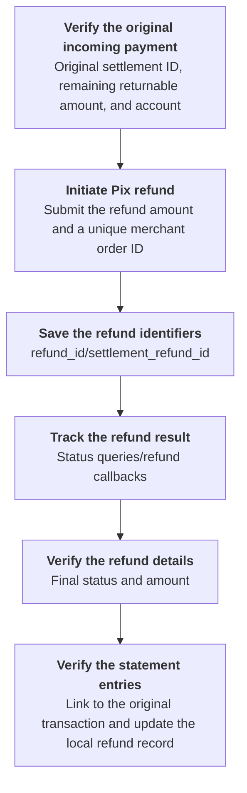
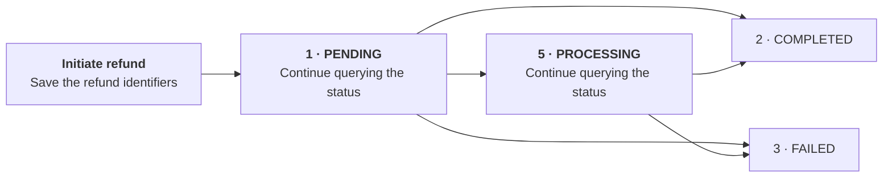

Initiate a refund for the original incoming Pix payment, and query the refund details and status.

Initiate the refund from the original payee account. Use `ACCOUNT` credentials for that account, or `USER` credentials with both `X-ISPB` and `X-Account-Number` targeting an account owned by that `USER`. `PLATFORM` credentials are not accepted for these refund operations. Keep the same original payee account context when tracking the refund you initiated. See [Initiate Pix refund](/api-reference/refunds/initiate-pix-refund) for the pre-initiation checks and [Environments & Credentials](/environments-and-credentials) for account targeting. <Badge color="blue" size="sm">Added · module-9-F05</Badge>

## API operations

| Operation | POST path |
| --- | --- |
| [Initiate Pix refund](/api-reference/refunds/initiate-pix-refund) | `/v3/refunds/pix` |
| [Get refund details](/api-reference/refunds/get-refund-details) | `/v3/refunds/details` |
| [Get refund status](/api-reference/refunds/get-refund-status) | `/v3/refunds/status/check` |

## Call sequence

Save the original settlement ID with the refund request. Get refund details currently returns an empty `data.details.original_settlement_id`; use the refund statement entry's `parent_txn_id` and `parent_settlement_id` to verify the link to the original transaction. <Badge color="orange" size="sm">Corrected · module-9-F03</Badge>

[Initiate Pix refund](/api-reference/refunds/initiate-pix-refund) → Save the refund identifiers → [Get refund status](/api-reference/refunds/get-refund-status)/Receive refund callbacks → [Get refund details](/api-reference/refunds/get-refund-details) → [Verify the statement entries](/api-reference/accounts/get-account-statement).

Configure refund callbacks before relying on notifications; without a configured callback URL, no HTTP callback is sent. See [Refund callbacks](/api-reference/refunds/callbacks) for the subscription direction and account scope. Use status queries to track the refund when callbacks are not configured or have not arrived. <Badge color="blue" size="sm">Added · module-9-F07</Badge>

## Refund status transitions

Refunds are processed asynchronously. When a refund creation request is accepted, the response returns `1 PENDING`. Save the refund identifiers and call [Get refund status](/api-reference/refunds/get-refund-status) to track the result. The refund can also return `5 PROCESSING`; continue polling while the status is `1 PENDING` or `5 PROCESSING`. Stop polling the refund status when it reaches `2 COMPLETED` or `3 FAILED`. Verify the details and funds records by calling [Get refund details](/api-reference/refunds/get-refund-details) and checking the statement entries. <Badge color="blue" size="sm">Added · module-9-F01</Badge>

## Error handling

- **Timeout or unknown result:** Query the original refund using the existing refund identifiers. Do not resubmit with a different order ID before confirming the result.
- **Duplicate requests:** A duplicate request error does not mean the original refund failed. Duplicate checking is based on the merchant order ID alone and is not scoped to an account or `USER`. Generate IDs that will not collide across accounts or users. An order ID reservation has a 48-hour expiry, but this is not permission to reuse an ID afterward: refund requests must also meet the UTC date rules in [Initiate Pix refund](/api-reference/refunds/initiate-pix-refund). <Badge color="blue" size="sm">Added · module-9-F06</Badge> Do not keep resubmitting the refund after a duplicate request error. Query the original refund using its saved identifiers; repeating the same order ID does not return the original refund result. If you have no refund identifiers, retain the original request information and contact support. <Badge color="orange" size="sm">Corrected · module-9-F02</Badge>
- **Refund failed or not found:** Check the refund details. A refund may temporarily be reported as not found immediately after creation is accepted because processing is asynchronous. Keep the returned identifiers and query the same refund again later; a single not-found result is not proof that the refund failed or that a new submission is safe. <Badge color="blue" size="sm">Added · module-9-F04</Badge> If you have no refund identifiers, retain the original order ID, account, original settlement ID, amount, and request time, and contact support to investigate.

<Accordion title="Corrections to the source document (7)" icon="clipboard-check">
This page was checked against the Pagsmile Open API source code on 2026-11-10. Each change below is marked in the page with a badge that shows its ID.

| ID | Change | Location | Source document text | Updated text |
| --- | --- | --- | --- | --- |
| module-9-F01 | Added (missing in the source) | Refund status transitions | Refunds are processed asynchronously. When a refund creation request is accepted, the response returns `1 PENDING`. Save the refund identifiers and call Get refund status to track the result. Stop polling the refund status when it reaches `2 COMPLETED` or `3 FAILED`. Verify the details and funds records by calling Get refund details and checking the statement entries. [Figure: The refund is PENDING when accepted, then transitions to COMPLETED or FAILED] labels: Initiate refund \| Save the refund identifiers \| 1 · PENDING \| Continue querying the status \| 2 · COMPLETED \| 3 · FAILED | Refunds are processed asynchronously. When a refund creation request is accepted, the response returns `1 PENDING`. Save the refund identifiers and call Get refund status to track the result. The refund can also return `5 PROCESSING`; continue polling while the status is `1 PENDING` or `5 PROCESSING`. Stop polling the refund status when it reaches `2 COMPLETED` or `3 FAILED`. Verify the details and funds records by calling Get refund details and checking the statement entries. [Figure: The refund is PENDING when accepted and can pass through PROCESSING before reaching COMPLETED or FAILED] labels: Initiate refund \| Save the refund identifiers \| 1 · PENDING \| 5 · PROCESSING \| Continue querying the status \| 2 · COMPLETED \| 3 · FAILED |
| module-9-F02 | Corrected (did not match the code) | Error handling / Duplicate requests | Resubmit using the same order ID without changing the amount or original transaction. | Do not keep resubmitting the refund after a duplicate request error. Query the original refund using its saved identifiers; repeating the same order ID does not return the original refund result. If you have no refund identifiers, retain the original request information and contact support. |
| module-9-F03 | Corrected (did not match the code) | Call sequence / Figure | [Figure: Verify the original incoming payment, initiate a refund, save the identifiers, track the result, query the details, and verify the statement entries] labels: Verify the original incoming payment \| Original settlement ID, remaining returnable amount, and account \| Initiate Pix refund \| Submit the refund amount and a unique merchant order ID \| Save the refund identifiers \| refund_id/settlement_refund_id \| Track the refund result \| Status queries/refund callbacks \| Verify the refund details \| Final status, amount, and link to the original transaction \| Verify the statement entries \| Update the local refund record | [Figure: Verify the original incoming payment, initiate a refund, save the identifiers, track the result, query the details, and verify the statement entries] labels: Verify the original incoming payment \| Original settlement ID, remaining returnable amount, and account \| Initiate Pix refund \| Submit the refund amount and a unique merchant order ID \| Save the refund identifiers \| refund_id/settlement_refund_id \| Track the refund result \| Status queries/refund callbacks \| Verify the refund details \| Final status and amount \| Verify the statement entries \| Link to the original transaction and update the local refund record Save the original settlement ID with the refund request. Get refund details currently returns an empty `data.details.original_settlement_id`; use the refund statement entry's `parent_txn_id` and `parent_settlement_id` to verify the link to the original transaction. |
| module-9-F04 | Added (missing in the source) | Error handling / Refund failed or not found | Check the refund details. | Check the refund details. A refund may temporarily be reported as not found immediately after creation is accepted because processing is asynchronous. Keep the returned identifiers and query the same refund again later; a single not-found result is not proof that the refund failed or that a new submission is safe. |
| module-9-F05 | Added (missing in the source) | Introduction / Account prerequisite for the call sequence | Initiate a refund for the original incoming Pix payment, and query the refund details and status. | Initiate a refund for the original incoming Pix payment, and query the refund details and status. Initiate the refund from the original payee account. Use ACCOUNT credentials for that account, or USER credentials with both `X-ISPB` and `X-Account-Number` targeting an account owned by that USER. PLATFORM credentials are not accepted for these refund operations. Keep the same original payee account context when tracking the refund you initiated. See Initiate Pix refund for the pre-initiation checks and Environments & Credentials for account targeting. |
| module-9-F06 | Added (missing in the source) | Error handling / Duplicate requests | A duplicate request error does not mean the original refund failed. | A duplicate request error does not mean the original refund failed. Duplicate checking is based on the merchant order ID alone and is not scoped to an account or USER. Generate IDs that will not collide across accounts or users. An order ID reservation has a 48-hour expiry, but this is not permission to reuse an ID afterward: refund requests must also meet the UTC date rules in Initiate Pix refund. |
| module-9-F07 | Added (missing in the source) | Call sequence / Callback prerequisite | Initiate Pix refund → Save the refund identifiers → Get refund status/Receive refund callbacks → Get refund details → Verify the statement entries. | Initiate Pix refund → Save the refund identifiers → Get refund status/Receive refund callbacks → Get refund details → Verify the statement entries. Configure refund callbacks before relying on notifications; without a configured callback URL, no HTTP callback is sent. See Refund callbacks for the subscription direction and account scope. Use status queries to track the refund when callbacks are not configured or have not arrived. |
</Accordion>
