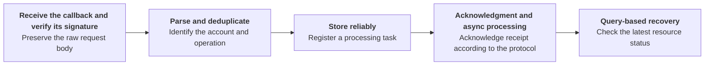
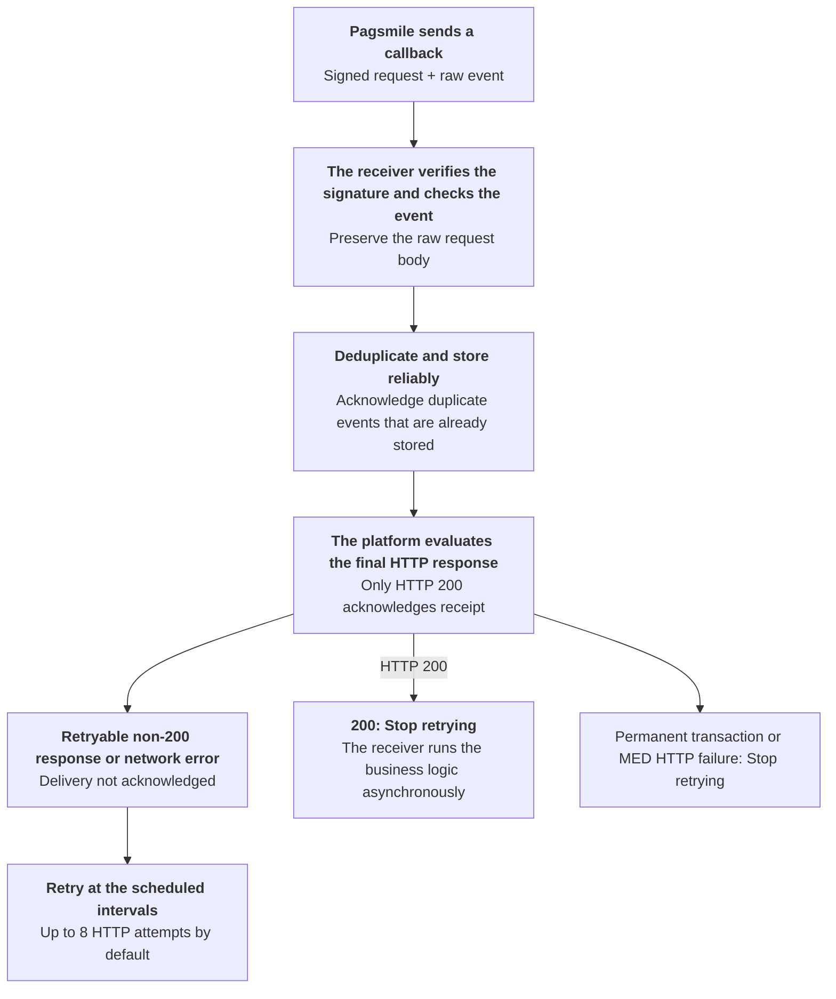

Manage event subscriptions, and receive and process notifications according to the callback protocol.

## API operations

| Operation | POST path |
| --- | --- |
| [Create event subscription](/api-reference/webhooks/create-event-subscription) | `/v3/webhooks/create` |
| [List event subscriptions](/api-reference/webhooks/list-event-subscriptions) | `/v3/webhooks/list` |
| [Get event subscription](/api-reference/webhooks/get-event-subscription) | `/v3/webhooks/get` |
| [Update event subscription](/api-reference/webhooks/update-event-subscription) | `/v3/webhooks/update` |
| [Deactivate event subscription](/api-reference/webhooks/deactivate-event-subscription) | `/v3/webhooks/delete` |

## Call sequence

After configuring the subscription and callback endpoint, follow this flow to receive and process events. For callback processing details, see [Webhook signature verification](/environments-and-credentials) and the delivery and retry rules below. <Badge color="orange" size="sm">Corrected · module-11-F06</Badge>

When you receive a callback, verify the request first as described in [Webhook signature verification](/environments-and-credentials). Then process the event.

For callback structures for incoming payment, outgoing payment, and refund events, ACCOUNT / USER delivery differences, and JSON examples, see [Transaction callbacks](/api-reference/webhooks/transaction-callbacks).

For `USER` scope, status descriptions, and callback examples for managed account compliance events, see [KYB callbacks](/api-reference/onboarding/kyb-callbacks). <Badge color="orange" size="sm">Corrected · module-11-F07</Badge>

## Webhook delivery and retries

Callbacks can arrive more than once or out of order. The diagram below distinguishes the platform's delivery rules from the recommended processing flow for the receiver. <Badge color="orange" size="sm">Corrected · module-11-F02</Badge>

Transaction `ACCOUNT` and `USER` callbacks and MED callbacks stop retrying after HTTP `400`, `401`, `403`, `404`, `405`, `406`, `410`, `414`, `415`, `422`, `431`, or `451`. HTTP `413` also stops retries unless it includes a valid `Retry-After` header. Other non-200 statuses retain the bounded retry policy. KYB callbacks retain their bounded retry policy for non-200 statuses.

### Acknowledgment and retry rules

- Only a final HTTP 200 response acknowledges receipt. The response body content does not determine success. However, a response-reading error or timeout counts as a delivery failure for transaction and MED callbacks, even if the response status is `200`. <Badge color="orange" size="sm">Corrected · module-11-F01</Badge> Responses with 201, 202, 204, or any other non-200 status, as well as network errors, count as failures. Return `200` after verifying the signature and reliably storing the event. Transaction and MED callback HTTP requests have a default timeout of 3 seconds, including response reading. Finish the acknowledgment promptly rather than waiting for business processing to complete. <Badge color="blue" size="sm">Added · module-11-F04</Badge> Process the event asynchronously afterward.
- Transaction, KYB, and MED deliveries with retries enabled default to a maximum of 8 attempts: the initial attempt plus 7 retries. MED retry intervals start when the previous HTTP request ends. The normal retry intervals are `5, 10, 20, 30, 60, 120, and 240 seconds`, in that order. For transaction `ACCOUNT` and `USER` callbacks and MED callbacks, HTTP `413` or `429` can include `Retry-After` as a non-negative integer number of seconds up to 900, or as an HTTP date no more than 900 seconds in the future. A valid value extends the delay only when it is longer than the normal interval. Invalid or missing values do not extend the delay; HTTP `413` without a valid value stops retries. KYB callbacks do not use this header to adjust their retry intervals. <Badge color="blue" size="sm">Added · module-11-F03</Badge>
- KYB and MED callbacks do not follow redirects. Transaction callbacks currently can follow supported redirects, and the final response determines success. Configure the final callback URL directly.

### Deduplication and out-of-order handling

- **Duplicate notifications:** Deduplicate by `delivery_id`. For transaction ACCOUNT callbacks, use the event type and `txn_id`. Return HTTP 200 for duplicate events that are already stored. Do not repeat processing.
- **Out-of-order or missing notifications:** Query the details to confirm the latest status. Check statement entries if needed. For MED updates, compare `resource_version` and track `stream_sequence` for each resource. For the same resource and subscription, a later delivery waits until the earlier delivery succeeds, fails permanently, or is cancelled. This does not eliminate gaps: query the resource details when an update is missing. <Badge color="blue" size="sm">Added · module-11-F08</Badge>
- **Subscription configuration:** Keep the subscription active. Avoid changing the configuration while delivery is pending. Pending `USER` transaction, KYB, and MED deliveries are cancelled if the subscription becomes inactive or no longer matches the subscription configuration saved for that delivery, including its callback URL and signing credential. `USER` transaction and `USER` MED deliveries also stop if the `USER` no longer has access to the account. <Badge color="blue" size="sm">Added · module-11-F05</Badge> If no callback URL matches when a transaction ACCOUNT notification is sent, HTTP retries are not scheduled automatically.

<Accordion title="Corrections to the source document (8)" icon="clipboard-check">
This page was checked against the Pagsmile Open API source code on 2026-11-10. Each change below is marked in the page with a badge that shows its ID.

| ID | Change | Location | Source document text | Updated text |
| --- | --- | --- | --- | --- |
| module-11-F01 | Corrected (did not match the code) | Acknowledgment and retry rules | The response body does not determine success. | The response body content does not determine success. However, a response-reading error or timeout counts as a delivery failure for transaction and MED callbacks, even if the response status is 200. |
| module-11-F02 | Corrected (did not match the code) | Webhook delivery and retries / delivery flow figure | [Figure: Webhook delivery and retry flow] labels: Pagsmile sends a callback \| The receiver verifies the signature and checks the event \| Deduplicate and store reliably \| The platform evaluates the final HTTP response \| Non-200 response or network error \| Retry at the scheduled intervals \| Signed request + raw event \| Preserve the raw request body \| Acknowledge duplicate events that are already stored \| Only HTTP 200 acknowledges receipt \| Delivery not acknowledged \| Up to 8 HTTP attempts by default \| 200: Stop retrying \| The receiver runs the business logic asynchronously | [Figure: Webhook delivery and retry flow] labels: Pagsmile sends a callback \| The receiver verifies the signature and checks the event \| Deduplicate and store reliably \| The platform evaluates the final HTTP response \| Retryable non-200 response or network error \| Retry at the scheduled intervals \| Signed request + raw event \| Preserve the raw request body \| Acknowledge duplicate events that are already stored \| Only HTTP 200 acknowledges receipt \| Delivery not acknowledged \| Up to 8 HTTP attempts by default \| 200: Stop retrying \| Permanent transaction or MED HTTP failure: Stop retrying \| The receiver runs the business logic asynchronously Transaction ACCOUNT and USER callbacks and MED callbacks stop retrying after HTTP 400, 401, 403, 404, 405, 406, 410, 414, 415, 422, 431, or 451. HTTP 413 also stops retries unless it includes a valid `Retry-After` header. Other non-200 statuses retain the bounded retry policy. KYB callbacks retain their bounded retry policy for non-200 statuses. |
| module-11-F03 | Added (missing in the source) | Acknowledgment and retry rules / retry intervals | The retry intervals are `5, 10, 20, 30, 60, 120, and 240 seconds`, in that order. | The normal retry intervals are `5, 10, 20, 30, 60, 120, and 240 seconds`, in that order. For transaction ACCOUNT and USER callbacks and MED callbacks, HTTP 413 or 429 can include `Retry-After` as a non-negative integer number of seconds up to 900, or as an HTTP date no more than 900 seconds in the future. A valid value extends the delay only when it is longer than the normal interval. Invalid or missing values do not extend the delay; HTTP 413 without a valid value stops retries. KYB callbacks do not use this header to adjust their retry intervals. |
| module-11-F04 | Added (missing in the source) | Acknowledgment and retry rules | Return 200 after verifying the signature and reliably storing the event. | Return 200 after verifying the signature and reliably storing the event. Transaction and MED callback HTTP requests have a default timeout of 3 seconds, including response reading. Finish the acknowledgment promptly rather than waiting for business processing to complete. |
| module-11-F05 | Added (missing in the source) | Deduplication and out-of-order handling / subscription configuration | Avoid changing the configuration while delivery is pending. | Avoid changing the configuration while delivery is pending. Pending USER transaction, KYB, and MED deliveries are cancelled if the subscription becomes inactive or no longer matches the subscription configuration saved for that delivery, including its callback URL and signing credential. USER transaction and USER MED deliveries also stop if the USER no longer has access to the account. |
| module-11-F06 | Corrected (did not match the code) | Call sequence | For callback processing details, see Create event subscription. | For callback processing details, see Webhook signature verification and the delivery and retry rules below. |
| module-11-F07 | Corrected (did not match the code) | Call sequence | For USER / PLATFORM scopes, status descriptions, and callback examples for compliance events, see KYB callbacks. | For USER scope, status descriptions, and callback examples for managed account compliance events, see KYB callbacks. |
| module-11-F08 | Added (missing in the source) | Deduplication and out-of-order handling | For MED updates, compare `resource_version`. | For MED updates, compare `resource_version` and track `stream_sequence` for each resource. For the same resource and subscription, a later delivery waits until the earlier delivery succeeds, fails permanently, or is cancelled. This does not eliminate gaps: query the resource details when an update is missing. |
</Accordion>
