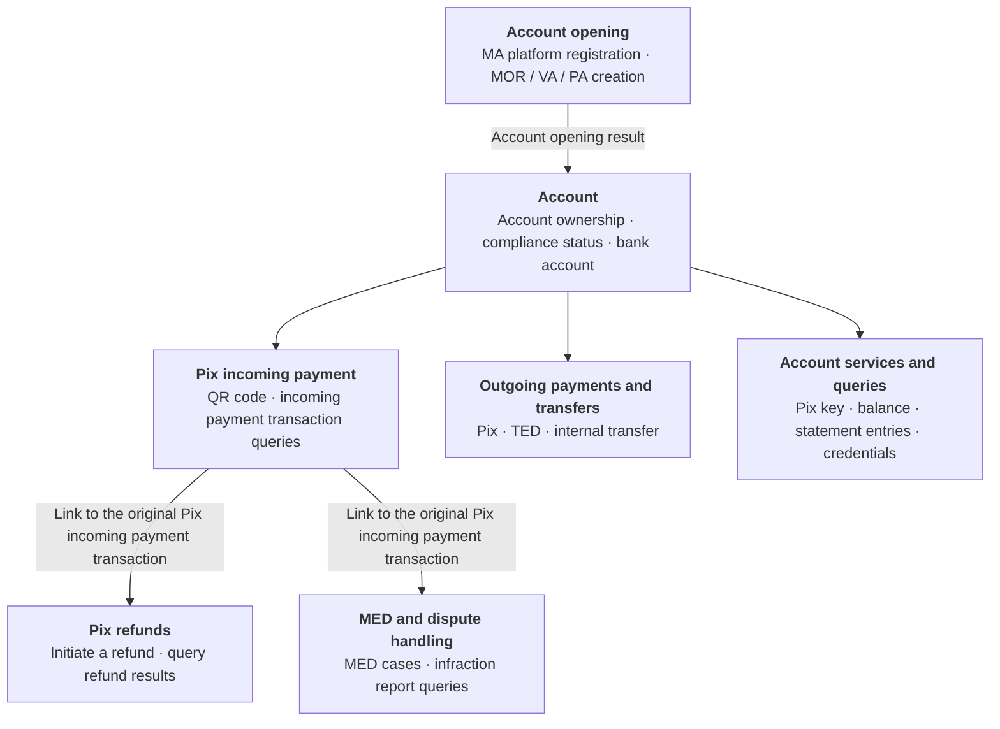

## Pagsmile overview

Pagsmile Open API integrates account and payment services into your systems. You can use the API to create managed accounts, query bank account information, manage Pix keys, and initiate payments and refunds. You can track the results through query endpoints and event notifications.

Operations use POST requests, JSON request bodies, and AK/SK signature authentication. Account permissions depend on the credential type, account ownership, and target account. For account and funds operations with `USER` credentials, send both `X-ISPB` and `X-Account-Number` to select an account within your authorized ownership scope. Account opening and event subscriptions follow their own account-selection rules; see [Account models and features](/account-models). <Badge color="blue" size="sm">Added · module-1-F01</Badge>

## Intended audience

Open API is for businesses and platforms that need to manage accounts, incoming and outgoing payments, and transaction results in their own systems. You can manage your own master account. Once you have managed account permissions, you can also create VAs or PAs for parties and manage their account details and transaction records separately.

Account opening management, account funds operations, and event subscriptions use different authorization scopes. Before integration, you must configure credentials for the features you need.

[Learn about MA, MOR, VA, and PA features](/account-models)

## Product capabilities

| Capability | Supported features |
| --- | --- |
| Account opening and management | MOR, VA, and PA creation and queries |
| Account and funds queries | Bank account information, balance, frozen amount, fees, limit configuration, and account statement entries |
| Pix Key | Key creation, queries for active keys linked to an account, and deletion |
| Incoming payment | Dynamic and static Pix QR code generation, QR code details, and Pix incoming payment detail queries |
| Outgoing payment | Pix key payments, Pix QR code payments, Pix payments using bank account details, TED payments using bank account details, and internal transfers within the same institution |
| Refund | Refunds of original Pix incoming payments and queries for refund details and status |
| Dispute handling | MED case creation, queries, and cancellation when eligible; infraction report queries |
| Event notifications | Event subscription management for Pix incoming and outgoing payments, refunds, and account compliance |

<Accordion title="How accounts relate to payment features">
- After account opening, confirm the account's compliance status and bank account readiness. Then use the account services and payment capabilities that have been enabled.
- Use the target account's authorization context for incoming payments, outgoing payments, and account queries. Account ownership does not mean balances are automatically aggregated.
- Pix refunds link to the original incoming payment transaction. MED cases must also link to the original Pix transaction. Each must meet its own conditions. Connecting lines indicate relationships between operations, not call sequence or cardinality.
- Webhooks notify you of changes based on the subscribed event types and scopes. Use them with detail, status, and statement entry queries to confirm processing results. MED callbacks are limited to the scope that has been enabled and delivered.
</Accordion>

## Core terminology

| Term | Meaning |
| --- | --- |
| MA / Master Account | Master account that establishes the party and ownership of managed accounts |
| Managed Account | Managed accounts, including MOR, VA, and PA |
| MOR | Operating account that reuses its parent MA's approved compliance records |
| VA | Managed account that must belong to a parent MA and has its own compliance records and bank account |
| PA | Payment account that must belong to a parent MA or a VA under that MA and has its own compliance records and bank account |
| PLATFORM / USER / ACCOUNT | Three API credential identities: platform, user, and account |
| ISPB | Bank participant identifier that identifies an account together with the account number |
| Pix Key | Identifier that points to a Pix payee account, distinct from API signing credentials |
| EndToEnd ID | Original Pix transaction ID, used to link transactions and for operations involving MED cases |
| Webhook | Notification method that sends business events to the integrator's callback URL |
| MED / Infraction | Pix special return mechanism and associated infraction reports |

<Accordion title="Corrections to the source document (1)" icon="clipboard-check">
This page was checked against the Pagsmile Open API source code on 2026-11-10. Each change below is marked in the page with a badge that shows its ID.

| ID | Change | Location | Source document text | Updated text |
| --- | --- | --- | --- | --- |
| module-1-F01 | Added (missing in the source) | Pagsmile overview; also introduction-1-1 | Account permissions depend on the credential type, account ownership, and target account. | Account permissions depend on the credential type, account ownership, and target account. For account and funds operations with USER credentials, send both `X-ISPB` and `X-Account-Number` to select an account within your authorized ownership scope. Account opening and event subscriptions follow their own account-selection rules; see Account models and features. |
</Accordion>
