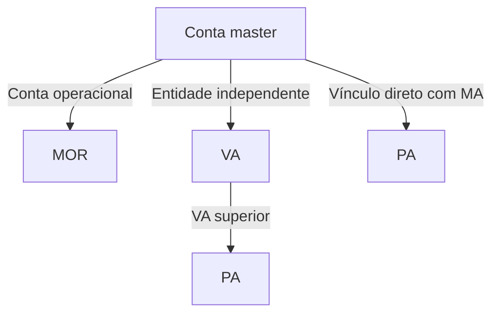

## Hierarquia de contas

MA é a conta master. MOR e VA pertencem diretamente à MA. A conta superior imediata de uma PA pode ser a MA ou uma VA sob a mesma MA. VA e PA não podem ser criadas sem uma conta superior.

## Funcionalidades e requisitos de abertura por tipo de conta

Após a ativação da conta, com a conta bancária pronta para uso e os serviços necessários habilitados, é possível consultar saldo e lançamentos do extrato, gerenciar chaves Pix, processar recebimentos e pagamentos, fazer devoluções e tratar contestações. Os recursos e as transações de cada conta são registrados separadamente. A hierarquia não implica a consolidação automática dos saldos.

| Conta | Exemplos de casos de uso | Como abrir uma conta | Dados necessários |
| --- | --- | --- | --- |
| MA: conta master | A empresa da plataforma atua como entidade responsável pela integração e gerencia suas próprias contas e as contas gerenciadas de seus comerciantes ou clientes | Conclua o cadastro, a verificação e a ativação da empresa pela plataforma. Veja Início rápido | Nome da empresa, CNPJ, dados de contato, dados das atividades e da composição societária, dados de verificação das pessoas relacionadas; envie os documentos exigidos pelo formulário |
| MOR: conta operacional | A mesma entidade da MA cria contas separadas para diferentes operações de negócio, por exemplo, para registrar separadamente os recebimentos e pagamentos das operações online e presenciais; as contas reutilizam os dados de conformidade da MA | Abra a conta com as credenciais de API do titular da conta master à qual ela pertence. O sistema vincula a conta automaticamente à conta master | ID de negócio da abertura de conta; o nome fantasia e o e-mail para notificações são opcionais. A conta reutiliza os dados de conformidade já aprovados da conta master. Para MOR, não envie método de análise, dados para análise da entidade, dados de sessão do provedor, URL de retorno nem seletor de conta superior <Badge color="blue" size="sm">Complementado · module-3-F03</Badge> |
| VA: conta gerenciada | A plataforma cria uma conta própria para cada comerciante pessoa jurídica com CNPJ que adere à plataforma, para acompanhar separadamente seus recebimentos, pagamentos e lançamentos do extrato | Abra a conta com as credenciais de API do titular da conta master à qual ela pertence. O sistema vincula a conta automaticamente à conta master | ID de negócio da abertura de conta, método de envio dos dados para análise, tipo de documento da pessoa jurídica (CNPJ), CNPJ e razão social. Conforme o método de análise escolhido, forneça dados detalhados, a URL de retorno após a conclusão da análise ou um registro de verificação existente |
| PA: conta de pagamento | A plataforma cria contas de pagamento para clientes pessoas físicas com CPF ou pessoas jurídicas com CNPJ. As operações na conta-alvo são iniciadas com as credenciais USER da MA à qual ela pertence. A conta de pagamento pode pertencer diretamente à MA ou a uma VA sob essa MA | Abra a conta com as credenciais `USER` da MA à qual ela pertence e defina essa MA ou uma VA diretamente sob ela como conta superior. A conta superior deve pertencer ao mesmo usuário titular, ter status `ACTIVE` e ter uma conta bancária ativa <Badge color="blue" size="sm">Complementado · module-3-F02</Badge> | ID de negócio da abertura de conta, método de envio dos dados para análise, tipo de documento da própria PA, CPF ou CNPJ e nome da pessoa física ou razão social. Forneça também o identificador da instituição participante e o número da conta superior. Complemente os dados conforme o método de análise |

VA e PA não precisam reenviar os dados da empresa da MA, mas devem fornecer os dados de sua própria entidade e concluir os processos de conformidade aplicáveis. Atualmente, a abertura de VA está disponível apenas para pessoas jurídicas com CNPJ. PA aceita pessoas físicas com CPF ou pessoas jurídicas com CNPJ.

Antes de criar uma conta gerenciada, confirme a configuração da tarifa de abertura de conta e a disponibilidade de recursos suficientes para pagar a tarifa aplicável. Uma falha na cobrança impede a conclusão da abertura de conta. Para requisitos técnicos de integração e exemplos de chamadas, consulte [Criar conta gerenciada](/pt-br/api-reference/onboarding/create-managed-account). <Badge color="blue" size="sm">Complementado · module-3-F05</Badge>

## Credenciais e seleção de conta

| Credenciais | Finalidade | Requisitos para seleção da conta |
| --- | --- | --- |
| Credenciais de API de nível de plataforma | Gerenciar assinaturas de eventos de conformidade de MA dentro do escopo de autorização | Não se destinam a operações financeiras em contas bancárias comuns; nenhuma conta é especificada para operações financeiras |
| Credenciais de API de nível de usuário | Abrir e consultar contas gerenciadas sob a MA à qual pertencem, movimentar recursos em contas autorizadas e gerenciar assinaturas de eventos de conformidade de contas gerenciadas e de eventos de transações de contas autorizadas <Badge color="blue" size="sm">Complementado · module-3-F04</Badge> | As credenciais determinam o escopo de gestão da abertura de contas. Para criar uma conta gerenciada, use as credenciais `USER` da MA à qual ela pertence, sem os cabeçalhos `X-ISPB` e `X-Account-Number`. O usuário titular deve ter a funcionalidade de contas gerenciadas habilitada e exatamente uma MA válida com status `ACTIVE` e conta bancária ativa. Para operações financeiras, informe o identificador da instituição participante e o número da conta que será usada na operação <Badge color="blue" size="sm">Complementado · module-3-F01</Badge> |
| Credenciais de API de nível de conta bancária | Operar a conta bancária MOR/VA vinculada às credenciais | Por padrão, as operações usam a conta bancária vinculada às credenciais; se uma conta for especificada, ela deve ser a conta vinculada. Essas credenciais não podem ser usadas para criar contas gerenciadas nem para operar contas PA |

A conta superior especificada na abertura é diferente da conta cujos recursos são usados na transação. Para iniciar uma transação de uma PA, deve ser especificada a conta bancária da própria PA.

## Exemplos de integração

### Modelos de conta: escolha pela titularidade dos recursos

No exemplo de venda de produtos, escolha conforme a titularidade dos recursos e a necessidade de abrir uma conta separada.

| Necessidades de negócio | Orientações de seleção |
| --- | --- |
| A empresa vende seus próprios produtos e centraliza os recebimentos | Conclua primeiro a integração da MA. Avalie a MOR se precisar reutilizar os registros de conformidade da MA para criar uma conta operacional. Compradores comuns não precisam abrir uma PA. |
| Abrir contas separadas para os comerciantes que ingressam na plataforma | Pessoas jurídicas podem avaliar a VA. Pessoas físicas ou jurídicas podem avaliar a PA conforme os requisitos de admissão. |
| Os compradores precisam ter sua própria conta para manter recursos | Avalie a PA e confirme separadamente as permissões para movimentações financeiras, como pagamentos e saques. |

A titularidade da conta não equivale à autorização para débito. A escolha final depende dos requisitos de admissão da parte e dos serviços habilitados.

<Accordion title="Correções em relação ao documento original (5)" icon="clipboard-check">
Esta página foi conferida com o código-fonte da Pagsmile Open API em 2026-11-10. Cada alteração abaixo está marcada na página com um selo que mostra o seu ID.

| ID | Alteração | Local | Texto do documento original | Texto atualizado |
| --- | --- | --- | --- | --- |
| module-3-F01 | Complementado (ausente no original) | Credentials and account selection / User-level API credentials | As credenciais determinam o escopo de gestão da abertura de contas; para operações financeiras, é obrigatório informar o identificador da instituição participante e o número da conta que será usada na operação | As credenciais determinam o escopo de gestão da abertura de contas. Para criar uma conta gerenciada, use as credenciais USER da MA à qual ela pertence, sem os cabeçalhos X-ISPB e X-Account-Number. O usuário titular deve ter a funcionalidade de contas gerenciadas habilitada e exatamente uma MA válida com status ACTIVE e conta bancária ativa. Para operações financeiras, informe o identificador da instituição participante e o número da conta que será usada na operação |
| module-3-F02 | Complementado (ausente no original) | Account features and opening requirements / PA payment account | Abra a conta com as credenciais de API do titular da conta master à qual ela pertence e defina essa conta master ou uma VA sob ela como conta superior | Abra a conta com as credenciais USER da MA à qual ela pertence e defina essa MA ou uma VA diretamente sob ela como conta superior. A conta superior deve pertencer ao mesmo usuário titular, ter status ACTIVE e ter uma conta bancária ativa |
| module-3-F03 | Complementado (ausente no original) | Account features and opening requirements / MOR operating account | ID de negócio da abertura de conta; o nome fantasia e o e-mail para notificações são opcionais. A conta reutiliza os dados de conformidade já aprovados da conta master, sem necessidade de enviar novos dados para análise da entidade | ID de negócio da abertura de conta; o nome fantasia e o e-mail para notificações são opcionais. A conta reutiliza os dados de conformidade já aprovados da conta master. Para MOR, não envie método de análise, dados para análise da entidade, dados de sessão do provedor, URL de retorno nem seletor de conta superior |
| module-3-F04 | Complementado (ausente no original) | Credentials and account selection / User-level API credentials | Abrir e consultar contas gerenciadas sob a MA à qual pertencem e movimentar recursos em contas autorizadas | Abrir e consultar contas gerenciadas sob a MA à qual pertencem, movimentar recursos em contas autorizadas e gerenciar assinaturas de eventos de conformidade de contas gerenciadas e de eventos de transações de contas autorizadas |
| module-3-F05 | Complementado (ausente no original) | Account features and opening requirements / after the account requirements table | Para requisitos técnicos de integração e exemplos de chamadas, consulte Criar conta gerenciada. | Antes de criar uma conta gerenciada, confirme a configuração da tarifa de abertura de conta e a disponibilidade de recursos suficientes para pagar a tarifa aplicável. Uma falha na cobrança impede a conclusão da abertura de conta. Para requisitos técnicos de integração e exemplos de chamadas, consulte Criar conta gerenciada. |
</Accordion>
