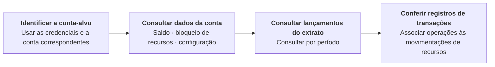

Consulte contas bancárias, saldos e lançamentos do extrato para gestão de contas e conciliação. Use credenciais de nível ACCOUNT para a conta vinculada a elas ou credenciais de nível USER com os cabeçalhos `X-ISPB` e `X-Account-Number` para uma conta dentro do seu escopo de autorização. Cada requisição consulta uma conta; a operação de subcontas não retorna uma lista de subcontas nem saldos agregados. Com credenciais de nível ACCOUNT, omita os dois cabeçalhos de seleção da conta ou informe ambos com valores correspondentes à conta vinculada. <Badge color="blue" size="sm">Complementado · module-5-F01</Badge>

## Operações da API

| Operação | Caminho POST |
| --- | --- |
| [Consultar saldo da conta](/pt-br/api-reference/accounts/get-account-balance) | `/v3/bank_account` |
| [Consultar extrato da conta](/pt-br/api-reference/accounts/get-account-statement) | `/v3/statements` |
| [Consultar subcontas e saldos](/pt-br/api-reference/accounts/get-subaccounts-and-balances) | `/v3/bank_account` |

## Sequência de chamadas

Consultar contas bancárias e saldos → Consultar os lançamentos do extrato da conta por período → Conferir os registros de transações e de movimentações de recursos. Os resultados do extrato são paginados. Omita `cursor` na primeira requisição e use o `cursor` e o `snapshot_timestamp` retornados para consultar as páginas seguintes com a mesma conta e os mesmos filtros. Continue até que nenhum cursor seja retornado antes de considerar que todo o período consultado foi recuperado. Se `page_size` for omitido, o padrão é 20; quando informado, deve estar entre 1 e 100. <Badge color="blue" size="sm">Complementado · module-5-F02</Badge>

Se não for possível consultar o snapshot do saldo, a consulta da conta ainda poderá retornar os dados da conta com o saldo, o valor disponível e os valores bloqueados definidos como `"0"`. A resposta não tem um indicador desses valores de fallback. Não considere uma única resposta com valores zerados como prova de saldo zero; consulte novamente e confira os lançamentos do extrato da conta e os registros de transações. <Badge color="blue" size="sm">Complementado · module-5-F03</Badge>

<Accordion title="Correções em relação ao documento original (3)" icon="clipboard-check">
Esta página foi conferida com o código-fonte da Pagsmile Open API em 2026-11-10. Cada alteração abaixo está marcada na página com um selo que mostra o seu ID.

| ID | Alteração | Local | Texto do documento original | Texto atualizado |
| --- | --- | --- | --- | --- |
| module-5-F01 | Complementado (ausente no original) | Introduction / account selection guidance | Consulte contas bancárias, saldos e lançamentos do extrato para gestão de contas e conciliação. | Consulte contas bancárias, saldos e lançamentos do extrato para gestão de contas e conciliação. Use credenciais de nível ACCOUNT para a conta vinculada a elas ou credenciais de nível USER com os cabeçalhos `X-ISPB` e `X-Account-Number` para uma conta dentro do seu escopo de autorização. Cada requisição consulta uma conta; a operação de subcontas não retorna uma lista de subcontas nem saldos agregados. Com credenciais de nível ACCOUNT, omita os dois cabeçalhos de seleção da conta ou informe ambos com valores correspondentes à conta vinculada. |
| module-5-F02 | Complementado (ausente no original) | Call sequence / statement reconciliation | Consultar contas bancárias e saldos → Consultar os lançamentos do extrato da conta por período → Conferir os registros de transações e de movimentações de recursos. | Consultar contas bancárias e saldos → Consultar os lançamentos do extrato da conta por período → Conferir os registros de transações e de movimentações de recursos. Os resultados do extrato são paginados. Omita `cursor` na primeira requisição e use o `cursor` e o `snapshot_timestamp` retornados para consultar as páginas seguintes com a mesma conta e os mesmos filtros. Continue até que nenhum cursor seja retornado antes de considerar que todo o período consultado foi recuperado. Se `page_size` for omitido, o padrão é 20; quando informado, deve estar entre 1 e 100. |
| module-5-F03 | Complementado (ausente no original) | Call sequence / balance interpretation | [Figure: Consulta de contas e recursos] labels: Identificar a conta-alvo \| Usar as credenciais e a conta correspondentes \| Consultar dados da conta \| Saldo · bloqueio de recursos · configuração \| Consultar lançamentos do extrato \| Consultar por período \| Conferir registros de transações \| Associar operações às movimentações de recursos | [Figure: Consulta de contas e recursos] labels: Identificar a conta-alvo \| Usar as credenciais e a conta correspondentes \| Consultar dados da conta \| Saldo · bloqueio de recursos · configuração \| Consultar lançamentos do extrato \| Consultar por período \| Conferir registros de transações \| Associar operações às movimentações de recursos Se não for possível consultar o snapshot do saldo, a consulta da conta ainda poderá retornar os dados da conta com o saldo, o valor disponível e os valores bloqueados definidos como `"0"`. A resposta não tem um indicador desses valores de fallback. Não considere uma única resposta com valores zerados como prova de saldo zero; consulte novamente e confira os lançamentos do extrato da conta e os registros de transações. |
</Accordion>
