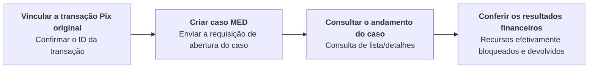

Crie, consulte ou cancele casos MED e consulte os registros de notificações de infração associados.

Use credenciais ACCOUNT para a conta autorizada ou credenciais USER com os dois cabeçalhos, `X-ISPB` e `X-Account-Number`, identificando uma conta à qual você tem autorização de acesso. Credenciais PLATFORM não são aceitas nessas operações. As consultas e o cancelamento de casos usam o contexto da conta do caso. Siga [Ambientes e credenciais](/pt-br/environments-and-credentials). <Badge color="blue" size="sm">Complementado · module-10-F01</Badge>

## Operações da API

| Operação | Caminho POST |
| --- | --- |
| [Criar caso MED](/pt-br/api-reference/med/create-med-case) | `/v3/med/create` |
| [Listar casos MED](/pt-br/api-reference/med/list-med-cases) | `/v3/med/list` |
| [Consultar detalhes do caso MED](/pt-br/api-reference/med/get-med-case-details) | `/v3/med/detail` |
| [Cancelar caso MED](/pt-br/api-reference/med/cancel-med-case) | `/v3/med/cancel` |
| [Listar notificações de infração](/pt-br/api-reference/med/list-infraction-reports) | `/v3/infractions/list` |
| [Consultar detalhes da notificação de infração](/pt-br/api-reference/med/get-infraction-report-details) | `/v3/infractions/detail` |

As consultas de notificações de infração usam o contexto autorizado da conta do recebedor da transação vinculada. O acesso ao caso MED do pagador não concede acesso às tarefas de notificação de infração ou de devolução do recebedor. As respostas de detalhes e de cancelamento do caso deixam `infractions`, `refunds` e `fund_dispositions` vazios; `timeline` também fica vazio quando existem tarefas vinculadas ou registros de movimentação de recursos. Use as operações de notificações de infração com o contexto da conta adequado para consultar as informações de notificação de infração e de bloqueio de recursos às quais você tem acesso. <Badge color="blue" size="sm">Complementado · module-10-F03</Badge>

## Sequência de chamadas

Identifique o pagamento Pix original pelo `end_to_end_id`, e não pelo ID interno da transação. A criação de um caso exige esse identificador e um `original_fraud_situation` válido: `1 SCAM`; `2 ACCOUNT_TAKEOVER`; `3 COERCION`; `4 SOCIAL_ENGINEERING`; `5 OTHER`; `6 UNKNOWN`. O valor `0 UNSPECIFIED` não é aceito. Você também pode informar `report_details`, `complaint_create_time` em milissegundos Unix UTC e a opção `automatic_refund`. Quando omitido, `automatic_refund` é `false`. Salve `data.med_case.case_id` da resposta de criação e use esse ID nas consultas de detalhes e no cancelamento. Consulte [Criar caso MED](/pt-br/api-reference/med/create-med-case) para ver os campos da requisição. <Badge color="blue" size="sm">Complementado · module-10-F02</Badge>

Uma consulta de detalhes do caso bem-sucedida pode retornar o último estado armazenado quando não for possível obter o status mais recente. Não interprete o sucesso da consulta como confirmação de que o caso avançou ou de que os recursos foram devolvidos; continue acompanhando o caso e confira os resultados financeiros separadamente. <Badge color="blue" size="sm">Complementado · module-10-F07</Badge>

Não é possível criar um novo caso MED quando a conta do pagador original está encerrada ou em processo de encerramento. <Badge color="blue" size="sm">Complementado · module-10-F08</Badge>

Para cancelar, consulte os detalhes mais recentes do caso e confirme que `can_cancel` é `true`. Os status de caso elegíveis são `1 CREATED`, `2 TRACKED`, `3 AWAITING_ANALYSIS` e `4 ANALYZED`; o cancelamento é rejeitado nos demais status. <Badge color="blue" size="sm">Complementado · module-10-F05</Badge> Depois, envie a requisição de cancelamento com `case_id`. Continue conferindo o caso e os resultados financeiros: a liberação dos recursos bloqueados pode ser concluída após a resposta de cancelamento. <Badge color="blue" size="sm">Complementado · module-10-F06</Badge>

Confirmar a transação Pix original → Criar caso MED → Consultar o andamento do caso → Conferir os resultados do bloqueio e da devolução de recursos.

A criação ou conclusão de um caso não confirma, por si só, que os recursos foram devolvidos. Confira `requested_amount`, `blocked_amount_total` e `returned_amount_total` separadamente e confirme qualquer devolução nos registros de movimentação de recursos correspondentes. Quando você tiver acesso aos detalhes da notificação de infração, diferencie `freeze_target_amount`, `freeze_effective_amount` e `freeze_shortfall_amount`. O bloqueio restringe a disponibilidade dos recursos; não representa uma devolução concluída. A opção de devolução automática não garante a recuperação integral dos recursos. <Badge color="blue" size="sm">Complementado · module-10-F04</Badge>

<Accordion title="Correções em relação ao documento original (8)" icon="clipboard-check">
Esta página foi conferida com o código-fonte da Pagsmile Open API em 2026-11-10. Cada alteração abaixo está marcada na página com um selo que mostra o seu ID.

| ID | Alteração | Local | Texto do documento original | Texto atualizado |
| --- | --- | --- | --- | --- |
| module-10-F01 | Complementado (ausente no original) | Introduction / add an account-context paragraph after the introductory sentence | Crie, consulte ou cancele casos MED e consulte os registros de notificações de infração associados. | Crie, consulte ou cancele casos MED e consulte os registros de notificações de infração associados. Use credenciais ACCOUNT para a conta autorizada ou credenciais USER com os dois cabeçalhos, `X-ISPB` e `X-Account-Number`, identificando uma conta à qual você tem autorização de acesso. Credenciais PLATFORM não são aceitas nessas operações. As consultas e o cancelamento de casos usam o contexto da conta do caso. Siga Ambientes e credenciais. |
| module-10-F02 | Complementado (ausente no original) | Call sequence / add a preparation paragraph before the figure | — | Identifique o pagamento Pix original pelo `end_to_end_id`, e não pelo ID interno da transação. A criação de um caso exige esse identificador e um `original_fraud_situation` válido: 1 SCAM; 2 ACCOUNT_TAKEOVER; 3 COERCION; 4 SOCIAL_ENGINEERING; 5 OTHER; 6 UNKNOWN. O valor 0 UNSPECIFIED não é aceito. Você também pode informar `report_details`, `complaint_create_time` em milissegundos Unix UTC e a opção `automatic_refund`. Quando omitido, `automatic_refund` é false. Salve `data.med_case.case_id` da resposta de criação e use esse ID nas consultas de detalhes e no cancelamento. Consulte Criar caso MED para ver os campos da requisição. |
| module-10-F03 | Complementado (ausente no original) | API operations / add an account-visibility note after the table | — | As consultas de notificações de infração usam o contexto autorizado da conta do recebedor da transação vinculada. O acesso ao caso MED do pagador não concede acesso às tarefas de notificação de infração ou de devolução do recebedor. As respostas de detalhes e de cancelamento do caso deixam `infractions`, `refunds` e `fund_dispositions` vazios; `timeline` também fica vazio quando existem tarefas vinculadas ou registros de movimentação de recursos. Use as operações de notificações de infração com o contexto da conta adequado para consultar as informações de notificação de infração e de bloqueio de recursos às quais você tem acesso. |
| module-10-F04 | Complementado (ausente no original) | Call sequence / add an outcomes paragraph after the final sequence | — | A criação ou conclusão de um caso não confirma, por si só, que os recursos foram devolvidos. Confira `requested_amount`, `blocked_amount_total` e `returned_amount_total` separadamente e confirme qualquer devolução nos registros de movimentação de recursos correspondentes. Quando você tiver acesso aos detalhes da notificação de infração, diferencie `freeze_target_amount`, `freeze_effective_amount` e `freeze_shortfall_amount`. O bloqueio restringe a disponibilidade dos recursos; não representa uma devolução concluída. A opção de devolução automática não garante a recuperação integral dos recursos. |
| module-10-F05 | Complementado (ausente no original) | Call sequence / cancellation sentence in the figure | Para cancelar, consulte primeiro o status do caso e confirme se ele atende às condições de cancelamento. | Para cancelar, consulte os detalhes mais recentes do caso e confirme que `can_cancel` é true. Os status de caso elegíveis são 1 CREATED, 2 TRACKED, 3 AWAITING_ANALYSIS e 4 ANALYZED; o cancelamento é rejeitado nos demais status. |
| module-10-F06 | Complementado (ausente no original) | Call sequence / final cancellation sentence in the figure | Depois, envie a requisição de cancelamento. | Depois, envie a requisição de cancelamento com `case_id`. Continue conferindo o caso e os resultados financeiros: a liberação dos recursos bloqueados pode ser concluída após a resposta de cancelamento. |
| module-10-F07 | Complementado (ausente no original) | Call sequence / add a progress-query caveat after the preparation paragraph | — | Uma consulta de detalhes do caso bem-sucedida pode retornar o último estado armazenado quando não for possível obter o status mais recente. Não interprete o sucesso da consulta como confirmação de que o caso avançou ou de que os recursos foram devolvidos; continue acompanhando o caso e confira os resultados financeiros separadamente. |
| module-10-F08 | Complementado (ausente no original) | Call sequence / add a case-initiation prerequisite before the figure | — | Não é possível criar um novo caso MED quando a conta do pagador original está encerrada ou em processo de encerramento. |
</Accordion>
