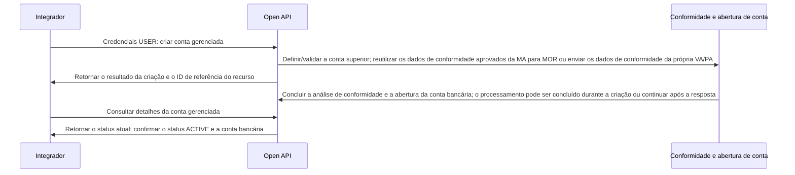

Gerencie a abertura e a consulta de contas MOR, VA e PA. Consulte os requisitos de dados e as descrições dos status em cada endpoint.

## Operações da API

| Operação | Caminho POST |
| --- | --- |
| [Criar conta gerenciada](/pt-br/api-reference/onboarding/create-managed-account) | `/v3/onboarding/managed_accounts/create` |
| [Consultar detalhes da conta gerenciada](/pt-br/api-reference/onboarding/get-managed-account) | `/v3/onboarding/managed_accounts/detail` |
| [Listar contas gerenciadas](/pt-br/api-reference/onboarding/list-managed-accounts) | `/v3/onboarding/managed_accounts/list` |

## Sequência de chamadas

*Abertura de conta gerenciada: criação, análise de conformidade e confirmação de status* <Badge color="orange" size="sm">Corrigido · module-4-F01</Badge>

- Cadastre uma MA na plataforma Banking e conclua a análise de conformidade e a abertura da conta bancária. Antes de criar uma conta gerenciada, confirme que o `USER` titular tem a funcionalidade de contas gerenciadas habilitada e exatamente uma MA válida com status `ACTIVE` e uma conta bancária ativa. <Badge color="blue" size="sm">Complementado · module-4-F02</Badge>
- Use as credenciais do `USER` titular para criar MOR/VA/PA e consulte o status de abertura de cada conta. Não inclua cabeçalhos de seleção da conta bancária ao chamar as operações de criação, consulta de detalhes ou listagem. <Badge color="blue" size="sm">Complementado · module-4-F03</Badge>

No onboarding de VA/PA com link hospedado, encaminhe o solicitante da abertura da conta ao `verification_url` retornado para concluir o envio dos dados obrigatórios. O status de conformidade `PENDING_SUBMISSION` indica que esse envio ainda é necessário; consultar a conta não conclui essa etapa. Continue consultando os detalhes da conta gerenciada para confirmar o resultado da abertura. <Badge color="blue" size="sm">Complementado · module-4-F04</Badge>

<Accordion title="Correções em relação ao documento original (4)" icon="clipboard-check">
Esta página foi conferida com o código-fonte da Pagsmile Open API em 2026-11-10. Cada alteração abaixo está marcada na página com um selo que mostra o seu ID.

| ID | Alteração | Local | Texto do documento original | Texto atualizado |
| --- | --- | --- | --- | --- |
| module-4-F01 | Corrigido (não correspondia ao código) | Call sequence / figure | [Figure: Abertura de conta gerenciada: criação, análise de conformidade e confirmação de status] labels: Integrador \| Open API \| Conformidade e abertura de conta \| Credenciais USER: criar conta gerenciada \| Definir/validar a conta superior e enviar os dados de conformidade \| Retornar o resultado da criação e o identificador do recurso \| Processar de forma assíncrona a conformidade e a abertura da conta bancária \| Consultar detalhes da conta gerenciada \| Retornar o status atual; confirmar o status ACTIVE e a conta bancária | [Figure: Abertura de conta gerenciada: criação, análise de conformidade e confirmação de status] labels: Integrador \| Open API \| Conformidade e abertura de conta \| Credenciais USER: criar conta gerenciada \| Definir/validar a conta superior; reutilizar os dados de conformidade aprovados da MA para MOR ou enviar os dados de conformidade da própria VA/PA \| Retornar o resultado da criação e o ID de referência do recurso \| Concluir a análise de conformidade e a abertura da conta bancária; o processamento pode ser concluído durante a criação ou continuar após a resposta \| Consultar detalhes da conta gerenciada \| Retornar o status atual; confirmar o status ACTIVE e a conta bancária |
| module-4-F02 | Complementado (ausente no original) | Call sequence / first prerequisite bullet | Cadastre uma MA na plataforma Banking e confirme que as condições para abertura de conta gerenciada foram atendidas. | Cadastre uma MA na plataforma Banking e conclua a análise de conformidade e a abertura da conta bancária. Antes de criar uma conta gerenciada, confirme que o USER titular tem a funcionalidade de contas gerenciadas habilitada e exatamente uma MA válida com status ACTIVE e uma conta bancária ativa. |
| module-4-F03 | Complementado (ausente no original) | Call sequence / USER-credentials bullet | Use as credenciais USER correspondentes para criar VA/PA e consulte o status de abertura de cada conta. | Use as credenciais do USER titular para criar MOR/VA/PA e consulte o status de abertura de cada conta. Não inclua cabeçalhos de seleção da conta bancária ao chamar as operações de criação, consulta de detalhes ou listagem. |
| module-4-F04 | Complementado (ausente no original) | Call sequence / add a paragraph after the USER-credentials bullet | — | No onboarding de VA/PA com link hospedado, encaminhe o solicitante da abertura da conta ao verification_url retornado para concluir o envio dos dados obrigatórios. O status de conformidade PENDING_SUBMISSION indica que esse envio ainda é necessário; consultar a conta não conclui essa etapa. Continue consultando os detalhes da conta gerenciada para confirmar o resultado da abertura. |
</Accordion>
