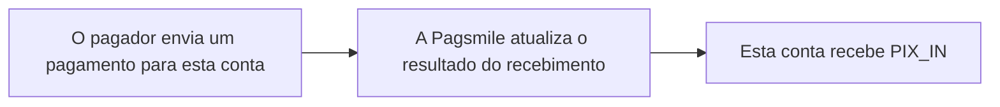

## Funcionamento e tratamento

Esta conta, como recebedor, recebe notificações de recebimentos Pix bem-sucedidos para atualizar os pedidos de recebimento e conferir as transações creditadas em conta. <Badge color="orange" size="sm">Corrigido · payin-transaction-webhooks-F15</Badge> O evento indica entrada de recursos nesta conta.



## Eventos e direção do fluxo de recursos

| Valor da assinatura de eventos | Nome do evento | Casos de uso |
| --- | --- | --- |
| 1 · PIX_IN | PIX_PAYMENT_IN | Atualize o pedido após receber um Pix e confira os detalhes da transação. |

Use `1 / PIX_IN` na assinatura de eventos de recebimento. O corpo do callback não contém `event_type` no nível superior. Identifique as notificações de recebimentos Pix pela configuração da assinatura de eventos de recebimento em conjunto com `txn_type=TXN_TYPE_PAYMENT`, `payment_method=PAYMENT_METHOD_PIX` e `flow_type=FLOW_TYPE_IN`. Não exija `flow_direction`: esse campo não é preenchido nesses callbacks. <Badge color="orange" size="sm">Corrigido · payin-transaction-webhooks-F01</Badge>

## Diferenças de entrega entre ACCOUNT e USER

| Escopo | Destino da entrega | Identificador de deduplicação |
| --- | --- | --- |
| ACCOUNT | Configuração ativa de conta que corresponde ao evento de recebimento Pix (PIX_IN), ao ISPB e ao número da conta. | Não contém `delivery_id`. Use "Tipo de evento da assinatura de eventos + `txn_id`" para deduplicação. <Badge color="orange" size="sm">Corrigido · payin-transaction-webhooks-F14</Badge> |
| USER | Assinatura de eventos ativa que pertence ao `USER` titular da conta recebedora e corresponde ao evento de recebimento Pix (`PIX_IN`). Antes de cada tentativa de entrega, a titularidade da conta e a configuração da assinatura de eventos são verificadas novamente. A entrega é cancelada se a titularidade da conta não corresponder mais ao `USER`, se a assinatura de eventos estiver inativa ou se sua configuração ou credencial de assinatura tiver mudado. <Badge color="blue" size="sm">Complementado · payin-transaction-webhooks-F13</Badge> | Contém delivery_id, que permanece inalterado nas novas tentativas da mesma entrega. |

## Exemplo JSON

A seguir, um exemplo de callback USER de recebimento Pix enviado a esta conta. `payee` é esta conta, e a direção do fluxo de recursos é IN. Os identificadores e valores do exemplo são fictícios. Nos callbacks reais, os campos não preenchidos e os campos com valores padrão são omitidos, incluindo strings vazias, timestamps iguais a zero e valores de enum não especificados. Considere um campo ausente como não informado para aquele evento. <Badge color="blue" size="sm">Complementado · payin-transaction-webhooks-F03</Badge> ACCOUNT usa a estrutura de transação do mesmo cenário, mas sem `delivery_id`. <Badge color="orange" size="sm">Corrigido · payin-transaction-webhooks-F02</Badge>

Os valores de status/enum e os timestamps int64 são strings. `created_at` indica o momento de início da transação, e `completed_at`, o momento de conclusão; ambos usam timestamps Unix em milissegundos. <Badge color="blue" size="sm">Complementado · payin-transaction-webhooks-F04</Badge> Os valores monetários permanecem como strings decimais. O callback não é uma resposta REST no formato `code/message/data`.

<ResponseField name="payer.document_id" type="string">
  Opcional. CPF ou CNPJ do pagador. Pode ser mascarado conforme a configuração de mascaramento de documentos.
</ResponseField>

<ResponseField name="payee.document_id" type="string">
  Opcional. CPF ou CNPJ do recebedor. Pode ser mascarado conforme a configuração de mascaramento de documentos.
</ResponseField>

<ResponseField name="payer.document_type" type="string">
  Opcional. Nome do enum de tipo de documento: `DOCUMENT_TYPE_CPF` ou `DOCUMENT_TYPE_CNPJ`.
</ResponseField>

<ResponseField name="payee.document_type" type="string">
  Opcional. Nome do enum de tipo de documento: `DOCUMENT_TYPE_CPF` ou `DOCUMENT_TYPE_CNPJ`.
</ResponseField>

<ResponseField name="payer.bank_account_type" type="string">
  Opcional. Nome do enum de tipo de conta bancária: `BANK_ACCOUNT_TYPE_CHECKING`, `BANK_ACCOUNT_TYPE_SALARY`, `BANK_ACCOUNT_TYPE_SAVINGS`, `BANK_ACCOUNT_TYPE_PAYMENT`, `BANK_ACCOUNT_TYPE_TRANSCTIONAL_PI`, `BANK_ACCOUNT_TYPE_GUARANTEED` ou `BANK_ACCOUNT_TYPE_DEPOSIT`.
</ResponseField>

<ResponseField name="payee.bank_account_type" type="string">
  Opcional. Nome do enum de tipo de conta bancária: `BANK_ACCOUNT_TYPE_CHECKING`, `BANK_ACCOUNT_TYPE_SALARY`, `BANK_ACCOUNT_TYPE_SAVINGS`, `BANK_ACCOUNT_TYPE_PAYMENT`, `BANK_ACCOUNT_TYPE_TRANSCTIONAL_PI`, `BANK_ACCOUNT_TYPE_GUARANTEED` ou `BANK_ACCOUNT_TYPE_DEPOSIT`.
</ResponseField>

<ResponseField name="payer.bank_branch" type="string">
  Opcional. Código da agência do pagador.
</ResponseField>

<ResponseField name="payee.bank_branch" type="string">
  Opcional. Código da agência do recebedor.
</ResponseField>

<ResponseField name="payer.bank_name" type="string">
  Opcional. Nome do banco do pagador.
</ResponseField>

<ResponseField name="payee.bank_name" type="string">
  Opcional. Nome do banco do recebedor. <Badge color="blue" size="sm">Complementado · payin-transaction-webhooks-F05</Badge>
</ResponseField>

<ResponseField name="refunded_amount" type="string">
  Opcional. Valor já devolvido, como string decimal. Omitido quando não informado; `"0"` é um valor informado como string, não um zero numérico omitido. <Badge color="blue" size="sm">Complementado · payin-transaction-webhooks-F07</Badge>
</ResponseField>

<ResponseField name="pix_details" type="object">
  Opcional. Detalhes específicos do Pix, quando disponíveis. Os campos não preenchidos são omitidos.
</ResponseField>

<ResponseField name="pix_details.pix_key" type="string">
  Opcional. Chave Pix associada à transação.
</ResponseField>

<ResponseField name="pix_details.pix_key_type" type="string">
  Opcional. Nome do enum de tipo de chave Pix: `PIX_KEY_TYPE_CPF`, `PIX_KEY_TYPE_CNPJ`, `PIX_KEY_TYPE_EMAIL`, `PIX_KEY_TYPE_PHONE` ou `PIX_KEY_TYPE_EVP`.
</ResponseField>

<ResponseField name="pix_details.qr_code_id" type="string">
  Opcional. ID do QR Code associado, quando disponível.
</ResponseField>

<ResponseField name="pix_details.qr_code_memo" type="string">
  Opcional. Observação do QR Code associado, quando disponível. <Badge color="blue" size="sm">Complementado · payin-transaction-webhooks-F09</Badge>
</ResponseField>

<ResponseField name="merchant_order_id" type="string">
  Opcional. No callback de recebimento, ID do pedido do comerciante informado no QR Code associado. Corresponde a `request_merchant_order_id`. Omitido quando essa referência do pedido do QR Code não está disponível.
</ResponseField>

<ResponseField name="request_merchant_order_id" type="string">
  Opcional. ID do pedido do comerciante informado no QR Code associado, quando disponível. Pode ser omitido em pagamentos sem referência de pedido no QR Code ou quando essa referência não pode ser consultada. <Badge color="blue" size="sm">Complementado · payin-transaction-webhooks-F11</Badge>
</ResponseField>

<Accordion title="Recebimentos Pix · USER" defaultOpen>
```json
{
  "delivery_id": "0000000000000000000000000000000000000000000000000000000000000001",
  "payer": {
    "name": "Demo Payer",
    "bank_account": "00098765",
    "bank_code": "87654321"
  },
  "payee": {
    "name": "Demo Merchant",
    "bank_account": "00012345",
    "bank_code": "12345678"
  },
  "txn_id": "PIX-IN-001",
  "settlement_txn_id": "SET-PAYMENT-IN-001",
  "txn_status": "TXN_STATUS_COMPLETED",
  "amount": "100.00",
  "currency": "BRL",
  "txn_type": "TXN_TYPE_PAYMENT",
  "payment_method": "PAYMENT_METHOD_PIX",
  "created_at": "1710000000000",
  "completed_at": "1710000005000",
  "flow_type": "FLOW_TYPE_IN",
  "merchant_order_id": "ORDER-IN-001",
  "request_merchant_order_id": "ORDER-IN-001",
  "pix_details": {
    "pix_key": "merchant@example.com",
    "pix_key_type": "PIX_KEY_TYPE_EMAIL",
    "qr_code_id": "QR-IN-001"
  }
}
```
</Accordion>

<Accordion title="Correções em relação ao documento original (11)" icon="clipboard-check">
Esta página foi conferida com o código-fonte da Pagsmile Open API em 2026-11-10. Cada alteração abaixo está marcada na página com um selo que mostra o seu ID.

| ID | Alteração | Local | Texto do documento original | Texto atualizado |
| --- | --- | --- | --- | --- |
| payin-transaction-webhooks-F01 | Corrigido (não correspondia ao código) | Events and funds flow direction | Identifique as notificações de recebimentos Pix pela configuração da assinatura de eventos de recebimento em conjunto com `txn_type=TXN_TYPE_PAYMENT`, `payment_method=PAYMENT_METHOD_PIX` e `flow_direction=FLOW_DIRECTION_IN`. | Identifique as notificações de recebimentos Pix pela configuração da assinatura de eventos de recebimento em conjunto com `txn_type=TXN_TYPE_PAYMENT`, `payment_method=PAYMENT_METHOD_PIX` e `flow_type=FLOW_TYPE_IN`. Não exija `flow_direction`: esse campo não é preenchido nesses callbacks. |
| payin-transaction-webhooks-F02 | Corrigido (não correspondia ao código) | JSON example / Incoming Pix payments · USER | `{ "delivery_id": "0000000000000000000000000000000000000000000000000000000000000001", "payer": { "name": "Demo Payer", "bank_account": "00098765", "bank_code": "87654321" }, "payee": { "name": "Demo Merchant", "bank_account": "00012345", "bank_code": "12345678" }, "txn_id": "PIX-IN-001", "settlement_txn_id": "SET-PAYMENT-IN-001", "txn_status": "TXN_STATUS_COMPLETED", "amount": "100.00", "currency": "BRL", "txn_type": "TXN_TYPE_PAYMENT", "payment_method": "PAYMENT_METHOD_PIX", "created_at": "1710000000000", "completed_at": "1710000005000", "flow_type": "FLOW_TYPE_IN", "flow_direction": "FLOW_DIRECTION_IN", "merchant_order_id": "ORDER-IN-001", "request_merchant_order_id": "ORDER-IN-001" }` | `{ "delivery_id": "0000000000000000000000000000000000000000000000000000000000000001", "payer": { "name": "Demo Payer", "bank_account": "00098765", "bank_code": "87654321" }, "payee": { "name": "Demo Merchant", "bank_account": "00012345", "bank_code": "12345678" }, "txn_id": "PIX-IN-001", "settlement_txn_id": "SET-PAYMENT-IN-001", "txn_status": "TXN_STATUS_COMPLETED", "amount": "100.00", "currency": "BRL", "txn_type": "TXN_TYPE_PAYMENT", "payment_method": "PAYMENT_METHOD_PIX", "created_at": "1710000000000", "completed_at": "1710000005000", "flow_type": "FLOW_TYPE_IN", "merchant_order_id": "ORDER-IN-001", "request_merchant_order_id": "ORDER-IN-001", "pix_details": { "pix_key": "merchant@example.com", "pix_key_type": "PIX_KEY_TYPE_EMAIL", "qr_code_id": "QR-IN-001" } }` |
| payin-transaction-webhooks-F03 | Complementado (ausente no original) | JSON example / serialization guidance | Nos callbacks reais, os campos opcionais podem ser omitidos. | Nos callbacks reais, os campos não preenchidos e os campos com valores padrão são omitidos, incluindo strings vazias, timestamps iguais a zero e valores de enum não especificados. Considere um campo ausente como não informado para aquele evento. |
| payin-transaction-webhooks-F04 | Complementado (ausente no original) | JSON example / serialization guidance | Os valores de status/enum e os timestamps int64 são strings. | Os valores de status/enum e os timestamps int64 são strings. `created_at` indica o momento de início da transação, e `completed_at`, o momento de conclusão; ambos usam timestamps Unix em milissegundos. |
| payin-transaction-webhooks-F05 | Complementado (ausente no original) | JSON example / add callback fields table before the example | — | `payer.document_id` \| string \| Opcional \| CPF ou CNPJ do pagador. Pode ser mascarado conforme a configuração de mascaramento de documentos. `payee.document_id` \| string \| Opcional \| CPF ou CNPJ do recebedor. Pode ser mascarado conforme a configuração de mascaramento de documentos. `payer.document_type` \| string \| Opcional \| Nome do enum de tipo de documento: `DOCUMENT_TYPE_CPF` ou `DOCUMENT_TYPE_CNPJ`. `payee.document_type` \| string \| Opcional \| Nome do enum de tipo de documento: `DOCUMENT_TYPE_CPF` ou `DOCUMENT_TYPE_CNPJ`. `payer.bank_account_type` \| string \| Opcional \| Nome do enum de tipo de conta bancária: `BANK_ACCOUNT_TYPE_CHECKING`, `BANK_ACCOUNT_TYPE_SALARY`, `BANK_ACCOUNT_TYPE_SAVINGS`, `BANK_ACCOUNT_TYPE_PAYMENT`, `BANK_ACCOUNT_TYPE_TRANSCTIONAL_PI`, `BANK_ACCOUNT_TYPE_GUARANTEED` ou `BANK_ACCOUNT_TYPE_DEPOSIT`. `payee.bank_account_type` \| string \| Opcional \| Nome do enum de tipo de conta bancária: `BANK_ACCOUNT_TYPE_CHECKING`, `BANK_ACCOUNT_TYPE_SALARY`, `BANK_ACCOUNT_TYPE_SAVINGS`, `BANK_ACCOUNT_TYPE_PAYMENT`, `BANK_ACCOUNT_TYPE_TRANSCTIONAL_PI`, `BANK_ACCOUNT_TYPE_GUARANTEED` ou `BANK_ACCOUNT_TYPE_DEPOSIT`. `payer.bank_branch` \| string \| Opcional \| Código da agência do pagador. `payee.bank_branch` \| string \| Opcional \| Código da agência do recebedor. `payer.bank_name` \| string \| Opcional \| Nome do banco do pagador. `payee.bank_name` \| string \| Opcional \| Nome do banco do recebedor. |
| payin-transaction-webhooks-F07 | Complementado (ausente no original) | JSON example / new callback fields table | — | `refunded_amount` \| string \| Opcional \| Valor já devolvido, como string decimal. Omitido quando não informado; `"0"` é um valor informado como string, não um zero numérico omitido. |
| payin-transaction-webhooks-F09 | Complementado (ausente no original) | JSON example / new callback fields table | — | `pix_details` \| object \| Opcional \| Detalhes específicos do Pix, quando disponíveis. Os campos não preenchidos são omitidos. `pix_details.pix_key` \| string \| Opcional \| Chave Pix associada à transação. `pix_details.pix_key_type` \| string \| Opcional \| Nome do enum de tipo de chave Pix: `PIX_KEY_TYPE_CPF`, `PIX_KEY_TYPE_CNPJ`, `PIX_KEY_TYPE_EMAIL`, `PIX_KEY_TYPE_PHONE` ou `PIX_KEY_TYPE_EVP`. `pix_details.qr_code_id` \| string \| Opcional \| ID do QR Code associado, quando disponível. `pix_details.qr_code_memo` \| string \| Opcional \| Observação do QR Code associado, quando disponível. |
| payin-transaction-webhooks-F11 | Complementado (ausente no original) | JSON example / new callback fields table | — | `merchant_order_id` \| string \| Opcional \| No callback de recebimento, ID do pedido do comerciante informado no QR Code associado. Corresponde a `request_merchant_order_id`. Omitido quando essa referência do pedido do QR Code não está disponível. `request_merchant_order_id` \| string \| Opcional \| ID do pedido do comerciante informado no QR Code associado, quando disponível. Pode ser omitido em pagamentos sem referência de pedido no QR Code ou quando essa referência não pode ser consultada. |
| payin-transaction-webhooks-F13 | Complementado (ausente no original) | ACCOUNT / USER delivery differences / USER delivery target cell | Assinatura de eventos ativa que pertence ao USER e corresponde ao evento de recebimento Pix (PIX_IN). | Assinatura de eventos ativa que pertence ao USER titular da conta recebedora e corresponde ao evento de recebimento Pix (PIX_IN). Antes de cada tentativa de entrega, a titularidade da conta e a configuração da assinatura de eventos são verificadas novamente. A entrega é cancelada se a titularidade da conta não corresponder mais ao USER, se a assinatura de eventos estiver inativa ou se sua configuração ou credencial de assinatura tiver mudado. |
| payin-transaction-webhooks-F14 | Corrigido (não correspondia ao código) | Diferenças de entrega entre ACCOUNT e USER / ACCOUNT deduplication cell | Não contém delivery_id. Use "Tipo de evento da assinatura + txn_id" para deduplicação. | Não contém delivery_id. Use "Tipo de evento da assinatura de eventos + txn_id" para deduplicação. |
| payin-transaction-webhooks-F15 | Corrigido (não correspondia ao código) | Funcionamento e tratamento | Esta conta, como Payee (recebedor), recebe notificações de recebimentos Pix bem-sucedidos para atualizar os pedidos de recebimento e conferir as transações creditadas em conta. | Esta conta, como recebedor, recebe notificações de recebimentos Pix bem-sucedidos para atualizar os pedidos de recebimento e conferir as transações creditadas em conta. |
</Accordion>
