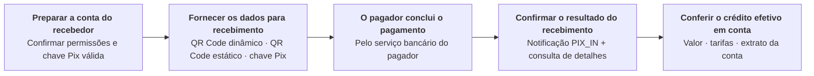
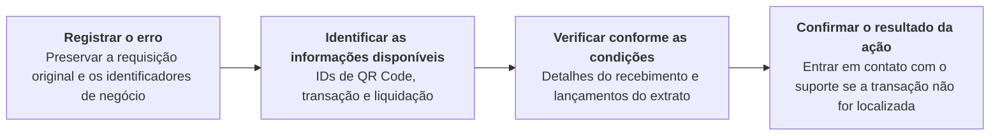

Receba pagamentos por QR Code dinâmico, QR Code estático ou chave Pix e consulte o resultado real do recebimento.

## Operações da API

| Operação | Caminho POST |
| --- | --- |
| [Gerar QR Code dinâmico](/pt-br/api-reference/payin/generate-dynamic-qr-code) | `/v3/qr_code/generate/dynamic` |
| [Gerar QR Code estático](/pt-br/api-reference/payin/generate-static-qr-code) | `/v3/qr_code/generate/static` |
| [Consultar detalhes do QR Code](/pt-br/api-reference/payin/get-qr-code-details) | `/v3/qr_code/details` |
| [Consultar detalhes da transação](/pt-br/api-reference/payin/get-transaction-details) | `/v3/charges/details` |

## Sequência de chamadas

- Confirme que a conta do recebedor está pronta e obtenha uma chave Pix ativa pertencente a essa conta. A geração de QR Code estático exige uma chave EVP (chave Pix aleatória). <Badge color="blue" size="sm">Complementado · module-7-F02</Badge>
- Gere um QR Code dinâmico ou estático conforme o cenário, ou forneça diretamente a chave Pix. Para recebimentos por QR Code, salve o ID do QR Code e o ID do pedido do comerciante.
- O pagador conclui o pagamento Pix pelo serviço bancário.
- Receba a notificação `PIX_IN`, obtenha `txn_id` ou `settlement_txn_id` do callback e consulte os detalhes do recebimento. Envie o `txn_id` do callback como `txn_id`, ou o `settlement_txn_id` como `settlement_id`, na requisição de detalhes da transação. Consulte [Callbacks de recebimentos Pix](/pt-br/api-reference/payin/callbacks) para ver a estrutura do callback. <Badge color="blue" size="sm">Complementado · module-7-F04</Badge> A consulta de detalhes do QR Code fornece informações do QR Code e pode incluir a transação associada mais recente em `last_txn`. Use o `txn_id` ou `settlement_id` dessa transação para consultar os detalhes do recebimento; os detalhes do QR Code não substituem os detalhes da transação nem a conferência dos lançamentos do extrato da conta. <Badge color="orange" size="sm">Corrigido · module-7-F01</Badge>
- Confira o status da transação, o valor, as tarifas e os lançamentos do extrato da conta para confirmar o crédito efetivo em conta.

## Cenários de erro

A seguir está o fluxo recomendado para o integrador. A ausência de notificação ou o timeout da requisição não significam, por si só, que o recebimento falhou. Primeiro, diferencie um erro na geração do QR Code de um crédito em conta ainda não confirmado.

| Cenários de erro | Verificações e ações |
| --- | --- |
| Timeout na requisição de geração do QR Code ou perda da resposta | Se tiver salvo o qr_code_id, chame [Consultar detalhes do QR Code](/pt-br/api-reference/payin/get-qr-code-details). Se não tiver obtido o ID do QR Code, preserve o ID do pedido, a conta e o horário da requisição e entre em contato com o suporte. Não considere um novo QR Code gerado com outro ID do pedido como recuperação da requisição original. Também não use esse novo QR Code para determinar se houve crédito em conta. |
| O cliente informa que pagou, mas a notificação PIX_IN não foi recebida | Se tiver `txn_id` ou `settlement_id`, chame [Consultar detalhes da transação](/pt-br/api-reference/payin/get-transaction-details). Essa consulta retorna os detalhes do recebimento somente após a conclusão da transação subjacente; uma transação ainda não concluída pode retornar um resultado de transação não localizada. Esse resultado, por si só, não comprova que o pagamento falhou. Também é possível conferir os lançamentos do extrato por conta e período para verificar os registros. Não determine se houve crédito em conta apenas com base em uma captura de tela do cliente, no sucesso da geração do QR Code ou na ausência de notificação. <Badge color="blue" size="sm">Complementado · module-7-F03</Badge> |
| O QR Code existe, mas a transação ainda não foi confirmada | As informações do QR Code servem para conferir o QR Code e não substituem os detalhes do recebimento efetivo. Um QR Code estático pode estar associado a vários recebimentos. Registre o ID da transação de cada recebimento. |
| Transação não localizada ou divergência no valor/status | Se as consultas e verificações ainda não forem suficientes para determinar se houve crédito em conta, preserve os registros originais e entre em contato com o suporte de integração. Evite lançamentos contábeis ou entregas em duplicidade. |

Ao solicitar ajuda ao suporte, informe o ambiente, o endpoint, a conta-alvo, o ID do pedido, os IDs disponíveis do QR Code, da transação e de liquidação, o valor, o horário da requisição ou do pagamento (com o fuso horário) e a resposta com dados sensíveis mascarados. Não envie a SK. Os canais de suporte e os prazos de resposta seguem o acordo de integração.

<Accordion title="Correções em relação ao documento original (4)" icon="clipboard-check">
Esta página foi conferida com o código-fonte da Pagsmile Open API em 2026-11-10. Cada alteração abaixo está marcada na página com um selo que mostra o seu ID.

| ID | Alteração | Local | Texto do documento original | Texto atualizado |
| --- | --- | --- | --- | --- |
| module-7-F01 | Corrigido (não correspondia ao código) | Call sequence | A consulta de detalhes do QR Code se limita às informações do próprio QR Code. | A consulta de detalhes do QR Code fornece informações do QR Code e pode incluir a transação associada mais recente em last_txn. Use o txn_id ou settlement_id dessa transação para consultar os detalhes do recebimento; os detalhes do QR Code não substituem os detalhes da transação nem a conferência dos lançamentos do extrato da conta. |
| module-7-F02 | Complementado (ausente no original) | Call sequence — prepare the payee account | Confirme que a conta do recebedor está pronta e obtenha uma chave Pix válida dessa conta. | Confirme que a conta do recebedor está pronta e obtenha uma chave Pix ativa pertencente a essa conta. A geração de QR Code estático exige uma chave EVP (chave Pix aleatória). |
| module-7-F03 | Complementado (ausente no original) | Error scenarios — missing PIX_IN notification | Se tiver txn_id ou settlement_id, chame Consultar detalhes da transação. Também é possível conferir os lançamentos do extrato por conta e período para verificar os registros. Não determine se houve crédito em conta apenas com base em uma captura de tela do cliente, no sucesso da geração do QR Code ou na ausência de notificação. | Se tiver txn_id ou settlement_id, chame Consultar detalhes da transação. Essa consulta retorna os detalhes do recebimento somente após a conclusão da transação subjacente; uma transação ainda não concluída pode retornar um resultado de transação não localizada. Esse resultado, por si só, não comprova que o pagamento falhou. Também é possível conferir os lançamentos do extrato por conta e período para verificar os registros. Não determine se houve crédito em conta apenas com base em uma captura de tela do cliente, no sucesso da geração do QR Code ou na ausência de notificação. |
| module-7-F04 | Complementado (ausente no original) | Call sequence — receive the incoming event | Receba o evento PIX_IN e, após obter o ID da transação ou o ID de liquidação, consulte os detalhes do recebimento. | Receba a notificação PIX_IN, obtenha txn_id ou settlement_txn_id do callback e consulte os detalhes do recebimento. Envie o txn_id do callback como txn_id, ou o settlement_txn_id como settlement_id, na requisição de detalhes da transação. Consulte Callbacks de recebimentos Pix para ver a estrutura do callback. |
</Accordion>
