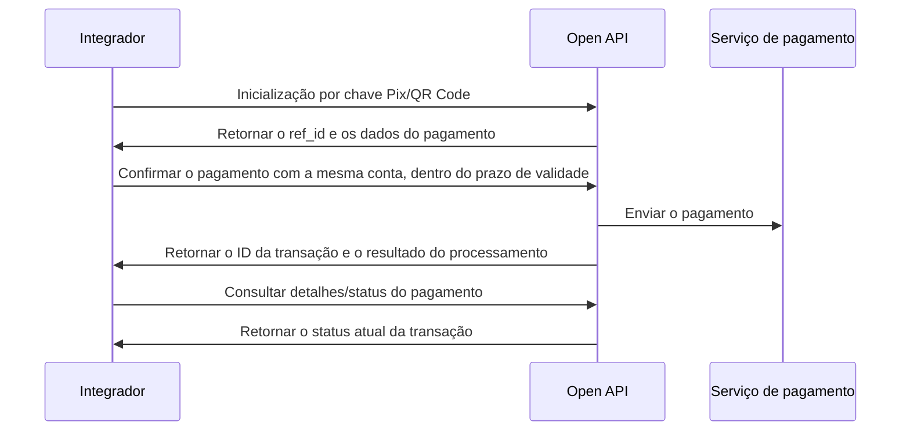
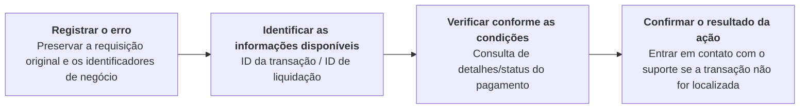

Selecione a forma de pagamento: Pix, TED ou transferência interna (Book Transfer). O envio bem-sucedido de um pagamento retorna o ID da transação e o status `Em processamento`; isso confirma a aceitação para processamento assíncrono, não a conclusão do pagamento. Salve o ID da transação e consulte o pagamento original até confirmar o resultado. <Badge color="blue" size="sm">Complementado · module-8-F02</Badge> Os endpoints de pagamento e consulta de cada forma estão listados abaixo.

## Pix

Inicie um pagamento Pix por chave Pix, QR Code ou dados bancários.

### Operações da API

| Operação | Caminho POST |
| --- | --- |
| [Inicializar pagamento via chave Pix](/pt-br/api-reference/payout/pix/initialize-pix-key-payment) | `/v3/transfers/pix/key-initiate` |
| [Confirmar pagamento via chave Pix](/pt-br/api-reference/payout/pix/confirm-pix-key-payment) | `/v3/transfers/pix/key-confirm` |
| [Inicializar pagamento via QR Code](/pt-br/api-reference/payout/pix/initialize-qr-code-payment) | `/v3/transfers/pix/qr-code-initiate` |
| [Confirmar pagamento via QR Code](/pt-br/api-reference/payout/pix/confirm-qr-code-payment) | `/v3/transfers/pix/qr-code-confirm` |
| [Pagar via Pix com dados bancários](/pt-br/api-reference/payout/pix/pay-with-bank-account-details) | `/v3/transfers/pix/bank-account` |
| [Consultar status do pagamento](/pt-br/api-reference/payout/get-payment-status) | `/v3/transfers/status/check` |
| [Consultar detalhes do pagamento](/pt-br/api-reference/payout/get-payment-details) | `/v3/transfers/details` |

### Sequência de chamadas

- Chave Pix: inicializar → conferir os dados do recebedor → confirmar o pagamento → consultar o resultado.
- QR Code: inicializar → conferir o valor e o recebedor → confirmar o pagamento → consultar o resultado.
- Conta bancária: iniciar o pagamento Pix diretamente → consultar o resultado. Não é necessário inicializar nem confirmar.

*Pagamento Pix em duas etapas: inicialização e confirmação*

A referência de inicialização por chave Pix é válida por 1 minuto. A referência de inicialização por QR Code é válida por 5 minutos. Confirme usando a mesma conta do pagador dentro desse prazo. O prazo de validade do próprio QR Code é separado do prazo de validade da referência de confirmação. <Badge color="blue" size="sm">Complementado · module-8-F03</Badge>

Após uma confirmação bem-sucedida, a referência de inicialização é removida. Não reutilize `ref_id` para confirmar novamente o mesmo pagamento. Acompanhe o pagamento aceito usando o `txn_id` retornado. <Badge color="blue" size="sm">Complementado · module-8-F07</Badge>

## TED

Inicie um pagamento via TED usando uma conta bancária em uma instituição diferente da instituição da conta do pagador. Para contas da mesma instituição, use transferência interna (Book Transfer). <Badge color="blue" size="sm">Complementado · module-8-F04</Badge>

### Operações da API

| Operação | Caminho POST |
| --- | --- |
| [Iniciar pagamento via TED](/pt-br/api-reference/payout/ted/initiate-ted-payment) | `/v3/transfers/ted/bank-account` |
| [Consultar status do pagamento](/pt-br/api-reference/payout/get-payment-status) | `/v3/transfers/status/check` |
| [Consultar detalhes do pagamento](/pt-br/api-reference/payout/get-payment-details) | `/v3/transfers/details` |

### Sequência de chamadas

Preencher os dados da conta bancária do recebedor e do pagamento → Iniciar pagamento via TED → Salvar o ID da transação → Consultar o status e os detalhes do pagamento.

## Transferência interna

Transferência interna entre contas diferentes da mesma instituição. A conta do pagador não pode ser também a conta do recebedor. <Badge color="blue" size="sm">Complementado · module-8-F05</Badge>

### Operações da API

| Operação | Caminho POST |
| --- | --- |
| [Iniciar transferência interna](/pt-br/api-reference/payout/book-transfer/initiate-internal-transfer) | `/v3/transfers/internal` |
| [Consultar status do pagamento](/pt-br/api-reference/payout/get-payment-status) | `/v3/transfers/status/check` |
| [Consultar detalhes do pagamento](/pt-br/api-reference/payout/get-payment-details) | `/v3/transfers/details` |

### Sequência de chamadas

Preencher os dados da conta do recebedor na mesma instituição e da transferência → Iniciar transferência interna → Salvar o ID da transação → Consultar o status e os detalhes do pagamento.

### Cenários de erro

Este é o fluxo recomendado para o integrador. Se a requisição de pagamento foi enviada, mas a resposta se perdeu ou houve timeout, o resultado deve ser registrado como "Resultado desconhecido". Esse caso não deve ser tratado diretamente como falha no pagamento.

| Informações disponíveis / Etapa da falha | Verificações e ações |
| --- | --- |
| txn_id disponível | Chame [Consultar detalhes do pagamento](/pt-br/api-reference/payout/get-payment-details) ou [Consultar status do pagamento](/pt-br/api-reference/payout/get-payment-status) para acompanhar a transação original. Continue consultando enquanto o pagamento estiver em processamento. Se um pagamento aceito há pouco ainda não for localizado, aguarde o processamento assíncrono e consulte novamente a transação original; não trate essa resposta como falha no pagamento nem envie um novo pagamento. Ao final, confira os lançamentos do extrato para verificar o resultado da movimentação dos recursos. <Badge color="blue" size="sm">Complementado · module-8-F06</Badge> |
| Apenas settlement_id disponível | Chame [Consultar detalhes do pagamento](/pt-br/api-reference/payout/get-payment-details). O endpoint de status do pagamento continua exigindo txn_id. |
| Apenas merchant_order_id disponível, sem ID da transação ou de liquidação | O endpoint atual de detalhes não permite consultar apenas pelo número do pedido. Interrompa os reenvios automáticos, guarde os dados da requisição original e entre em contato com o suporte de integração para localizar a transação original. |
| Inicialização bem-sucedida, mas a confirmação do pagamento ainda não foi enviada | A inicialização não indica que o pagamento foi executado. Confira a conta e o prazo de validade da referência. Se a referência tiver expirado, inicialize novamente. Se a requisição de confirmação já tiver sido enviada, siga o fluxo de "Resultado desconhecido" para verificar o pagamento. |
| A API rejeita explicitamente a requisição | Corrija os parâmetros, as permissões ou as condições da conta conforme o código de erro. Se houver falha durante o processamento do pagamento, ainda é obrigatório verificar primeiro a transação original. Não determine o resultado da movimentação dos recursos apenas pelo texto do erro. |

Antes de confirmar o resultado do pagamento original, não reenvie a requisição com outro número de pedido sem verificar o que ocorreu. Nos formulários de pagamento, "Pré-visualizar" gera um novo número de pedido. "Enviar" envia o JSON da requisição exibido no momento, sem substituir o número do pedido. <Badge color="orange" size="sm">Corrigido · module-8-F01</Badge> Clicar novamente em "Enviar" não equivale a uma nova tentativa técnica segura da operação original.

Ao solicitar ajuda ao suporte, informe o ambiente, o endpoint, o número do pedido original, o ISPB e o número da conta do pagador, o valor, o horário da requisição (com o fuso horário), os IDs de transação/liquidação disponíveis, a resposta com dados sensíveis mascarados e o histórico de novas tentativas. Não envie a SK. Os canais de suporte e os prazos de resposta seguem o acordo de integração.

<Accordion title="Correções em relação ao documento original (7)" icon="clipboard-check">
Esta página foi conferida com o código-fonte da Pagsmile Open API em 2026-11-10. Cada alteração abaixo está marcada na página com um selo que mostra o seu ID.

| ID | Alteração | Local | Texto do documento original | Texto atualizado |
| --- | --- | --- | --- | --- |
| module-8-F01 | Corrigido (não correspondia ao código) | Book Transfer / Error scenarios / Sandbox retry warning | A ferramenta Sandbox gera um novo número de pedido a cada clique em "Pré-visualizar" ou "Enviar". | Nos formulários de pagamento, "Pré-visualizar" gera um novo número de pedido. "Enviar" envia o JSON da requisição exibido no momento, sem substituir o número do pedido. |
| module-8-F02 | Complementado (ausente no original) | PayOut introduction / before the payment-method sections | Selecione a forma de pagamento: Pix, TED ou transferência interna (Book Transfer). | Selecione a forma de pagamento: Pix, TED ou transferência interna (Book Transfer). O envio bem-sucedido de um pagamento retorna o ID da transação e o status Em processamento; isso confirma a aceitação para processamento assíncrono, não a conclusão do pagamento. Salve o ID da transação e consulte o pagamento original até confirmar o resultado. |
| module-8-F03 | Complementado (ausente no original) | Pix / Call sequence / after the two-step diagram | — | A referência de inicialização por chave Pix é válida por 1 minuto. A referência de inicialização por QR Code é válida por 5 minutos. Confirme usando a mesma conta do pagador dentro desse prazo. O prazo de validade do próprio QR Code é separado do prazo de validade da referência de confirmação. |
| module-8-F04 | Complementado (ausente no original) | TED / introductory behavior | Inicie um pagamento via TED usando uma conta bancária. | Inicie um pagamento via TED usando uma conta bancária em uma instituição diferente da instituição da conta do pagador. Para contas da mesma instituição, use transferência interna (Book Transfer). |
| module-8-F05 | Complementado (ausente no original) | Book Transfer / introductory behavior | Transferência interna entre contas da mesma instituição. | Transferência interna entre contas diferentes da mesma instituição. A conta do pagador não pode ser também a conta do recebedor. |
| module-8-F06 | Complementado (ausente no original) | Book Transfer / Error scenarios / txn_id available row | Chame Consultar detalhes do pagamento ou Consultar status do pagamento para acompanhar a transação original. Continue consultando enquanto o pagamento estiver em processamento. Ao final, confira os lançamentos do extrato para verificar o resultado da movimentação dos recursos. | Chame Consultar detalhes do pagamento ou Consultar status do pagamento para acompanhar a transação original. Continue consultando enquanto o pagamento estiver em processamento. Se um pagamento aceito há pouco ainda não for localizado, aguarde o processamento assíncrono e consulte novamente a transação original; não trate essa resposta como falha no pagamento nem envie um novo pagamento. Ao final, confira os lançamentos do extrato para verificar o resultado da movimentação dos recursos. |
| module-8-F07 | Complementado (ausente no original) | Pix / Call sequence / confirmation and retry behavior | — | Após uma confirmação bem-sucedida, a referência de inicialização é removida. Não reutilize ref_id para confirmar novamente o mesmo pagamento. Acompanhe o pagamento aceito usando o txn_id retornado. |
</Accordion>
