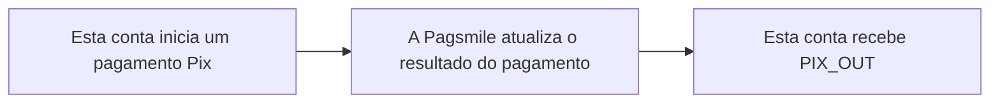

## Funcionamento e tratamento

Esta conta, como pagador, recebe notificações com os resultados do processamento dos pagamentos Pix iniciados. <Badge color="orange" size="sm">Corrigido · payout-transaction-webhooks-F16</Badge> Use essas notificações para atualizar o status do pagamento e conferir as transações de débito. O evento indica a direção de pagamento enviado desta conta. As notificações de resultado incluem pagamentos concluídos (`txn_status=TXN_STATUS_COMPLETED`, código de enum 2) e pagamentos que falharam (`txn_status=TXN_STATUS_FAILED`, código de enum 3). Uma notificação de falha no pagamento não confirma, por si só, que houve débito de recursos. <Badge color="blue" size="sm">Complementado · payout-transaction-webhooks-F03</Badge>



## Eventos e direção do fluxo de recursos

| Valor da assinatura de eventos | Nome do evento | Casos de uso |
| --- | --- | --- |
| 2 · PIX_OUT | PIX_PAYMENT_OUT | Acompanhe os resultados do processamento dos pagamentos iniciados por esta conta. |

Use `2 / PIX_OUT` na assinatura de eventos de pagamento. O corpo do callback não contém `event_type` no nível superior. Identifique as notificações de pagamentos Pix pela combinação da configuração da assinatura de eventos de pagamentos enviados com `txn_type=TXN_TYPE_PAYMENT` e `payment_method=PAYMENT_METHOD_PIX`. Não exija `flow_direction`: esse campo não é preenchido no corpo do callback de pagamento atual. <Badge color="orange" size="sm">Corrigido · payout-transaction-webhooks-F01</Badge>

## Diferenças de entrega entre ACCOUNT e USER

| Escopo | Destino da entrega | Identificador de deduplicação |
| --- | --- | --- |
| ACCOUNT | A primeira configuração de conta ativa encontrada que corresponda ao evento de pagamento Pix enviado (`PIX_OUT`), ao ISPB e ao número da conta. A entrega `ACCOUNT` não envia o mesmo evento a todas as configurações de conta correspondentes. <Badge color="blue" size="sm">Complementado · payout-transaction-webhooks-F15</Badge> | Não contém `delivery_id`. Use "Tipo de evento da assinatura de eventos + `txn_id`" para deduplicação. <Badge color="orange" size="sm">Corrigido · payout-transaction-webhooks-F17</Badge> |
| USER | Assinatura de eventos ativa que pertença ao `USER` em questão e corresponda ao evento de pagamento Pix enviado (`PIX_OUT`). Antes de cada tentativa HTTP, a titularidade da conta e a configuração da assinatura de eventos são verificadas novamente. A entrega pendente é cancelada se o `USER` deixar de ser titular da conta ou se a assinatura de eventos estiver inativa ou tiver sido alterada. <Badge color="blue" size="sm">Complementado · payout-transaction-webhooks-F14</Badge> | Contém delivery_id, que permanece inalterado nas novas tentativas da mesma entrega. |

## Exemplo JSON

A seguir estão exemplos de callbacks USER recebidos por esta conta, referentes a pagamentos Pix. <Badge color="orange" size="sm">Corrigido · payout-transaction-webhooks-F01</Badge> O campo `payer` representa esta conta, e a direção dos recursos é OUT. Os identificadores e valores dos exemplos são fictícios. Nos callbacks reais, os campos opcionais podem ser omitidos. Tanto `payer` quanto `payee` também podem conter `document_id` (string), `document_type` (nome de enum), `bank_account_type` (nome de enum), `bank_branch` (string) e `bank_name` (string). Os tipos de documento são `DOCUMENT_TYPE_CPF` (1) e `DOCUMENT_TYPE_CNPJ` (2). Os tipos de conta bancária são `BANK_ACCOUNT_TYPE_CHECKING` (1), `BANK_ACCOUNT_TYPE_SALARY` (2), `BANK_ACCOUNT_TYPE_SAVINGS` (3), e `BANK_ACCOUNT_TYPE_PAYMENT` (4). Os códigos numéricos identificam os valores do enum; os callbacks enviam os nomes e omitem os valores não especificados (0). Quando o mascaramento de documentos está habilitado, um CPF pode manter apenas os primeiros 3 e os últimos 4 caracteres, com os caracteres intermediários substituídos por `*`; os valores de CNPJ não são mascarados por essa regra. <Badge color="blue" size="sm">Complementado · payout-transaction-webhooks-F12</Badge> ACCOUNT usa a estrutura de transação do mesmo cenário, mas sem `delivery_id`.

Os valores de status/enum e os timestamps int64 são strings. `created_at` é o timestamp de início do pagamento, em milissegundos Unix. `completed_at` é o timestamp do resultado final do processamento, também em milissegundos Unix; ele pode estar presente em um pagamento que falhou e não indica sucesso por si só. <Badge color="blue" size="sm">Complementado · payout-transaction-webhooks-F04</Badge> Os valores monetários permanecem como strings decimais. O callback não é uma resposta REST no formato `code/message/data`.

<Accordion title="Pagamentos Pix · USER">
```json
{
  "delivery_id": "0000000000000000000000000000000000000000000000000000000000000002",
  "payer": {
    "name": "Demo Payer",
    "bank_account": "00098765",
    "bank_code": "87654321"
  },
  "payee": {
    "name": "Demo Merchant",
    "bank_account": "00012345",
    "bank_code": "12345678"
  },
  "txn_id": "PIX-OUT-001",
  "settlement_txn_id": "SET-PAYMENT-OUT-001",
  "txn_status": "TXN_STATUS_COMPLETED",
  "amount": "100.00",
  "currency": "BRL",
  "txn_type": "TXN_TYPE_PAYMENT",
  "payment_method": "PAYMENT_METHOD_PIX",
  "created_at": "1710000000000",
  "completed_at": "1710000005000",
  "flow_type": "FLOW_TYPE_OUT",
  "merchant_order_id": "ORDER-OUT-001"
}
```
</Accordion>

<ResponseField name="refunded_amount" type="string">
  Valor devolvido registrado para este pagamento, como string decimal. Um valor como `"0"` pode ser incluído; um valor vazio é omitido. <Badge color="blue" size="sm">Complementado · payout-transaction-webhooks-F06</Badge>
</ResponseField>

<ResponseField name="rejection_reason" type="string">
  Motivo da falha no pagamento, quando disponível. Omitido em pagamentos concluídos ou quando vazio. <Badge color="blue" size="sm">Complementado · payout-transaction-webhooks-F07</Badge>
</ResponseField>

<ResponseField name="payment_variant" type="string">
  Modalidade do pagamento como nome de enum. Os valores Pix incluem `PAYMENT_VARIANT_PIX_MANUAL` (1), `PAYMENT_VARIANT_PIX_KEY` (2), `PAYMENT_VARIANT_STATIC_QRCODE` (3), `PAYMENT_VARIANT_DYNAMIC_QRCODE` (4), `PAYMENT_VARIANT_AUTO_PIX` (5) e `PAYMENT_VARIANT_DYNAMIC_BILLING` (9). Os códigos numéricos identificam os valores do enum; o callback envia os nomes. O valor não especificado (0) é omitido. <Badge color="blue" size="sm">Complementado · payout-transaction-webhooks-F08</Badge>
</ResponseField>

<ResponseField name="pix_details" type="object">
  Detalhes Pix, quando houver um registro Pix com uma chave Pix não vazia.
</ResponseField>

<ResponseField name="pix_details.pix_key" type="string">
  Chave Pix registrada para o pagamento.
</ResponseField>

<ResponseField name="pix_details.pix_key_type" type="string">
  Tipo de chave Pix como nome de enum: `PIX_KEY_TYPE_CPF` (1), `PIX_KEY_TYPE_CNPJ` (2), `PIX_KEY_TYPE_EMAIL` (3), `PIX_KEY_TYPE_PHONE` (4) ou `PIX_KEY_TYPE_EVP` (5). O valor não especificado (0) é omitido.
</ResponseField>

<ResponseField name="pix_details.qr_code_id" type="string">
  Identificador do QR Code, quando registrado para o pagamento.
</ResponseField>

<ResponseField name="pix_details.qr_code_memo" type="string">
  Descrição do QR Code, quando disponível. Os campos string vazios são omitidos. <Badge color="blue" size="sm">Complementado · payout-transaction-webhooks-F09</Badge>
</ResponseField>

<ResponseField name="request_merchant_order_id" type="string">
  Referência do pedido do comerciante associada à solicitação do QR Code, quando disponível. No callback de pagamento enviado, `merchant_order_id` continua sendo a referência do pedido de pagamento do pagador. Referências vazias são omitidas. <Badge color="blue" size="sm">Complementado · payout-transaction-webhooks-F11</Badge>
</ResponseField>

<Accordion title="Correções em relação ao documento original (13)" icon="clipboard-check">
Esta página foi conferida com o código-fonte da Pagsmile Open API em 2026-11-10. Cada alteração abaixo está marcada na página com um selo que mostra o seu ID.

| ID | Alteração | Local | Texto do documento original | Texto atualizado |
| --- | --- | --- | --- | --- |
| payout-transaction-webhooks-F01 | Corrigido (não correspondia ao código) | Events and funds flow direction | Identifique as notificações de pagamentos Pix pela combinação da configuração da assinatura de eventos de pagamento com `txn_type=TXN_TYPE_PAYMENT`, `payment_method=PAYMENT_METHOD_PIX` e `flow_direction=FLOW_DIRECTION_OUT`. | Identifique as notificações de pagamentos Pix pela combinação da configuração da assinatura de eventos de pagamentos enviados com `txn_type=TXN_TYPE_PAYMENT` e `payment_method=PAYMENT_METHOD_PIX`. Não exija `flow_direction`: esse campo não é preenchido no corpo do callback de pagamento atual. |
| payout-transaction-webhooks-F03 | Complementado (ausente no original) | Behavior and handling / append to funds-direction sentence | O evento indica saída de recursos desta conta. | O evento indica a direção de pagamento enviado desta conta. As notificações de resultado incluem pagamentos concluídos (`txn_status=TXN_STATUS_COMPLETED`, código de enum 2) e pagamentos que falharam (`txn_status=TXN_STATUS_FAILED`, código de enum 3). Uma notificação de falha no pagamento não confirma, por si só, que houve débito de recursos. |
| payout-transaction-webhooks-F04 | Complementado (ausente no original) | JSON example / timestamp explanation | Os valores de status/enum e os timestamps int64 são strings. | Os valores de status/enum e os timestamps int64 são strings. `created_at` é o timestamp de início do pagamento, em milissegundos Unix. `completed_at` é o timestamp do resultado final do processamento, também em milissegundos Unix; ele pode estar presente em um pagamento que falhou e não indica sucesso por si só. |
| payout-transaction-webhooks-F06 | Complementado (ausente no original) | JSON example / optional callback-field table | — | `refunded_amount` \| string \| Não \| Valor devolvido registrado para este pagamento, como string decimal. Um valor como `"0"` pode ser incluído; um valor vazio é omitido. |
| payout-transaction-webhooks-F07 | Complementado (ausente no original) | JSON example / optional callback-field table | — | `rejection_reason` \| string \| Não \| Motivo da falha no pagamento, quando disponível. Omitido em pagamentos concluídos ou quando vazio. |
| payout-transaction-webhooks-F08 | Complementado (ausente no original) | JSON example / optional callback-field table | — | `payment_variant` \| string \| Não \| Modalidade do pagamento como nome de enum. Os valores Pix incluem `PAYMENT_VARIANT_PIX_MANUAL` (1), `PAYMENT_VARIANT_PIX_KEY` (2), `PAYMENT_VARIANT_STATIC_QRCODE` (3), `PAYMENT_VARIANT_DYNAMIC_QRCODE` (4), `PAYMENT_VARIANT_AUTO_PIX` (5) e `PAYMENT_VARIANT_DYNAMIC_BILLING` (9). Os códigos numéricos identificam os valores do enum; o callback envia os nomes. O valor não especificado (0) é omitido. |
| payout-transaction-webhooks-F09 | Complementado (ausente no original) | JSON example / optional callback-field table | — | `pix_details` \| object \| Não \| Detalhes Pix, quando houver um registro Pix com uma chave Pix não vazia. `pix_details.pix_key` \| string \| Não \| Chave Pix registrada para o pagamento. `pix_details.pix_key_type` \| string \| Não \| Tipo de chave Pix como nome de enum: `PIX_KEY_TYPE_CPF` (1), `PIX_KEY_TYPE_CNPJ` (2), `PIX_KEY_TYPE_EMAIL` (3), `PIX_KEY_TYPE_PHONE` (4) ou `PIX_KEY_TYPE_EVP` (5). O valor não especificado (0) é omitido. `pix_details.qr_code_id` \| string \| Não \| Identificador do QR Code, quando registrado para o pagamento. `pix_details.qr_code_memo` \| string \| Não \| Descrição do QR Code, quando disponível. Os campos string vazios são omitidos. |
| payout-transaction-webhooks-F11 | Complementado (ausente no original) | JSON example / optional callback-field table | — | `request_merchant_order_id` \| string \| Não \| Referência do pedido do comerciante associada à solicitação do QR Code, quando disponível. No callback de pagamento enviado, `merchant_order_id` continua sendo a referência do pedido de pagamento do pagador. Referências vazias são omitidas. |
| payout-transaction-webhooks-F12 | Complementado (ausente no original) | JSON example / add party-field descriptions | Nos callbacks reais, os campos opcionais podem ser omitidos. | Nos callbacks reais, os campos opcionais podem ser omitidos. Tanto `payer` quanto `payee` também podem conter `document_id` (string), `document_type` (nome de enum), `bank_account_type` (nome de enum), `bank_branch` (string) e `bank_name` (string). Os tipos de documento são `DOCUMENT_TYPE_CPF` (1) e `DOCUMENT_TYPE_CNPJ` (2). Os tipos de conta bancária são `BANK_ACCOUNT_TYPE_CHECKING` (1), `BANK_ACCOUNT_TYPE_SALARY` (2), `BANK_ACCOUNT_TYPE_SAVINGS` (3), e `BANK_ACCOUNT_TYPE_PAYMENT` (4). Os códigos numéricos identificam os valores do enum; os callbacks enviam os nomes e omitem os valores não especificados (0). Quando o mascaramento de documentos está habilitado, um CPF pode manter apenas os primeiros 3 e os últimos 4 caracteres, com os caracteres intermediários substituídos por `*`; os valores de CNPJ não são mascarados por essa regra. |
| payout-transaction-webhooks-F14 | Complementado (ausente no original) | ACCOUNT / USER delivery differences / USER delivery target cell | Assinatura de eventos ativa que pertença ao USER em questão e corresponda ao evento de pagamento Pix (PIX_OUT). | Assinatura de eventos ativa que pertença ao USER em questão e corresponda ao evento de pagamento Pix enviado (PIX_OUT). Antes de cada tentativa HTTP, a titularidade da conta e a configuração da assinatura de eventos são verificadas novamente. A entrega pendente é cancelada se o USER deixar de ser titular da conta ou se a assinatura de eventos estiver inativa ou tiver sido alterada. |
| payout-transaction-webhooks-F15 | Complementado (ausente no original) | ACCOUNT / USER delivery differences / ACCOUNT delivery target cell | Configuração de conta ativa que corresponda ao evento de pagamento Pix (PIX_OUT), ao ISPB e ao número da conta. | A primeira configuração de conta ativa encontrada que corresponda ao evento de pagamento Pix enviado (PIX_OUT), ao ISPB e ao número da conta. A entrega ACCOUNT não envia o mesmo evento a todas as configurações de conta correspondentes. |
| payout-transaction-webhooks-F16 | Corrigido (não correspondia ao código) | Funcionamento e tratamento | Esta conta, como Payer (pagador), recebe notificações com os resultados do processamento dos pagamentos Pix iniciados. | Esta conta, como pagador, recebe notificações com os resultados do processamento dos pagamentos Pix iniciados. |
| payout-transaction-webhooks-F17 | Corrigido (não correspondia ao código) | Diferenças de entrega entre ACCOUNT e USER / ACCOUNT deduplication cell | Não contém delivery_id. Use "Tipo de evento da assinatura + txn_id" para deduplicação. | Não contém delivery_id. Use "Tipo de evento da assinatura de eventos + txn_id" para deduplicação. |
</Accordion>
