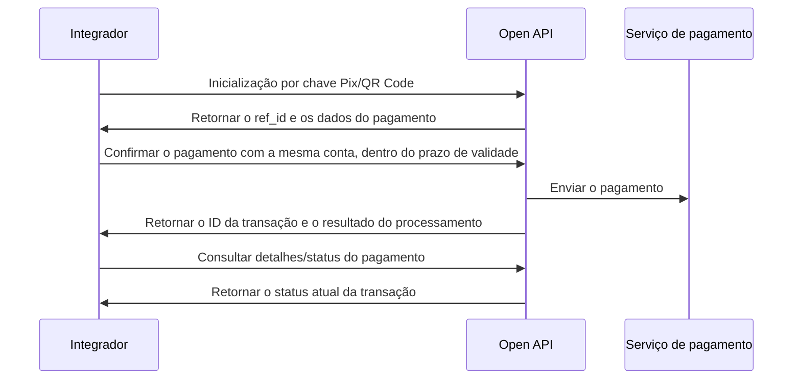

Inicie um pagamento Pix por chave Pix, QR Code ou dados bancários.

A confirmação por chave Pix, a confirmação por QR Code e o pagamento Pix direto com dados bancários retornam `data.txn_id` e `data.txn_status`. Um pagamento aceito retorna `5` (`TXN_STATUS_PROCESSING`), não a confirmação de que a liquidação foi concluída. Salve o ID da transação e consulte o status ou os detalhes do pagamento para determinar o resultado. <Badge color="blue" size="sm">Complementado · payout-pix-F03</Badge>

Essas operações exigem credenciais `ACCOUNT` da conta vinculada ou credenciais `USER` com `X-ISPB` e `X-Account-Number` identificando uma conta de titularidade desse usuário. Credenciais `PLATFORM` não são aceitas. Com credenciais `ACCOUNT`, omita os dois cabeçalhos de direcionamento da conta ou informe ambos com valores correspondentes à conta vinculada. Siga [Ambientes e credenciais](/pt-br/environments-and-credentials). <Badge color="blue" size="sm">Complementado · payout-pix-F06</Badge>

## Operações da API

| Operação | Caminho POST |
| --- | --- |
| [Inicializar pagamento via chave Pix](/pt-br/api-reference/payout/pix/initialize-pix-key-payment) | `/v3/transfers/pix/key-initiate` |
| [Confirmar pagamento via chave Pix](/pt-br/api-reference/payout/pix/confirm-pix-key-payment) | `/v3/transfers/pix/key-confirm` |
| [Inicializar pagamento via QR Code](/pt-br/api-reference/payout/pix/initialize-qr-code-payment) | `/v3/transfers/pix/qr-code-initiate` |
| [Confirmar pagamento via QR Code](/pt-br/api-reference/payout/pix/confirm-qr-code-payment) | `/v3/transfers/pix/qr-code-confirm` |
| [Pagar via Pix com dados bancários](/pt-br/api-reference/payout/pix/pay-with-bank-account-details) | `/v3/transfers/pix/bank-account` |
| [Consultar status do pagamento](/pt-br/api-reference/payout/get-payment-status) | `/v3/transfers/status/check` |
| [Consultar detalhes do pagamento](/pt-br/api-reference/payout/get-payment-details) | `/v3/transfers/details` |

## Sequência de chamadas

- Chave Pix: inicializar → conferir os dados do recebedor → confirmar o pagamento → consultar o resultado. Você pode informar `amount` opcionalmente na inicialização para verificar o saldo disponível em BRL. Se informar esse campo, a confirmação deve usar o mesmo valor. <Badge color="blue" size="sm">Complementado · payout-pix-F04</Badge>
- QR Code: inicializar → conferir o valor e o recebedor → confirmar o pagamento → consultar o resultado. A confirmação exige um valor positivo que possa ser representado exatamente com duas casas decimais. Para um QR Code dinâmico com valor definido e não editável, use o valor retornado na inicialização; a alteração é rejeitada. <Badge color="blue" size="sm">Complementado · payout-pix-F05</Badge>
- Conta bancária: iniciar o pagamento Pix diretamente → consultar o resultado. Nos três fluxos de pagamento Pix, o pagador e o recebedor não podem usar a mesma conta, identificada pela combinação de ISPB e número da conta. <Badge color="blue" size="sm">Complementado · payout-pix-F07</Badge> Não é necessário inicializar nem confirmar.

Logo após a aceitação, Consultar status do pagamento pode retornar temporariamente um erro de transação não encontrada enquanto o pagamento ainda está sendo registrado. Isso não comprova que o envio do pagamento falhou. Consulte novamente em vez de criar outro pagamento. Ao usar Consultar detalhes do pagamento para um pagamento recém-aceito, informe `merchant_order_id` junto com o `txn_id` retornado para identificar um pagamento que ainda aguarda registro. <Badge color="blue" size="sm">Complementado · payout-pix-F08</Badge>

Se a resposta da confirmação ou do pagamento direto se perder, ou se o resultado for desconhecido, verifique a operação original conforme [Cenários de erro no módulo de pagamentos de saída](/pt-br/api-reference/payout/overview). Não envie outro pagamento com um novo `merchant_order_id` apenas porque a resposta se perdeu. Um `merchant_order_id` duplicado é rejeitado, sem repetir a resposta de sucesso original. <Badge color="blue" size="sm">Complementado · payout-pix-F09</Badge>

Depois que a confirmação é aceita, a referência de inicialização é consumida. Não reutilize o mesmo `ref_id` em outro pagamento. <Badge color="blue" size="sm">Complementado · payout-pix-F02</Badge>

*Pagamento Pix em duas etapas: inicialização e confirmação*

A referência de inicialização por chave Pix é válida por 1 minuto; a referência de inicialização por QR Code é válida por 5 minutos. Confirme com a mesma conta do pagador. Se a referência expirar, inicialize novamente e confira os dados do pagamento retornados. <Badge color="blue" size="sm">Complementado · payout-pix-F01</Badge>

<Accordion title="Correções em relação ao documento original (9)" icon="clipboard-check">
Esta página foi conferida com o código-fonte da Pagsmile Open API em 2026-11-10. Cada alteração abaixo está marcada na página com um selo que mostra o seu ID.

| ID | Alteração | Local | Texto do documento original | Texto atualizado |
| --- | --- | --- | --- | --- |
| payout-pix-F01 | Complementado (ausente no original) | Call sequence / reference validity | Chave Pix: inicializar → conferir os dados do recebedor → confirmar o pagamento → consultar o resultado. | Chave Pix: inicializar → conferir os dados do recebedor → confirmar o pagamento → consultar o resultado. A referência de inicialização por chave Pix é válida por 1 minuto; a referência de inicialização por QR Code é válida por 5 minutos. Confirme com a mesma conta do pagador. Se a referência expirar, inicialize novamente e confira os dados do pagamento retornados. |
| payout-pix-F02 | Complementado (ausente no original) | Call sequence / reference reuse | QR Code: inicializar → conferir o valor e o recebedor → confirmar o pagamento → consultar o resultado. | QR Code: inicializar → conferir o valor e o recebedor → confirmar o pagamento → consultar o resultado. Depois que a confirmação é aceita, a referência de inicialização é consumida. Não reutilize o mesmo ref_id em outro pagamento. |
| payout-pix-F03 | Complementado (ausente no original) | Call sequence / processing result | Inicie um pagamento Pix por chave Pix, QR Code ou dados bancários. | Inicie um pagamento Pix por chave Pix, QR Code ou dados bancários. A confirmação por chave Pix, a confirmação por QR Code e o pagamento Pix direto com dados bancários retornam data.txn_id e data.txn_status. Um pagamento aceito retorna 5 (TXN_STATUS_PROCESSING), não a confirmação de que a liquidação foi concluída. Salve o ID da transação e consulte o status ou os detalhes do pagamento para determinar o resultado. |
| payout-pix-F04 | Complementado (ausente no original) | Call sequence / Pix key amount | Chave Pix: inicializar → conferir os dados do recebedor → confirmar o pagamento → consultar o resultado. | Chave Pix: inicializar → conferir os dados do recebedor → confirmar o pagamento → consultar o resultado. Você pode informar amount opcionalmente na inicialização para verificar o saldo disponível em BRL. Se informar esse campo, a confirmação deve usar o mesmo valor. |
| payout-pix-F05 | Complementado (ausente no original) | Call sequence / QR code amount | QR Code: inicializar → conferir o valor e o recebedor → confirmar o pagamento → consultar o resultado. | QR Code: inicializar → conferir o valor e o recebedor → confirmar o pagamento → consultar o resultado. A confirmação exige um valor positivo que possa ser representado exatamente com duas casas decimais. Para um QR Code dinâmico com valor definido e não editável, use o valor retornado na inicialização; a alteração é rejeitada. |
| payout-pix-F06 | Complementado (ausente no original) | Introduction / permissions and payer account context | Inicie um pagamento Pix por chave Pix, QR Code ou dados bancários. | Inicie um pagamento Pix por chave Pix, QR Code ou dados bancários. Essas operações exigem credenciais ACCOUNT da conta vinculada ou credenciais USER com X-ISPB e X-Account-Number identificando uma conta de titularidade desse usuário. Credenciais PLATFORM não são aceitas. Com credenciais ACCOUNT, omita os dois cabeçalhos de direcionamento da conta ou informe ambos com valores correspondentes à conta vinculada. Siga Ambientes e credenciais. |
| payout-pix-F07 | Complementado (ausente no original) | Call sequence / payer and payee accounts | Conta bancária: iniciar o pagamento Pix diretamente → consultar o resultado. | Conta bancária: iniciar o pagamento Pix diretamente → consultar o resultado. Nos três fluxos de pagamento Pix, o pagador e o recebedor não podem usar a mesma conta, identificada pela combinação de ISPB e número da conta. |
| payout-pix-F08 | Complementado (ausente no original) | Call sequence / querying a newly accepted payment | Conta bancária: iniciar o pagamento Pix diretamente → consultar o resultado. | Conta bancária: iniciar o pagamento Pix diretamente → consultar o resultado. Logo após a aceitação, Consultar status do pagamento pode retornar temporariamente um erro de transação não encontrada enquanto o pagamento ainda está sendo registrado. Isso não comprova que o envio do pagamento falhou. Consulte novamente em vez de criar outro pagamento. Ao usar Consultar detalhes do pagamento para um pagamento recém-aceito, informe merchant_order_id junto com o txn_id retornado para identificar um pagamento que ainda aguarda registro. |
| payout-pix-F09 | Complementado (ausente no original) | Call sequence / unknown result and duplicate submissions | Não é necessário inicializar nem confirmar. | Não é necessário inicializar nem confirmar. Se a resposta da confirmação ou do pagamento direto se perder, ou se o resultado for desconhecido, verifique a operação original conforme Cenários de erro no módulo de pagamentos de saída. Não envie outro pagamento com um novo merchant_order_id apenas porque a resposta se perdeu. Um merchant_order_id duplicado é rejeitado, sem repetir a resposta de sucesso original. |
</Accordion>
