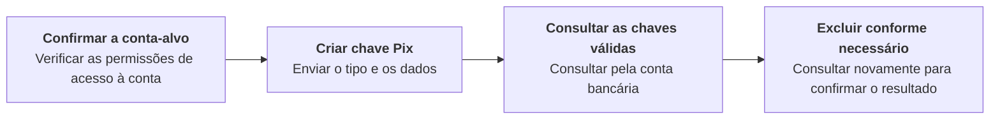

Crie e exclua chaves Pix da conta-alvo. Com credenciais de nível `ACCOUNT`, a conta-alvo é a conta vinculada a essas credenciais. Você pode omitir os cabeçalhos da conta; se enviar `X-ISPB` ou `X-Account-Number`, envie ambos, e ambos devem corresponder à conta vinculada. Com credenciais de nível `USER`, envie ambos os cabeçalhos para selecionar uma conta de titularidade desse usuário e permitida pela hierarquia de contas. Credenciais de nível `PLATFORM` não podem realizar essas operações. Consulte [Ambientes e credenciais](/pt-br/environments-and-credentials). <Badge color="blue" size="sm">Complementado · module-6-F01</Badge> Consulte a conta bancária para obter as chaves válidas.

## Operações da API

| Operação | Caminho POST |
| --- | --- |
| [Criar chave Pix](/pt-br/api-reference/pix-keys/create-pix-key) | `/v3/pix_keys/create` |
| [Excluir chave Pix](/pt-br/api-reference/pix-keys/delete-pix-key) | `/v3/pix_keys/delete` |

## Sequência de chamadas

Criar chave Pix → Consultar as chaves válidas da conta bancária → Excluir as chaves conforme necessário → Consultar novamente para confirmar. Use [Consultar saldo da conta](/pt-br/api-reference/accounts/get-account-balance) para ler `data.pix_keys`, que contém apenas chaves `ACTIVE`. A consulta da conta ainda pode ser bem-sucedida e retornar uma lista de chaves vazia se a obtenção das chaves falhar; por isso, uma lista vazia, por si só, não confirma que a criação falhou ou que a exclusão foi concluída. Se o resultado for incerto, consulte novamente e verifique a resposta de criação ou exclusão antes de atualizar seu sistema. <Badge color="blue" size="sm">Complementado · module-6-F02</Badge>

<Accordion title="Correções em relação ao documento original (2)" icon="clipboard-check">
Esta página foi conferida com o código-fonte da Pagsmile Open API em 2026-11-10. Cada alteração abaixo está marcada na página com um selo que mostra o seu ID.

| ID | Alteração | Local | Texto do documento original | Texto atualizado |
| --- | --- | --- | --- | --- |
| module-6-F01 | Complementado (ausente no original) | Opening description / account permissions | Crie e exclua chaves Pix da conta-alvo. | Crie e exclua chaves Pix da conta-alvo. Com credenciais de nível ACCOUNT, a conta-alvo é a conta vinculada a essas credenciais. Você pode omitir os cabeçalhos da conta; se enviar `X-ISPB` ou `X-Account-Number`, envie ambos, e ambos devem corresponder à conta vinculada. Com credenciais de nível USER, envie ambos os cabeçalhos para selecionar uma conta de titularidade desse usuário e permitida pela hierarquia de contas. Credenciais de nível PLATFORM não podem realizar essas operações. Consulte Ambientes e credenciais. |
| module-6-F02 | Complementado (ausente no original) | Call sequence | Criar chave Pix → Consultar as chaves válidas da conta bancária → Excluir as chaves conforme necessário → Consultar novamente para confirmar. | Criar chave Pix → Consultar as chaves válidas da conta bancária → Excluir as chaves conforme necessário → Consultar novamente para confirmar. Use Consultar saldo da conta para ler `data.pix_keys`, que contém apenas chaves ACTIVE. A consulta da conta ainda pode ser bem-sucedida e retornar uma lista de chaves vazia se a obtenção das chaves falhar; por isso, uma lista vazia, por si só, não confirma que a criação falhou ou que a exclusão foi concluída. Se o resultado for incerto, consulte novamente e verifique a resposta de criação ou exclusão antes de atualizar seu sistema. |
</Accordion>
