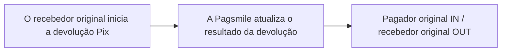

## Funcionamento e tratamento

Após o recebedor original iniciar uma devolução Pix, acompanhe o resultado pelos callbacks. <Badge color="orange" size="sm">Corrigido · refund-transaction-webhooks-F23</Badge> Uma devolução concluída usa `txn_status=TXN_STATUS_COMPLETED`. Uma devolução com falha usa `txn_status=TXN_STATUS_FAILED` e é notificada apenas ao recebedor original por `REFUND_OUT`; `REFUND_IN` não é enviado para uma devolução com falha. A entrega exige uma assinatura de eventos ativa correspondente à conta Pagsmile que recebe a notificação; contas de outros bancos não recebem esses callbacks. <Badge color="blue" size="sm">Complementado · refund-transaction-webhooks-F04</Badge>



## Eventos e direção do fluxo de recursos

| Valor da assinatura de eventos | Nome do evento | Casos de uso |
| --- | --- | --- |
| 3 · REFUND_IN | PIX_REFUND_IN | Esta conta recebe os valores devolvidos do pagamento original. |
| 4 · REFUND_OUT | PIX_REFUND_OUT | Esta conta devolve os valores ao pagador original. |

O pagador original configura uma assinatura de eventos para `3 / REFUND_IN`, e o recebedor original, para `4 / REFUND_OUT`. O corpo do callback não contém `event_type` no nível superior. Para distinguir devoluções recebidas de devoluções enviadas, use o evento da assinatura de eventos (`3 / REFUND_IN` ou `4 / REFUND_OUT`) e a conta que recebe a notificação. O corpo usa `txn_type=TXN_TYPE_REFUND` e `payment_method=PAYMENT_METHOD_PIX`, mas não preenche `flow_direction`. No corpo da devolução, `payer` é o recebedor original e `payee` é o pagador original. <Badge color="orange" size="sm">Corrigido · refund-transaction-webhooks-F01</Badge>

## Diferenças de entrega entre ACCOUNT e USER

| Escopo | Destino da entrega | Identificador de deduplicação |
| --- | --- | --- |
| ACCOUNT | Configuração de conta ativa que corresponde ao evento de devolução recebida ou enviada (REFUND_IN/REFUND_OUT), ao ISPB e ao número da conta. | Não contém `delivery_id`. Use "Tipo de evento da assinatura de eventos + `txn_id`" para deduplicação. <Badge color="orange" size="sm">Corrigido · refund-transaction-webhooks-F24</Badge> |
| USER | Assinatura de eventos ativa que pertence ao USER correspondente e abrange o evento de devolução recebida ou enviada (`REFUND_IN`/`REFUND_OUT`). A entrega também exige a manutenção do acesso à conta e uma credencial de assinatura válida. Uma entrega pendente é cancelada se o acesso for revogado, a assinatura de eventos estiver inativa ou for alterada, ou a credencial de assinatura se tornar inválida. <Badge color="blue" size="sm">Complementado · refund-transaction-webhooks-F21</Badge> | Contém delivery_id, que permanece inalterado nas novas tentativas da mesma entrega. |

## Exemplo JSON

Os exemplos a seguir mostram o callback USER de devolução recebida enviado ao pagador original e o callback USER de devolução enviada enviado ao recebedor original. O campo `original_txn` vincula a devolução à transação de pagamento original. Em `REFUND_IN`, `original_txn.merchant_order_id` é o ID do pedido de pagamento original. Em `REFUND_OUT`, é o ID do pedido do QR Code original, quando disponível. Esse campo pode ser omitido quando o ID do pedido correspondente não está disponível; `original_txn.txn_id` e `original_txn.settlement_txn_id` identificam o pagamento original independentemente desse campo. <Badge color="blue" size="sm">Complementado · refund-transaction-webhooks-F05</Badge> Os identificadores e valores dos exemplos são fictícios. Nos callbacks reais, os campos opcionais podem ser omitidos. ACCOUNT usa a estrutura de transação do mesmo cenário, mas sem `delivery_id`. <Badge color="orange" size="sm">Corrigido · refund-transaction-webhooks-F02</Badge> <Badge color="orange" size="sm">Corrigido · refund-transaction-webhooks-F03</Badge>

Os valores de status/enum e os timestamps int64 são strings. `created_at` é o momento de início da devolução, e `completed_at` é o momento de conclusão da devolução, ambos expressos em milissegundos Unix UTC. Um timestamp não definido pode ser omitido. <Badge color="blue" size="sm">Complementado · refund-transaction-webhooks-F11</Badge> Os valores monetários permanecem como strings decimais. O callback não é uma resposta REST no formato `code/message/data`.

<ResponseField name="merchant_order_id" type="string">
  ID do pedido de devolução informado ao iniciar a devolução. Incluído em `REFUND_OUT` quando disponível; omitido em `REFUND_IN`. <Badge color="blue" size="sm">Complementado · refund-transaction-webhooks-F06</Badge>
</ResponseField>

<ResponseField name="memo" type="string">
  Descrição da devolução, quando disponível. <Badge color="blue" size="sm">Complementado · refund-transaction-webhooks-F07</Badge>
</ResponseField>

<ResponseField name="refund_reason" type="string">
  Descrição do motivo da devolução, quando disponível. <Badge color="blue" size="sm">Complementado · refund-transaction-webhooks-F08</Badge>
</ResponseField>

<ResponseField name="rejection_reason" type="string">
  Descrição do motivo da falha em uma devolução com falha, quando disponível. Omitido em devoluções concluídas. <Badge color="blue" size="sm">Complementado · refund-transaction-webhooks-F09</Badge>
</ResponseField>

<ResponseField name="payment_variant" type="string">
  Variante de pagamento herdada do pagamento Pix original, quando definida: `PAYMENT_VARIANT_PIX_MANUAL`, `PAYMENT_VARIANT_PIX_KEY`, `PAYMENT_VARIANT_STATIC_QRCODE`, `PAYMENT_VARIANT_DYNAMIC_QRCODE`, `PAYMENT_VARIANT_AUTO_PIX` ou `PAYMENT_VARIANT_DYNAMIC_BILLING`. <Badge color="blue" size="sm">Complementado · refund-transaction-webhooks-F10</Badge>
</ResponseField>

<ResponseField name="payer.document_id" type="string">
  Documento fiscal (CPF/CNPJ) desta parte da devolução, quando disponível. Pode ser mascarado conforme a configuração de mascaramento de documentos do cliente que recebe a notificação.
</ResponseField>

<ResponseField name="payee.document_id" type="string">
  Documento fiscal (CPF/CNPJ) desta parte da devolução, quando disponível. Pode ser mascarado conforme a configuração de mascaramento de documentos do cliente que recebe a notificação. <Badge color="blue" size="sm">Complementado · refund-transaction-webhooks-F12</Badge>
</ResponseField>

<ResponseField name="payer.document_type" type="string">
  Tipo de documento desta parte da devolução: `DOCUMENT_TYPE_CPF` ou `DOCUMENT_TYPE_CNPJ`, quando definido.
</ResponseField>

<ResponseField name="payee.document_type" type="string">
  Tipo de documento desta parte da devolução: `DOCUMENT_TYPE_CPF` ou `DOCUMENT_TYPE_CNPJ`, quando definido. <Badge color="blue" size="sm">Complementado · refund-transaction-webhooks-F13</Badge>
</ResponseField>

<ResponseField name="payer.bank_account_type" type="string">
  Tipo de conta bancária desta parte da devolução, quando definido: `BANK_ACCOUNT_TYPE_CHECKING`, `BANK_ACCOUNT_TYPE_SALARY`, `BANK_ACCOUNT_TYPE_SAVINGS` ou `BANK_ACCOUNT_TYPE_PAYMENT`. Outros tipos de conta são omitidos neste fluxo de callback.
</ResponseField>

<ResponseField name="payee.bank_account_type" type="string">
  Tipo de conta bancária desta parte da devolução, quando definido: `BANK_ACCOUNT_TYPE_CHECKING`, `BANK_ACCOUNT_TYPE_SALARY`, `BANK_ACCOUNT_TYPE_SAVINGS` ou `BANK_ACCOUNT_TYPE_PAYMENT`. Outros tipos de conta são omitidos neste fluxo de callback. <Badge color="blue" size="sm">Complementado · refund-transaction-webhooks-F14</Badge>
</ResponseField>

<ResponseField name="payer.bank_branch" type="string">
  Código da agência desta parte da devolução, quando disponível. Preserve os zeros à esquerda.
</ResponseField>

<ResponseField name="payee.bank_branch" type="string">
  Código da agência desta parte da devolução, quando disponível. Preserve os zeros à esquerda. <Badge color="blue" size="sm">Complementado · refund-transaction-webhooks-F15</Badge>
</ResponseField>

<ResponseField name="payer.bank_name" type="string">
  Nome do banco desta parte da devolução, quando disponível.
</ResponseField>

<ResponseField name="payee.bank_name" type="string">
  Nome do banco desta parte da devolução, quando disponível. <Badge color="blue" size="sm">Complementado · refund-transaction-webhooks-F16</Badge>
</ResponseField>

<ResponseField name="original_txn.amount" type="string">
  Valor do pagamento original como string decimal. Não é o valor da devolução no nível superior. <Badge color="blue" size="sm">Complementado · refund-transaction-webhooks-F17</Badge>
</ResponseField>

<ResponseField name="flow_type" type="string">
  Tipo de fluxo registrado para a devolução, não uma direção definida por entrega. Inverte o tipo de fluxo IN/OUT do registro do pagamento original; `FLOW_TYPE_TRANSFER` é preservado. Valores: `FLOW_TYPE_IN`, `FLOW_TYPE_OUT`, `FLOW_TYPE_TRANSFER`. Use o evento da assinatura de eventos e a conta que recebe a notificação para identificar a direção da entrega. <Badge color="blue" size="sm">Complementado · refund-transaction-webhooks-F22</Badge>
</ResponseField>

<Accordion title="Devoluções recebidas · USER">
```json
{
  "delivery_id": "0000000000000000000000000000000000000000000000000000000000000003",
  "payer": {
    "name": "Demo Merchant",
    "bank_account": "00012345",
    "bank_code": "12345678"
  },
  "payee": {
    "name": "Demo Payer",
    "bank_account": "00098765",
    "bank_code": "87654321"
  },
  "txn_id": "REFUND-IN-001",
  "settlement_txn_id": "SET-REFUND-IN-001",
  "txn_status": "TXN_STATUS_COMPLETED",
  "amount": "10.00",
  "currency": "BRL",
  "txn_type": "TXN_TYPE_REFUND",
  "payment_method": "PAYMENT_METHOD_PIX",
  "created_at": "1710000000000",
  "completed_at": "1710000005000",
  "flow_type": "FLOW_TYPE_IN",
  "original_txn": {
    "txn_id": "ORIGINAL-PAYMENT-001",
    "settlement_txn_id": "ORIGINAL-SET-001",
    "merchant_order_id": "ORIGINAL-PAYMENT-ORDER-001",
    "amount": "100.00",
    "debit_fee": "0.00",
    "credit_fee": "0.00"
  }
}
```
</Accordion>

<Accordion title="Devoluções enviadas · USER">
```json
{
  "delivery_id": "0000000000000000000000000000000000000000000000000000000000000004",
  "payer": {
    "name": "Demo Merchant",
    "bank_account": "00012345",
    "bank_code": "12345678"
  },
  "payee": {
    "name": "Demo Payer",
    "bank_account": "00098765",
    "bank_code": "87654321"
  },
  "txn_id": "REFUND-OUT-001",
  "settlement_txn_id": "SET-REFUND-OUT-001",
  "txn_status": "TXN_STATUS_COMPLETED",
  "amount": "10.00",
  "currency": "BRL",
  "txn_type": "TXN_TYPE_REFUND",
  "payment_method": "PAYMENT_METHOD_PIX",
  "created_at": "1710000000000",
  "completed_at": "1710000005000",
  "flow_type": "FLOW_TYPE_OUT",
  "original_txn": {
    "txn_id": "ORIGINAL-PAYMENT-001",
    "settlement_txn_id": "ORIGINAL-SET-001",
    "merchant_order_id": "ORIGINAL-QR-ORDER-001",
    "amount": "100.00",
    "debit_fee": "0.00",
    "credit_fee": "0.00"
  }
}
```
</Accordion>

<Accordion title="Correções em relação ao documento original (21)" icon="clipboard-check">
Esta página foi conferida com o código-fonte da Pagsmile Open API em 2026-11-10. Cada alteração abaixo está marcada na página com um selo que mostra o seu ID.

| ID | Alteração | Local | Texto do documento original | Texto atualizado |
| --- | --- | --- | --- | --- |
| refund-transaction-webhooks-F01 | Corrigido (não correspondia ao código) | Events and funds flow direction | Para distinguir devoluções recebidas de devoluções enviadas, use a configuração da assinatura de eventos de devolução, `txn_type=TXN_TYPE_REFUND`, `payment_method=PAYMENT_METHOD_PIX` e `flow_direction=FLOW_DIRECTION_IN` ou `FLOW_DIRECTION_OUT`. | Para distinguir devoluções recebidas de devoluções enviadas, use o evento da assinatura de eventos (`3 / REFUND_IN` ou `4 / REFUND_OUT`) e a conta que recebe a notificação. O corpo usa `txn_type=TXN_TYPE_REFUND` e `payment_method=PAYMENT_METHOD_PIX`, mas não preenche `flow_direction`. No corpo da devolução, `payer` é o recebedor original e `payee` é o pagador original. |
| refund-transaction-webhooks-F02 | Corrigido (não correspondia ao código) | JSON example / Incoming refunds · USER | `{ "delivery_id": "0000000000000000000000000000000000000000000000000000000000000003", "payer": { "name": "Demo Payer", "bank_account": "00098765", "bank_code": "87654321" }, "payee": { "name": "Demo Merchant", "bank_account": "00012345", "bank_code": "12345678" }, "txn_id": "REFUND-IN-001", "settlement_txn_id": "SET-REFUND-IN-001", "txn_status": "TXN_STATUS_COMPLETED", "amount": "10.00", "currency": "BRL", "txn_type": "TXN_TYPE_REFUND", "payment_method": "PAYMENT_METHOD_PIX", "created_at": "1710000000000", "completed_at": "1710000005000", "flow_type": "FLOW_TYPE_IN", "flow_direction": "FLOW_DIRECTION_IN", "original_txn": { "txn_id": "ORIGINAL-PAYMENT-001", "settlement_txn_id": "ORIGINAL-SET-001", "merchant_order_id": "ORIGINAL-PAYMENT-ORDER-001" } }` | `{ "delivery_id": "0000000000000000000000000000000000000000000000000000000000000003", "payer": { "name": "Demo Merchant", "bank_account": "00012345", "bank_code": "12345678" }, "payee": { "name": "Demo Payer", "bank_account": "00098765", "bank_code": "87654321" }, "txn_id": "REFUND-IN-001", "settlement_txn_id": "SET-REFUND-IN-001", "txn_status": "TXN_STATUS_COMPLETED", "amount": "10.00", "currency": "BRL", "txn_type": "TXN_TYPE_REFUND", "payment_method": "PAYMENT_METHOD_PIX", "created_at": "1710000000000", "completed_at": "1710000005000", "flow_type": "FLOW_TYPE_IN", "original_txn": { "txn_id": "ORIGINAL-PAYMENT-001", "settlement_txn_id": "ORIGINAL-SET-001", "merchant_order_id": "ORIGINAL-PAYMENT-ORDER-001", "amount": "100.00", "debit_fee": "0.00", "credit_fee": "0.00" } }` |
| refund-transaction-webhooks-F03 | Corrigido (não correspondia ao código) | JSON example / Outgoing refunds · USER | `{ "delivery_id": "0000000000000000000000000000000000000000000000000000000000000004", "payer": { "name": "Demo Payer", "bank_account": "00098765", "bank_code": "87654321" }, "payee": { "name": "Demo Merchant", "bank_account": "00012345", "bank_code": "12345678" }, "txn_id": "REFUND-OUT-001", "settlement_txn_id": "SET-REFUND-OUT-001", "txn_status": "TXN_STATUS_COMPLETED", "amount": "10.00", "currency": "BRL", "txn_type": "TXN_TYPE_REFUND", "payment_method": "PAYMENT_METHOD_PIX", "created_at": "1710000000000", "completed_at": "1710000005000", "flow_type": "FLOW_TYPE_OUT", "flow_direction": "FLOW_DIRECTION_OUT", "original_txn": { "txn_id": "ORIGINAL-PAYMENT-001", "settlement_txn_id": "ORIGINAL-SET-001", "merchant_order_id": "ORIGINAL-PAYMENT-ORDER-001" } }` | `{ "delivery_id": "0000000000000000000000000000000000000000000000000000000000000004", "payer": { "name": "Demo Merchant", "bank_account": "00012345", "bank_code": "12345678" }, "payee": { "name": "Demo Payer", "bank_account": "00098765", "bank_code": "87654321" }, "txn_id": "REFUND-OUT-001", "settlement_txn_id": "SET-REFUND-OUT-001", "txn_status": "TXN_STATUS_COMPLETED", "amount": "10.00", "currency": "BRL", "txn_type": "TXN_TYPE_REFUND", "payment_method": "PAYMENT_METHOD_PIX", "created_at": "1710000000000", "completed_at": "1710000005000", "flow_type": "FLOW_TYPE_OUT", "original_txn": { "txn_id": "ORIGINAL-PAYMENT-001", "settlement_txn_id": "ORIGINAL-SET-001", "merchant_order_id": "ORIGINAL-QR-ORDER-001", "amount": "100.00", "debit_fee": "0.00", "credit_fee": "0.00" } }` |
| refund-transaction-webhooks-F04 | Complementado (ausente no original) | Behavior and handling | Após o Payee (recebedor original) iniciar uma devolução Pix, acompanhe o resultado pelos callbacks. | Após o recebedor original iniciar uma devolução Pix, acompanhe o resultado pelos callbacks. Uma devolução concluída usa `txn_status=TXN_STATUS_COMPLETED`. Uma devolução com falha usa `txn_status=TXN_STATUS_FAILED` e é notificada apenas ao recebedor original por REFUND_OUT; REFUND_IN não é enviado para uma devolução com falha. A entrega exige uma assinatura de eventos ativa correspondente à conta Pagsmile que recebe a notificação; contas de outros bancos não recebem esses callbacks. |
| refund-transaction-webhooks-F05 | Complementado (ausente no original) | JSON example / original transaction linking | O campo `original_txn` vincula a devolução à transação de pagamento original. | O campo `original_txn` vincula a devolução à transação de pagamento original. Em REFUND_IN, `original_txn.merchant_order_id` é o ID do pedido de pagamento original. Em REFUND_OUT, é o ID do pedido do QR Code original, quando disponível. Esse campo pode ser omitido quando o ID do pedido correspondente não está disponível; `original_txn.txn_id` e `original_txn.settlement_txn_id` identificam o pagamento original independentemente desse campo. |
| refund-transaction-webhooks-F06 | Complementado (ausente no original) | JSON example / new callback fields table | — | `merchant_order_id` \| string \| Não \| ID do pedido de devolução informado ao iniciar a devolução. Incluído em REFUND_OUT quando disponível; omitido em REFUND_IN. |
| refund-transaction-webhooks-F07 | Complementado (ausente no original) | JSON example / new callback fields table | — | `memo` \| string \| Não \| Descrição da devolução, quando disponível. |
| refund-transaction-webhooks-F08 | Complementado (ausente no original) | JSON example / new callback fields table | — | `refund_reason` \| string \| Não \| Descrição do motivo da devolução, quando disponível. |
| refund-transaction-webhooks-F09 | Complementado (ausente no original) | JSON example / new callback fields table | — | `rejection_reason` \| string \| Não \| Descrição do motivo da falha em uma devolução com falha, quando disponível. Omitido em devoluções concluídas. |
| refund-transaction-webhooks-F10 | Complementado (ausente no original) | JSON example / new callback fields table | — | `payment_variant` \| string (enum) \| Não \| Variante de pagamento herdada do pagamento Pix original, quando definida: PAYMENT_VARIANT_PIX_MANUAL, PAYMENT_VARIANT_PIX_KEY, PAYMENT_VARIANT_STATIC_QRCODE, PAYMENT_VARIANT_DYNAMIC_QRCODE, PAYMENT_VARIANT_AUTO_PIX ou PAYMENT_VARIANT_DYNAMIC_BILLING. |
| refund-transaction-webhooks-F11 | Complementado (ausente no original) | JSON example / timestamp format | Os valores de status/enum e os timestamps int64 são strings. | Os valores de status/enum e os timestamps int64 são strings. `created_at` é o momento de início da devolução, e `completed_at` é o momento de conclusão da devolução, ambos expressos em milissegundos Unix UTC. Um timestamp não definido pode ser omitido. |
| refund-transaction-webhooks-F12 | Complementado (ausente no original) | JSON example / new callback fields table | — | `payer.document_id` \| string \| Não \| Documento fiscal (CPF/CNPJ) desta parte da devolução, quando disponível. Pode ser mascarado conforme a configuração de mascaramento de documentos do cliente que recebe a notificação. `payee.document_id` \| string \| Não \| Documento fiscal (CPF/CNPJ) desta parte da devolução, quando disponível. Pode ser mascarado conforme a configuração de mascaramento de documentos do cliente que recebe a notificação. |
| refund-transaction-webhooks-F13 | Complementado (ausente no original) | JSON example / new callback fields table | — | `payer.document_type` \| string (enum) \| Não \| Tipo de documento desta parte da devolução: DOCUMENT_TYPE_CPF ou DOCUMENT_TYPE_CNPJ, quando definido. `payee.document_type` \| string (enum) \| Não \| Tipo de documento desta parte da devolução: DOCUMENT_TYPE_CPF ou DOCUMENT_TYPE_CNPJ, quando definido. |
| refund-transaction-webhooks-F14 | Complementado (ausente no original) | JSON example / new callback fields table | — | `payer.bank_account_type` \| string (enum) \| Não \| Tipo de conta bancária desta parte da devolução, quando definido: BANK_ACCOUNT_TYPE_CHECKING, BANK_ACCOUNT_TYPE_SALARY, BANK_ACCOUNT_TYPE_SAVINGS ou BANK_ACCOUNT_TYPE_PAYMENT. Outros tipos de conta são omitidos neste fluxo de callback. `payee.bank_account_type` \| string (enum) \| Não \| Tipo de conta bancária desta parte da devolução, quando definido: BANK_ACCOUNT_TYPE_CHECKING, BANK_ACCOUNT_TYPE_SALARY, BANK_ACCOUNT_TYPE_SAVINGS ou BANK_ACCOUNT_TYPE_PAYMENT. Outros tipos de conta são omitidos neste fluxo de callback. |
| refund-transaction-webhooks-F15 | Complementado (ausente no original) | JSON example / new callback fields table | — | `payer.bank_branch` \| string \| Não \| Código da agência desta parte da devolução, quando disponível. Preserve os zeros à esquerda. `payee.bank_branch` \| string \| Não \| Código da agência desta parte da devolução, quando disponível. Preserve os zeros à esquerda. |
| refund-transaction-webhooks-F16 | Complementado (ausente no original) | JSON example / new callback fields table | — | `payer.bank_name` \| string \| Não \| Nome do banco desta parte da devolução, quando disponível. `payee.bank_name` \| string \| Não \| Nome do banco desta parte da devolução, quando disponível. |
| refund-transaction-webhooks-F17 | Complementado (ausente no original) | JSON example / new callback fields table | — | `original_txn.amount` \| string \| Não \| Valor do pagamento original como string decimal. Não é o valor da devolução no nível superior. |
| refund-transaction-webhooks-F21 | Complementado (ausente no original) | ACCOUNT / USER delivery differences | Assinatura de eventos ativa que pertence ao USER correspondente e abrange o evento de devolução recebida ou enviada (REFUND_IN/REFUND_OUT). | Assinatura de eventos ativa que pertence ao USER correspondente e abrange o evento de devolução recebida ou enviada (REFUND_IN/REFUND_OUT). A entrega também exige a manutenção do acesso à conta e uma credencial de assinatura válida. Uma entrega pendente é cancelada se o acesso for revogado, a assinatura de eventos estiver inativa ou for alterada, ou a credencial de assinatura se tornar inválida. |
| refund-transaction-webhooks-F22 | Complementado (ausente no original) | JSON example / new callback fields table | — | `flow_type` \| string (enum) \| Não \| Tipo de fluxo registrado para a devolução, não uma direção definida por entrega. Inverte o tipo de fluxo IN/OUT do registro do pagamento original; FLOW_TYPE_TRANSFER é preservado. Valores: FLOW_TYPE_IN, FLOW_TYPE_OUT, FLOW_TYPE_TRANSFER. Use o evento da assinatura de eventos e a conta que recebe a notificação para identificar a direção da entrega. |
| refund-transaction-webhooks-F23 | Corrigido (não correspondia ao código) | Behavior and handling | Após o Payee (recebedor original) iniciar uma devolução Pix, acompanhe o resultado pelos callbacks. | Após o recebedor original iniciar uma devolução Pix, acompanhe o resultado pelos callbacks. |
| refund-transaction-webhooks-F24 | Corrigido (não correspondia ao código) | ACCOUNT / USER delivery differences | Não contém delivery_id. Use "Tipo de evento da assinatura + txn_id" para deduplicação. | Não contém delivery_id. Use "Tipo de evento da assinatura de eventos + txn_id" para deduplicação. |
</Accordion>
