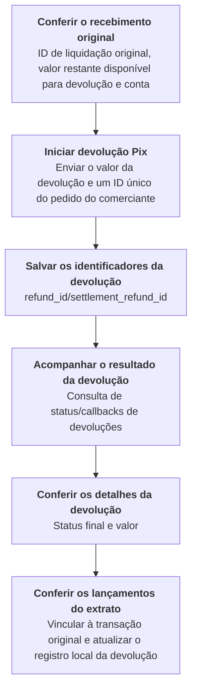
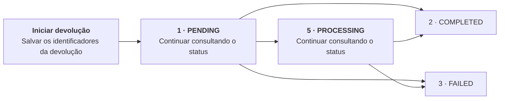

Inicie uma devolução do recebimento Pix original e consulte os detalhes e o status da devolução.

Inicie a devolução pela conta do recebedor original. Use credenciais `ACCOUNT` dessa conta ou credenciais `USER` com `X-ISPB` e `X-Account-Number` indicando uma conta de titularidade desse `USER`. Credenciais `PLATFORM` não são aceitas nessas operações de devolução. Mantenha o contexto da mesma conta do recebedor original ao acompanhar a devolução iniciada. Consulte as verificações prévias em [Iniciar devolução Pix](/pt-br/api-reference/refunds/initiate-pix-refund) e as regras para selecionar a conta em [Ambientes e credenciais](/pt-br/environments-and-credentials). <Badge color="blue" size="sm">Complementado · module-9-F05</Badge>

## Operações da API

| Operação | Caminho POST |
| --- | --- |
| [Iniciar devolução Pix](/pt-br/api-reference/refunds/initiate-pix-refund) | `/v3/refunds/pix` |
| [Consultar detalhes da devolução](/pt-br/api-reference/refunds/get-refund-details) | `/v3/refunds/details` |
| [Consultar status da devolução](/pt-br/api-reference/refunds/get-refund-status) | `/v3/refunds/status/check` |

## Sequência de chamadas

Salve o ID de liquidação original com a requisição de devolução. Consultar detalhes da devolução retorna atualmente `data.details.original_settlement_id` vazio; use `parent_txn_id` e `parent_settlement_id` do lançamento da devolução no extrato para conferir o vínculo com a transação original. <Badge color="orange" size="sm">Corrigido · module-9-F03</Badge>

[Iniciar devolução Pix](/pt-br/api-reference/refunds/initiate-pix-refund) → Salvar os identificadores da devolução → [Consultar status da devolução](/pt-br/api-reference/refunds/get-refund-status)/Receber callbacks de devoluções → [Consultar detalhes da devolução](/pt-br/api-reference/refunds/get-refund-details) → [Conferir os lançamentos do extrato](/pt-br/api-reference/accounts/get-account-statement).

Configure os callbacks de devoluções antes de depender das notificações; sem uma URL de callback configurada, nenhum callback HTTP é enviado. Consulte a direção da assinatura e o escopo da conta em [Callbacks de devoluções](/pt-br/api-reference/refunds/callbacks). Use consultas de status para acompanhar a devolução quando os callbacks não estiverem configurados ou ainda não tiverem chegado. <Badge color="blue" size="sm">Complementado · module-9-F07</Badge>

## Transições de status da devolução

As devoluções são processadas de forma assíncrona. Quando a requisição de criação é aceita, a resposta retorna `1 PENDING`. Salve os identificadores da devolução e use [Consultar status da devolução](/pt-br/api-reference/refunds/get-refund-status) para acompanhar o resultado. A devolução também pode retornar `5 PROCESSING`; continue as consultas periódicas enquanto o status for `1 PENDING` ou `5 PROCESSING`. Encerre as consultas periódicas do status dessa devolução quando ela atingir `2 COMPLETED` ou `3 FAILED`. Confira os detalhes e os registros de movimentação de recursos em [Consultar detalhes da devolução](/pt-br/api-reference/refunds/get-refund-details) e nos lançamentos do extrato. <Badge color="blue" size="sm">Complementado · module-9-F01</Badge>

## Tratamento de erros

- **Timeout ou resultado desconhecido:** consulte a devolução original com os identificadores de devolução existentes. Não reenvie a requisição com outro ID do pedido antes de confirmar o resultado.
- **Requisições duplicadas:** um erro de duplicidade não significa que a devolução original falhou. A verificação de duplicidade usa apenas o ID do pedido do comerciante, sem restringi-lo a uma conta ou `USER`. Gere IDs que não coincidam entre contas ou usuários. A reserva do ID do pedido tem prazo de expiração de 48 horas, mas isso não autoriza reutilizar o ID depois: as requisições de devolução também devem seguir as regras de data UTC de [Iniciar devolução Pix](/pt-br/api-reference/refunds/initiate-pix-refund). <Badge color="blue" size="sm">Complementado · module-9-F06</Badge> Não continue reenviando a devolução após um erro de duplicidade. Consulte a devolução original com os identificadores salvos; repetir o mesmo ID do pedido não retorna o resultado da devolução original. Se não houver identificadores da devolução, guarde os dados da requisição original e entre em contato com o suporte. <Badge color="orange" size="sm">Corrigido · module-9-F02</Badge>
- **Devolução com falha ou não localizada:** consulte os detalhes da devolução. A devolução pode ser temporariamente informada como não localizada logo após a aceitação da criação, pois o processamento é assíncrono. Mantenha os identificadores retornados e consulte a mesma devolução novamente mais tarde; um único resultado de devolução não localizada não comprova falha nem torna seguro um novo envio. <Badge color="blue" size="sm">Complementado · module-9-F04</Badge> Se não houver um identificador da devolução, guarde o ID do pedido original, a conta, o ID de liquidação original, o valor e o horário da requisição. Entre em contato com o suporte para verificar.

<Accordion title="Correções em relação ao documento original (7)" icon="clipboard-check">
Esta página foi conferida com o código-fonte da Pagsmile Open API em 2026-11-10. Cada alteração abaixo está marcada na página com um selo que mostra o seu ID.

| ID | Alteração | Local | Texto do documento original | Texto atualizado |
| --- | --- | --- | --- | --- |
| module-9-F01 | Complementado (ausente no original) | Refund status transitions | As devoluções são processadas de forma assíncrona. Quando a requisição de criação é aceita, a resposta retorna `1 PENDING`. Salve os identificadores da devolução e use Consultar status da devolução para acompanhar o resultado. Encerre as consultas periódicas do status dessa devolução quando ela atingir `2 COMPLETED` ou `3 FAILED`. Confira os detalhes e os registros de movimentação de recursos em Consultar detalhes da devolução e nos lançamentos do extrato. [Figure: A devolução fica com status PENDING ao ser aceita e depois passa para COMPLETED ou FAILED] labels: Iniciar devolução \| Salvar os identificadores da devolução \| 1 · PENDING \| Continuar consultando o status \| 2 · COMPLETED \| 3 · FAILED | As devoluções são processadas de forma assíncrona. Quando a requisição de criação é aceita, a resposta retorna `1 PENDING`. Salve os identificadores da devolução e use Consultar status da devolução para acompanhar o resultado. A devolução também pode retornar `5 PROCESSING`; continue as consultas periódicas enquanto o status for `1 PENDING` ou `5 PROCESSING`. Encerre as consultas periódicas do status dessa devolução quando ela atingir `2 COMPLETED` ou `3 FAILED`. Confira os detalhes e os registros de movimentação de recursos em Consultar detalhes da devolução e nos lançamentos do extrato. [Figure: A devolução fica com status PENDING ao ser aceita e pode passar por PROCESSING antes de atingir COMPLETED ou FAILED] labels: Iniciar devolução \| Salvar os identificadores da devolução \| 1 · PENDING \| 5 · PROCESSING \| Continuar consultando o status \| 2 · COMPLETED \| 3 · FAILED |
| module-9-F02 | Corrigido (não correspondia ao código) | Error handling / Duplicate requests | Reenvie a requisição com o mesmo ID do pedido, sem alterar o valor nem a transação original. | Não continue reenviando a devolução após um erro de duplicidade. Consulte a devolução original com os identificadores salvos; repetir o mesmo ID do pedido não retorna o resultado da devolução original. Se não houver identificadores da devolução, guarde os dados da requisição original e entre em contato com o suporte. |
| module-9-F03 | Corrigido (não correspondia ao código) | Call sequence / Figure | [Figure: Conferir o recebimento original, iniciar a devolução, salvar os identificadores, acompanhar o resultado, consultar os detalhes e conferir os lançamentos do extrato] labels: Conferir o recebimento original \| ID de liquidação original, valor restante disponível para devolução e conta \| Iniciar devolução Pix \| Enviar o valor da devolução e um ID único do pedido do comerciante \| Salvar os identificadores da devolução \| refund_id/settlement_refund_id \| Acompanhar o resultado da devolução \| Consulta de status/callbacks de devoluções \| Conferir os detalhes da devolução \| Status final, valor e vínculo com a transação original \| Conferir os lançamentos do extrato \| Atualizar o registro local da devolução | [Figure: Conferir o recebimento original, iniciar a devolução, salvar os identificadores, acompanhar o resultado, consultar os detalhes e conferir os lançamentos do extrato] labels: Conferir o recebimento original \| ID de liquidação original, valor restante disponível para devolução e conta \| Iniciar devolução Pix \| Enviar o valor da devolução e um ID único do pedido do comerciante \| Salvar os identificadores da devolução \| refund_id/settlement_refund_id \| Acompanhar o resultado da devolução \| Consulta de status/callbacks de devoluções \| Conferir os detalhes da devolução \| Status final e valor \| Conferir os lançamentos do extrato \| Vincular à transação original e atualizar o registro local da devolução Salve o ID de liquidação original com a requisição de devolução. Consultar detalhes da devolução retorna atualmente `data.details.original_settlement_id` vazio; use `parent_txn_id` e `parent_settlement_id` do lançamento da devolução no extrato para conferir o vínculo com a transação original. |
| module-9-F04 | Complementado (ausente no original) | Error handling / Refund failed or not found | consulte os detalhes da devolução. | consulte os detalhes da devolução. A devolução pode ser temporariamente informada como não localizada logo após a aceitação da criação, pois o processamento é assíncrono. Mantenha os identificadores retornados e consulte a mesma devolução novamente mais tarde; um único resultado de devolução não localizada não comprova falha nem torna seguro um novo envio. |
| module-9-F05 | Complementado (ausente no original) | Introduction / Account prerequisite for the call sequence | Inicie uma devolução do recebimento Pix original e consulte os detalhes e o status da devolução. | Inicie uma devolução do recebimento Pix original e consulte os detalhes e o status da devolução. Inicie a devolução pela conta do recebedor original. Use credenciais ACCOUNT dessa conta ou credenciais USER com `X-ISPB` e `X-Account-Number` indicando uma conta de titularidade desse USER. Credenciais PLATFORM não são aceitas nessas operações de devolução. Mantenha o contexto da mesma conta do recebedor original ao acompanhar a devolução iniciada. Consulte as verificações prévias em Iniciar devolução Pix e as regras para selecionar a conta em Ambientes e credenciais. |
| module-9-F06 | Complementado (ausente no original) | Error handling / Duplicate requests | um erro de duplicidade não significa que a devolução original falhou. | um erro de duplicidade não significa que a devolução original falhou. A verificação de duplicidade usa apenas o ID do pedido do comerciante, sem restringi-lo a uma conta ou USER. Gere IDs que não coincidam entre contas ou usuários. A reserva do ID do pedido tem prazo de expiração de 48 horas, mas isso não autoriza reutilizar o ID depois: as requisições de devolução também devem seguir as regras de data UTC de Iniciar devolução Pix. |
| module-9-F07 | Complementado (ausente no original) | Call sequence / Callback prerequisite | Iniciar devolução Pix → Salvar os identificadores da devolução → Consultar status da devolução/Receber callbacks de devoluções → Consultar detalhes da devolução → Conferir os lançamentos do extrato. | Iniciar devolução Pix → Salvar os identificadores da devolução → Consultar status da devolução/Receber callbacks de devoluções → Consultar detalhes da devolução → Conferir os lançamentos do extrato. Configure os callbacks de devoluções antes de depender das notificações; sem uma URL de callback configurada, nenhum callback HTTP é enviado. Consulte a direção da assinatura e o escopo da conta em Callbacks de devoluções. Use consultas de status para acompanhar a devolução quando os callbacks não estiverem configurados ou ainda não tiverem chegado. |
</Accordion>
