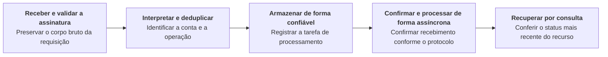
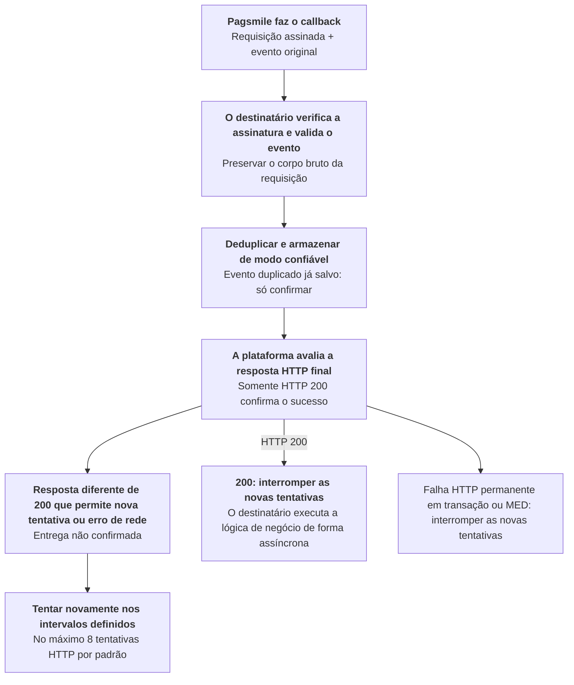

Gerencie as assinaturas de eventos e receba e processe as notificações de negócio conforme o protocolo de callback.

## Operações da API

| Operação | Caminho POST |
| --- | --- |
| [Criar assinatura de eventos](/pt-br/api-reference/webhooks/create-event-subscription) | `/v3/webhooks/create` |
| [Listar assinaturas de eventos](/pt-br/api-reference/webhooks/list-event-subscriptions) | `/v3/webhooks/list` |
| [Consultar assinatura de eventos](/pt-br/api-reference/webhooks/get-event-subscription) | `/v3/webhooks/get` |
| [Atualizar assinatura de eventos](/pt-br/api-reference/webhooks/update-event-subscription) | `/v3/webhooks/update` |
| [Desativar assinatura de eventos](/pt-br/api-reference/webhooks/deactivate-event-subscription) | `/v3/webhooks/delete` |

## Sequência de chamadas

Após configurar a assinatura de eventos e o endpoint de callback, siga o fluxo abaixo para receber e processar os eventos. Para mais detalhes sobre o processamento dos callbacks, veja [Verificação de assinatura de webhook](/pt-br/environments-and-credentials) e as regras de entrega e de novas tentativas abaixo. <Badge color="orange" size="sm">Corrigido · module-11-F06</Badge>

Ao receber um callback, verifique primeiro a requisição conforme [Verificação de assinatura de webhook](/pt-br/environments-and-credentials). Depois, processe o evento de negócio.

Para consultar a estrutura dos callbacks de eventos de recebimentos, pagamentos e devoluções, as diferenças de entrega entre ACCOUNT e USER e os exemplos JSON, veja [Callbacks de transações](/pt-br/api-reference/webhooks/transaction-callbacks).

Para consultar o escopo `USER`, as descrições dos status e os exemplos de callbacks de eventos de conformidade de contas gerenciadas, veja [Callbacks KYB](/pt-br/api-reference/onboarding/kyb-callbacks). <Badge color="orange" size="sm">Corrigido · module-11-F07</Badge>

## Entrega de webhooks e novas tentativas

Os callbacks podem chegar duplicados ou fora de ordem. O diagrama abaixo distingue as regras de entrega da plataforma do fluxo de processamento recomendado para quem recebe os callbacks.

Os callbacks de transações `ACCOUNT` e `USER` e os callbacks de MED interrompem as novas tentativas após HTTP `400`, `401`, `403`, `404`, `405`, `406`, `410`, `414`, `415`, `422`, `431` ou `451`. HTTP `413` também interrompe as novas tentativas, exceto quando inclui um cabeçalho `Retry-After` válido. Os demais status diferentes de `200` mantêm a política limitada de novas tentativas. Os callbacks de KYB mantêm essa política para status diferentes de `200`. <Badge color="orange" size="sm">Corrigido · module-11-F02</Badge>

### Regras de confirmação de recebimento e novas tentativas

- Somente uma resposta HTTP 200 final confirma o sucesso. O conteúdo do corpo da resposta não determina o sucesso. Porém, um erro de leitura da resposta ou timeout é considerado uma falha de entrega nos callbacks de transações e de MED, mesmo que o status da resposta seja `200`. <Badge color="orange" size="sm">Corrigido · module-11-F01</Badge> Respostas 201, 202, 204 ou com qualquer outro status diferente de 200, assim como erros de rede, são consideradas falhas. Retorne `200` após verificar a assinatura e salvar o evento de modo confiável. As requisições HTTP de callback de transações e de MED têm timeout padrão de 3 segundos, incluindo a leitura da resposta. Conclua a confirmação de recebimento rapidamente, sem aguardar o término do processamento das operações de negócio. <Badge color="blue" size="sm">Complementado · module-11-F04</Badge> Processe as operações de negócio de modo assíncrono em seguida.
- As entregas de transações, de KYB e de MED com novas tentativas habilitadas têm, por padrão, no máximo 8 tentativas: o envio inicial mais 7 novas tentativas. Para MED, o intervalo é contado a partir do término da requisição HTTP anterior. Os intervalos normais entre as tentativas são, nesta ordem: `5, 10, 20, 30, 60, 120 e 240 segundos`. Nos callbacks de transações `ACCOUNT` e `USER` e nos callbacks de MED, HTTP `413` ou `429` pode incluir `Retry-After` como um número inteiro não negativo de segundos até 900, ou como uma data HTTP até 900 segundos no futuro. Um valor válido aumenta o intervalo somente quando é maior que o intervalo normal. Valores inválidos ou ausentes não aumentam o intervalo; HTTP `413` sem um valor válido interrompe as novas tentativas. Os callbacks de KYB não usam esse cabeçalho para ajustar os intervalos entre as tentativas. <Badge color="blue" size="sm">Complementado · module-11-F03</Badge>
- Os callbacks de KYB e de MED não seguem redirecionamentos. Atualmente, os callbacks de transações podem seguir os redirecionamentos compatíveis, e a resposta final determina o sucesso. Configure diretamente a URL de callback final.

### Deduplicação e tratamento de eventos fora de ordem

- **Notificações duplicadas:** faça a deduplicação por `delivery_id`. Nos callbacks de transações ACCOUNT, use o tipo de evento e o `txn_id`. Retorne HTTP 200 para eventos duplicados já salvos, sem repetir o processamento das operações de negócio.
- **Notificações fora de ordem ou ausentes:** consulte os detalhes para confirmar o status mais recente. Se necessário, confira os lançamentos do extrato. Para atualizações de MED, compare o `resource_version` e acompanhe o `stream_sequence` de cada recurso. Para o mesmo recurso e a mesma assinatura de eventos, uma entrega posterior aguarda até que a anterior tenha sucesso, falhe permanentemente ou seja cancelada. Isso não elimina lacunas: consulte os detalhes do recurso quando uma atualização estiver ausente. <Badge color="blue" size="sm">Complementado · module-11-F08</Badge>
- **Configuração da assinatura de eventos:** mantenha a assinatura de eventos ativa. Evite alterar a configuração enquanto houver entregas pendentes. As entregas pendentes de transações `USER`, de KYB e de MED são canceladas se a assinatura de eventos ficar inativa ou deixar de corresponder à configuração salva para aquela entrega, incluindo a URL de callback e a credencial de assinatura. As entregas de transações `USER` e de MED `USER` também são interrompidas se o `USER` deixar de ter acesso à conta. <Badge color="blue" size="sm">Complementado · module-11-F05</Badge> Se não houver uma URL de callback que corresponda à notificação de transação ACCOUNT no momento do envio, novas tentativas HTTP não serão agendadas automaticamente.

<Accordion title="Correções em relação ao documento original (8)" icon="clipboard-check">
Esta página foi conferida com o código-fonte da Pagsmile Open API em 2026-11-10. Cada alteração abaixo está marcada na página com um selo que mostra o seu ID.

| ID | Alteração | Local | Texto do documento original | Texto atualizado |
| --- | --- | --- | --- | --- |
| module-11-F01 | Corrigido (não correspondia ao código) | Acknowledgment and retry rules | O corpo da resposta não participa da determinação de sucesso. | O conteúdo do corpo da resposta não determina o sucesso. Porém, um erro de leitura da resposta ou timeout é considerado uma falha de entrega nos callbacks de transações e de MED, mesmo que o status da resposta seja 200. |
| module-11-F02 | Corrigido (não correspondia ao código) | Webhook delivery and retries / delivery flow figure | [Figure: Fluxo de entrega de webhooks e novas tentativas] labels: Pagsmile faz o callback \| O destinatário verifica a assinatura e valida o evento \| Deduplicar e armazenar de modo confiável \| A plataforma avalia a resposta HTTP final \| Resposta diferente de 200 ou erro de rede \| Tentar novamente nos intervalos definidos \| Requisição assinada + evento original \| Preservar o corpo bruto da requisição \| Evento duplicado já salvo: só confirmar \| Somente HTTP 200 confirma o sucesso \| Entrega não confirmada \| No máximo 8 tentativas HTTP por padrão \| 200: interromper as novas tentativas \| O destinatário executa a lógica de negócio de forma assíncrona | [Figure: Fluxo de entrega de webhooks e novas tentativas] labels: Pagsmile faz o callback \| O destinatário verifica a assinatura e valida o evento \| Deduplicar e armazenar de modo confiável \| A plataforma avalia a resposta HTTP final \| Resposta diferente de 200 que permite nova tentativa ou erro de rede \| Tentar novamente nos intervalos definidos \| Requisição assinada + evento original \| Preservar o corpo bruto da requisição \| Evento duplicado já salvo: só confirmar \| Somente HTTP 200 confirma o sucesso \| Entrega não confirmada \| No máximo 8 tentativas HTTP por padrão \| 200: interromper as novas tentativas \| Falha HTTP permanente em transação ou MED: interromper as novas tentativas \| O destinatário executa a lógica de negócio de forma assíncrona Os callbacks de transações ACCOUNT e USER e os callbacks de MED interrompem as novas tentativas após HTTP 400, 401, 403, 404, 405, 406, 410, 414, 415, 422, 431 ou 451. HTTP 413 também interrompe as novas tentativas, exceto quando inclui um cabeçalho `Retry-After` válido. Os demais status diferentes de 200 mantêm a política limitada de novas tentativas. Os callbacks de KYB mantêm essa política para status diferentes de 200. |
| module-11-F03 | Complementado (ausente no original) | Acknowledgment and retry rules / retry intervals | Os intervalos entre as tentativas são, nesta ordem: `5, 10, 20, 30, 60, 120 e 240 segundos`. | Os intervalos normais entre as tentativas são, nesta ordem: `5, 10, 20, 30, 60, 120 e 240 segundos`. Nos callbacks de transações ACCOUNT e USER e nos callbacks de MED, HTTP 413 ou 429 pode incluir `Retry-After` como um número inteiro não negativo de segundos até 900, ou como uma data HTTP até 900 segundos no futuro. Um valor válido aumenta o intervalo somente quando é maior que o intervalo normal. Valores inválidos ou ausentes não aumentam o intervalo; HTTP 413 sem um valor válido interrompe as novas tentativas. Os callbacks de KYB não usam esse cabeçalho para ajustar os intervalos entre as tentativas. |
| module-11-F04 | Complementado (ausente no original) | Acknowledgment and retry rules | Retorne 200 após verificar a assinatura e salvar o evento de modo confiável. | Retorne 200 após verificar a assinatura e salvar o evento de modo confiável. As requisições HTTP de callback de transações e de MED têm timeout padrão de 3 segundos, incluindo a leitura da resposta. Conclua a confirmação de recebimento rapidamente, sem aguardar o término do processamento das operações de negócio. |
| module-11-F05 | Complementado (ausente no original) | Deduplication and out-of-order handling / subscription configuration | Evite alterar a configuração enquanto houver entregas pendentes. | Evite alterar a configuração enquanto houver entregas pendentes. As entregas pendentes de transações USER, de KYB e de MED são canceladas se a assinatura de eventos ficar inativa ou deixar de corresponder à configuração salva para aquela entrega, incluindo a URL de callback e a credencial de assinatura. As entregas de transações USER e de MED USER também são interrompidas se o USER deixar de ter acesso à conta. |
| module-11-F06 | Corrigido (não correspondia ao código) | Call sequence | Para mais detalhes sobre o processamento dos callbacks, veja Criar assinatura de eventos. | Para mais detalhes sobre o processamento dos callbacks, veja Verificação de assinatura de webhook e as regras de entrega e de novas tentativas abaixo. |
| module-11-F07 | Corrigido (não correspondia ao código) | Call sequence | Para consultar os escopos USER/PLATFORM, as descrições dos status e os exemplos de callbacks de eventos de conformidade, veja Callbacks KYB. | Para consultar o escopo USER, as descrições dos status e os exemplos de callbacks de eventos de conformidade de contas gerenciadas, veja Callbacks KYB. |
| module-11-F08 | Complementado (ausente no original) | Deduplication and out-of-order handling | Para atualizações de MED, compare o `resource_version`. | Para atualizações de MED, compare o `resource_version` e acompanhe o `stream_sequence` de cada recurso. Para o mesmo recurso e a mesma assinatura de eventos, uma entrega posterior aguarda até que a anterior tenha sucesso, falhe permanentemente ou seja cancelada. Isso não elimina lacunas: consulte os detalhes do recurso quando uma atualização estiver ausente. |
</Accordion>
