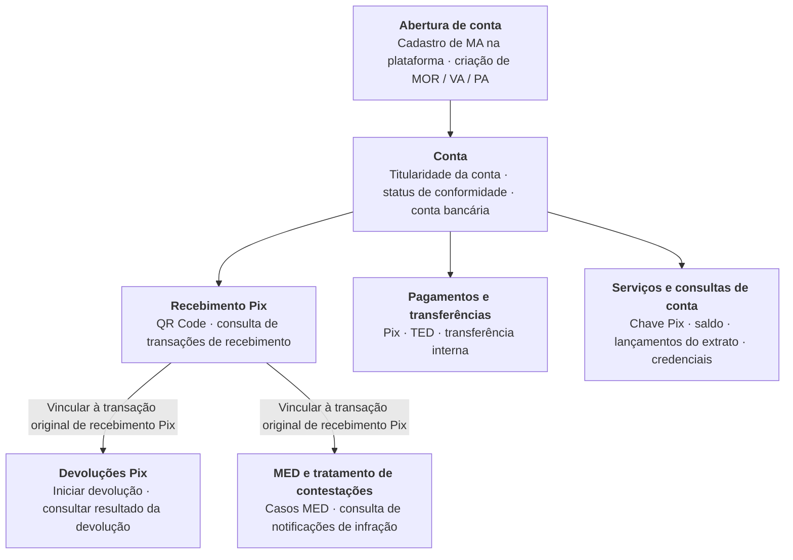

## Visão geral da Pagsmile

A Pagsmile Open API integra serviços de contas e pagamentos aos seus sistemas. Pela API, você pode criar contas gerenciadas, consultar dados de contas bancárias, gerenciar chaves Pix e iniciar pagamentos e devoluções. Você pode acompanhar os resultados pelos endpoints de consulta e pelas notificações de eventos.

As operações usam requisições POST, corpo em JSON e autenticação por assinatura com AK/SK. As permissões de acesso à conta são determinadas pelo tipo de credencial, pela titularidade da conta e pela conta-alvo. Para operações de conta e recursos com credenciais USER, envie `X-ISPB` e `X-Account-Number` para selecionar uma conta dentro do seu escopo autorizado de titularidade. A abertura de contas e a assinatura de eventos seguem regras próprias de seleção de conta; consulte [Modelos de conta e funcionalidades](/pt-br/account-models). <Badge color="blue" size="sm">Complementado · module-1-F01</Badge>

## Público-alvo

A Open API atende empresas e plataformas que precisam gerenciar contas, recebimentos, pagamentos e resultados de transações em seus próprios sistemas. Você pode gerenciar sua própria conta master. Após obter as permissões de acesso às contas gerenciadas, também pode criar VA ou PA para as partes e gerenciar separadamente os dados de conta e os registros de transações de cada parte.

A gestão da abertura de contas, as operações com recursos da conta e a assinatura de eventos usam escopos de autorização distintos. Antes da integração, configure as credenciais de acordo com as funcionalidades que serão usadas.

[Conheça as funcionalidades de MA, MOR, VA e PA](/pt-br/account-models)

## Capacidades do produto

| Capacidade | Funcionalidades suportadas |
| --- | --- |
| Abertura e gestão de contas | Criação e consulta de MOR, VA e PA |
| Consulta de contas e recursos | Dados da conta bancária, saldo, valor bloqueado, tarifas, configuração de limites e lançamentos do extrato da conta |
| Chave Pix | Criação, consulta de chaves ativas vinculadas à conta e exclusão |
| Recebimento | Geração de QR Code Pix dinâmico e estático, consulta de detalhes do QR Code e de recebimentos Pix |
| Pagamento | Pagamento Pix por chave Pix, por QR Code ou por dados bancários, pagamento TED por conta bancária e transferência interna na mesma instituição |
| Devolução | Devolução do recebimento Pix original e consulta de detalhes e status da devolução |
| Tratamento de contestações | Criação, consulta e cancelamento de casos MED quando as condições forem atendidas; consulta de notificações de infração |
| Notificações de eventos | Gestão da assinatura de eventos de recebimentos e pagamentos Pix, devoluções e conformidade da conta |

Resultado da abertura de conta

<Accordion title="Relação entre contas e funcionalidades de pagamento">
- Após a abertura de conta, confirme o status de conformidade e se a conta bancária está pronta para uso. Em seguida, utilize os serviços de conta e as funcionalidades de pagamento habilitados.
- Use o contexto de autorização da conta-alvo para recebimentos, pagamentos e consultas de conta. A titularidade da conta não implica a soma automática dos saldos.
- As devoluções Pix são vinculadas à transação original de recebimento. Os casos MED também devem ser vinculados à transação Pix original. Cada operação deve atender às suas próprias condições de negócio. As linhas de conexão indicam relações entre as operações, não a sequência de chamadas nem relações de quantidade.
- Os webhooks notificam alterações nas operações conforme os tipos de evento e os escopos da assinatura de eventos. Use essas notificações em conjunto com consultas de detalhes, status e lançamentos do extrato para confirmar os resultados do processamento. Os callbacks de MED ficam limitados ao escopo habilitado e entregue.
</Accordion>

## Terminologia principal

| Termo | Significado |
| --- | --- |
| MA / Conta master | Conta master que define a parte e a titularidade das contas gerenciadas <Badge color="orange" size="sm">Corrigido · module-1-F02</Badge> |
| Conta gerenciada | Conta gerenciada, que inclui MOR, VA e PA |
| MOR | Conta operacional que reutiliza os registros de conformidade aprovados da MA à qual pertence |
| VA | Conta gerenciada que deve pertencer a uma MA superior e possui registros de conformidade e conta bancária próprios |
| PA | Conta de pagamento que deve pertencer a uma MA superior ou a uma VA dessa MA e possui registros de conformidade e conta bancária próprios |
| PLATFORM / USER / ACCOUNT | Três identidades de credenciais de API: plataforma, usuário e conta |
| ISPB | Identificador da instituição participante que, em conjunto com o número da conta, identifica a conta bancária |
| Chave Pix | Identificador que aponta para a conta do recebedor Pix, distinto das credenciais de assinatura da API |
| Identificador fim a fim (EndToEnd ID) | ID da transação Pix original, usado para vincular transações e em operações com casos MED, entre outras |
| Webhook | Forma de notificação que envia eventos de negócio à URL de callback do integrador |
| MED / notificação de infração | Mecanismo Especial de Devolução do Pix e notificações de infração associadas |

<Accordion title="Correções em relação ao documento original (2)" icon="clipboard-check">
Esta página foi conferida com o código-fonte da Pagsmile Open API em 2026-11-10. Cada alteração abaixo está marcada na página com um selo que mostra o seu ID.

| ID | Alteração | Local | Texto do documento original | Texto atualizado |
| --- | --- | --- | --- | --- |
| module-1-F01 | Complementado (ausente no original) | Pagsmile overview; also introduction-1-1 | As permissões de acesso à conta são determinadas pelo tipo de credencial, pela titularidade da conta e pela conta-alvo. | As permissões de acesso à conta são determinadas pelo tipo de credencial, pela titularidade da conta e pela conta-alvo. Para operações de conta e recursos com credenciais USER, envie `X-ISPB` e `X-Account-Number` para selecionar uma conta dentro do seu escopo autorizado de titularidade. A abertura de contas e a assinatura de eventos seguem regras próprias de seleção de conta; consulte Modelos de conta e funcionalidades. |
| module-1-F02 | Corrigido (não correspondia ao código) | Core terminology; also introduction-1-4 | Conta master que define a parte e o vínculo de gestão das contas gerenciadas | Conta master que define a parte e a titularidade das contas gerenciadas |
</Accordion>
